# PRISM · AI assistant for in-line spectroscopy solution design

**PRISM turns a customer's in-line spectroscopy enquiry into a grounded first technical assessment:** the process requirements, the questions that still decide the method, a recommended method with spectral range and probe concept, the reasoning with page-level citations of the Art Fiber Systems (AFS) materials, the risks, and a first feasibility-study plan.

Built for the **Art Fiber Systems challenge** of the SchubKI National AI Hackathon 2026.

[](https://github.com/m-mahmoud-mohamed/AI-Assistant-for-In-line-Spectroscopy/actions/workflows/ci.yml)

## For the jury

| What | Where |
|---|---|
| **Live demo** | **https://prism-spectroscopy-mahmoud-abdellahi.vercel.app** (frontend on Vercel, API on an Oracle Cloud VM, OpenAI models) |
| **Answers H01–H06**, generated by PRISM without manual editing | [`outputs/`](outputs/): [index](outputs/index.md) · one `.md` and `.json` per case · [compliance](outputs/compliance.md) · [run manifest](outputs/run_manifest.json) |
| **Proof the answers were not edited** | `make verify-outputs` replays every case from the committed LLM cache (no key, no network) and compares byte for byte |
| **Slides (PDF)** | [`slides/PRISM_slides.pdf`](slides/PRISM_slides.pdf) |
| **Architecture** | [Architecture](#architecture) below and [docs/ASSISTANT_ARCHITECTURE.md](docs/ASSISTANT_ARCHITECTURE.md) |
| **Use of the AFS materials** | [How PRISM uses the AFS materials](#how-prism-uses-the-afs-materials) |
| **Evaluation** | [Results](#results) below and [docs/EVAL_RESULTS.md](docs/EVAL_RESULTS.md) |

Every answer contains the main process requirements and constraints, clarification questions for missing information, recommended method(s) with spectral range and a measurement concept, reasoning with supporting sources (AFS page citations with verbatim quotes), risks and uncertainty, and a first feasibility study of at most six steps.

## What PRISM does

- **Grounded assessment.** Every sentence is a typed segment: `CLIENT` fact, `AFS` evidence, `EXTERNAL` source, `ASSUMPTION`, `PROPOSAL` or `UNKNOWN`. AFS claims cite the supplied sources page by page (`S01 p.10`, `S01 Table 1 (p.6)`) with a quote that is verbatim on that page.
- **Rules decide, the LLM writes.** A deterministic engine of 14 spectroscopy rules over the AFS method table sets the decision status (`PROVISIONAL`, `INSUFFICIENT_INFORMATION`, `OUTSIDE_SUPPORTED_SCOPE`), the candidate methods and what is blocked (for example a silica fiber for mid-infrared). The LLM can only make the status stricter.
- **Asks before it guesses.** Clarifying questions with clickable options, ranked by how much each answer changes the recommendation; each option shows its effect. A click re-runs the engine without a model call.
- **A living report.** A new fact in the chat revises only the affected sections and creates report v2, v3 … with "What changed"; a change of the primary method asks first. Questions are answered from the sources, the user's own data and labelled deductions, without changing the report.
- **Exports:** A4 PDF, Markdown and JSON of the version on screen, with the original enquiry and numbered references.
- **Your own sources:** upload PDFs, DOCX, text files and folders or add web links; they are indexed and cited separately from AFS ([docs/SOURCES.md](docs/SOURCES.md)).
- **MCP integrations:** connect external tools as an MCP client with per-tool permissions and approvals ([docs/MCP.md](docs/MCP.md)).

### The workspace

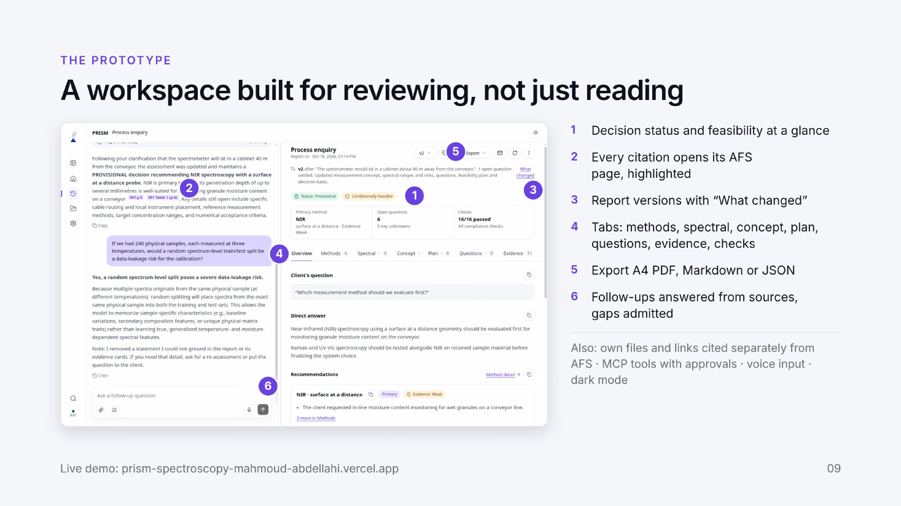

### From enquiry to a living report

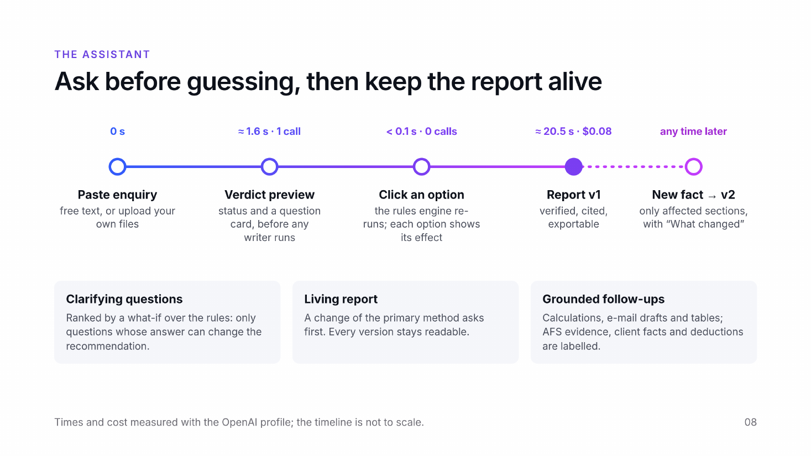

## Screenshots

Taken from the running app (Docker, `openai` profile).

**1 · Paste an enquiry.**

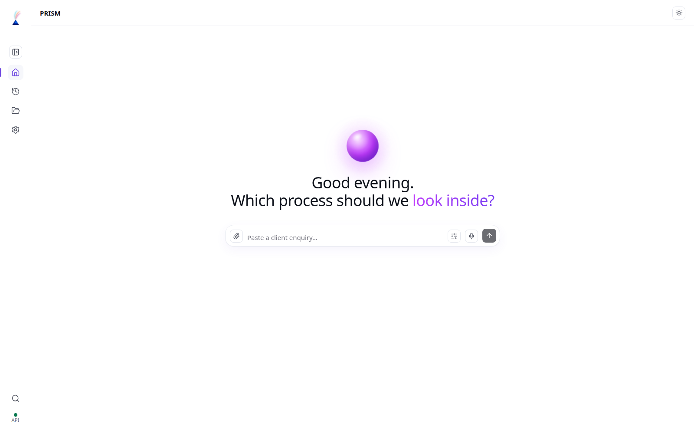

**2 · Ask before guessing.** The verdict preview comes back in about 1.6 s, with one question that would change the recommendation. Fluorescence is already blocked: no fluorescent target is named.

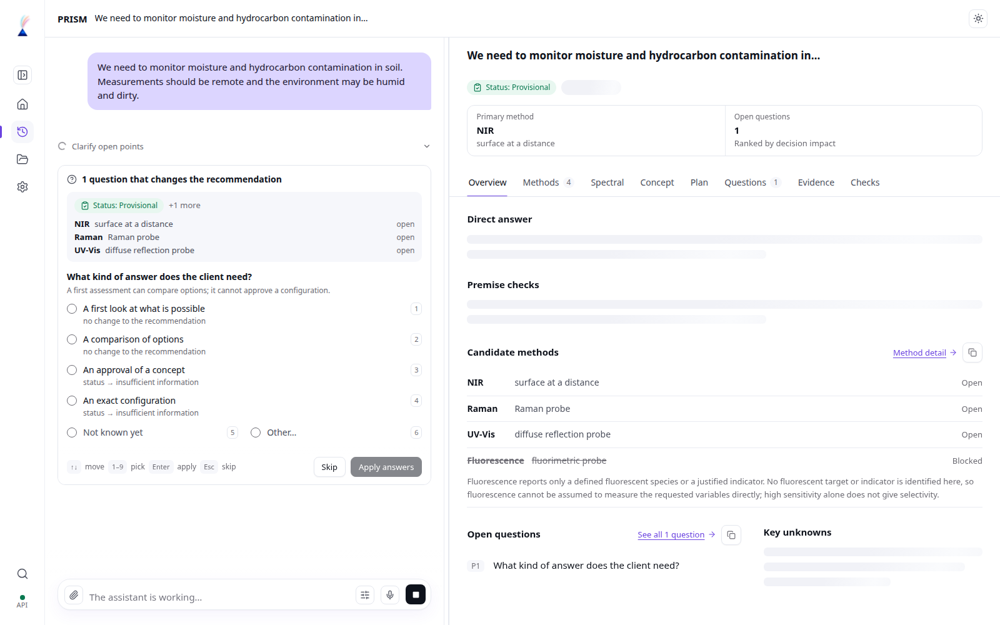

Picking an option re-runs the rules, not the model: choosing "An approval of a concept" turns the status into insufficient information before anything is written.

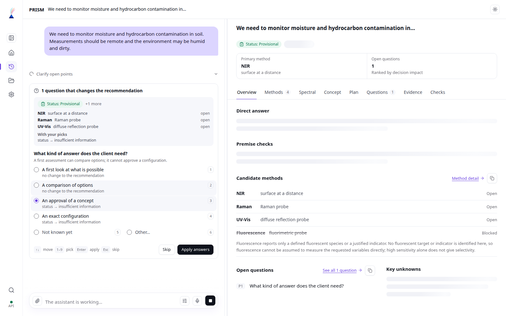

**3 · The report.** Status, feasibility, primary method and open questions at a glance; every recommendation carries its AFS citation and an evidence strength.

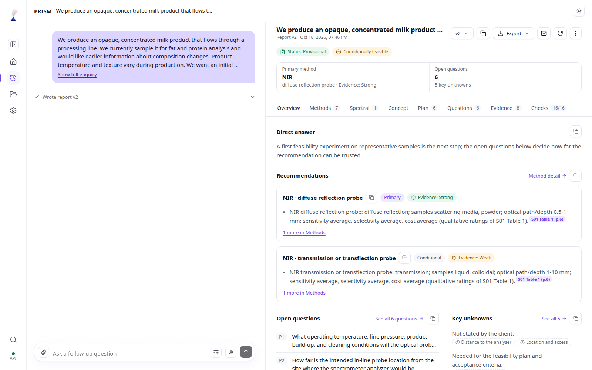

**4 · Spectral windows and the feasibility plan.**

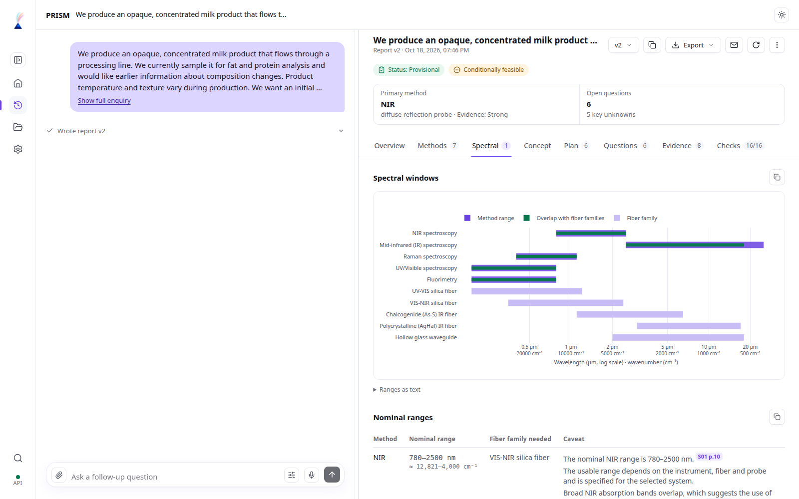

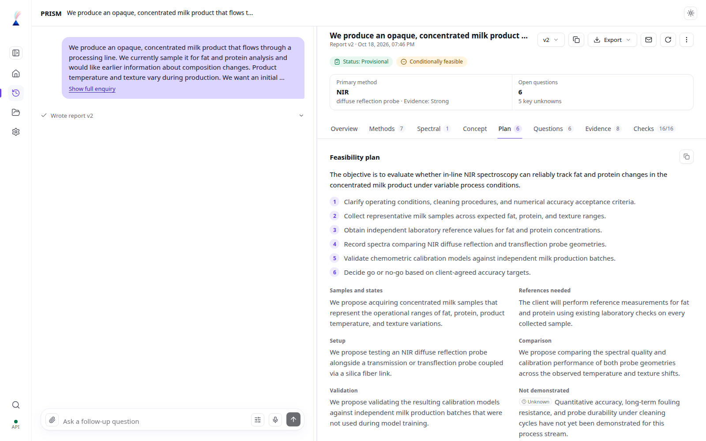

**5 · Every citation opens on its page.** The verbatim quote is highlighted on the source page.

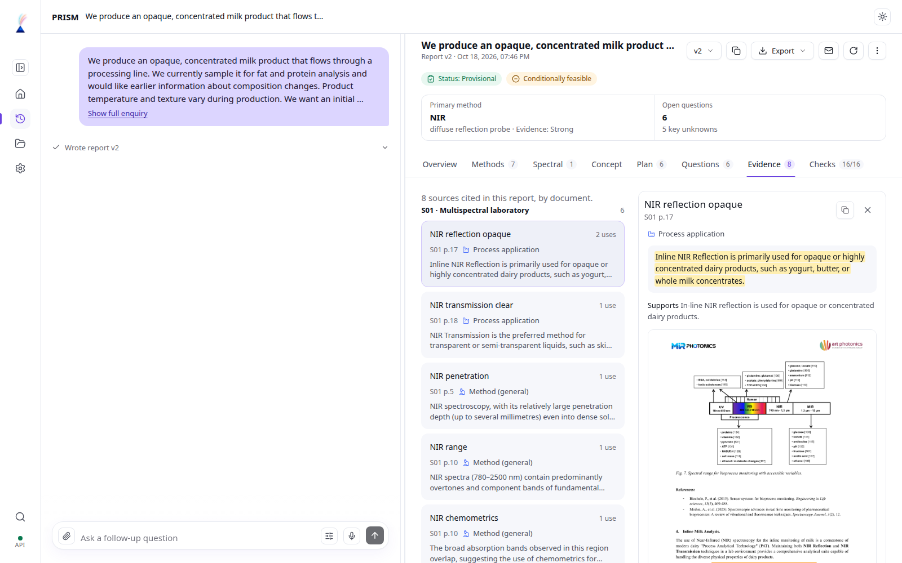

**6 · What was checked.**

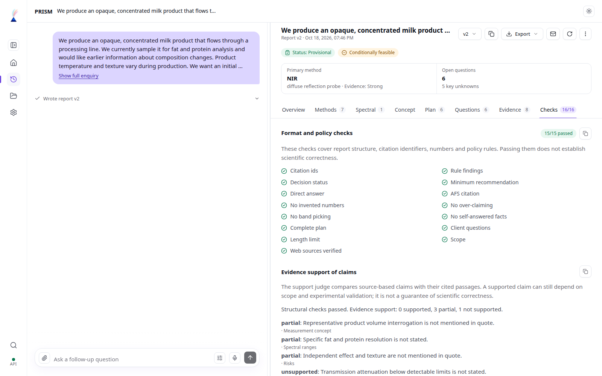

**7 · Your own sources and dark mode.**

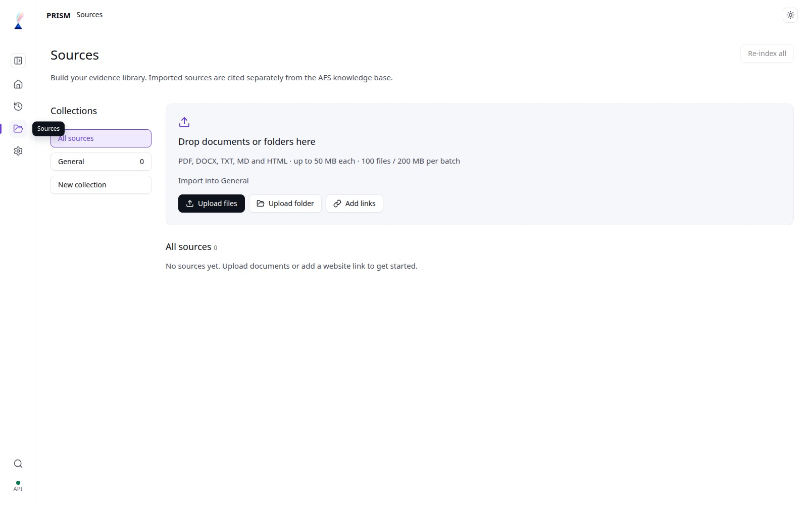

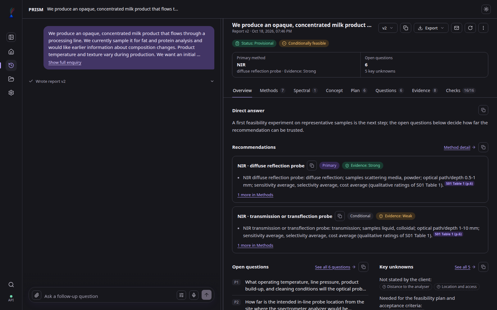

## Architecture

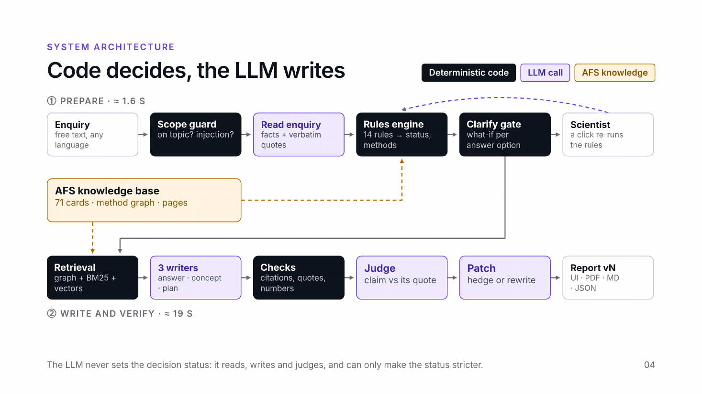

The same flow as a diagram that renders from source:

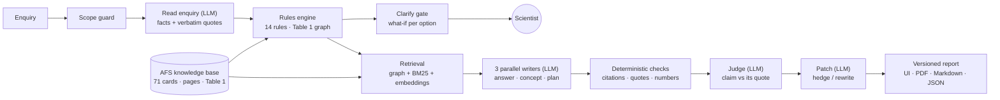

- **Deterministic code decides; the LLM reads, writes and judges.** The status, candidate methods, blocked methods, premise checks and clarifying questions come from code. Model calls go through one provider-agnostic gateway: code asks for a role (`extractor`, `writer`, `judge`, `agent` …) and `config/llm.yaml` maps roles to models per profile (OpenAI, Gemini or your own endpoint).
- **Verification before display:** citations must exist, quotes must be verbatim on the cited page, numbers must come from the enquiry or a cited source, and a judge checks every sourced claim against its quote. Partly supported sentences are hedged or rewritten, unsupported ones removed.

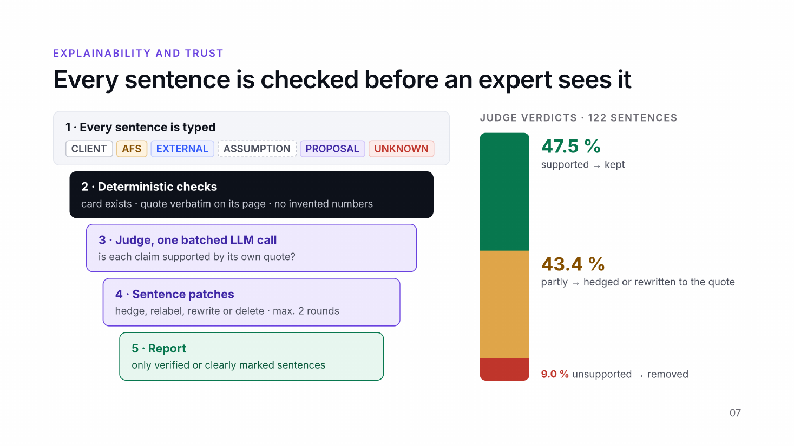

More: [docs/ASSISTANT_ARCHITECTURE.md](docs/ASSISTANT_ARCHITECTURE.md) (assistant and pipeline) · [docs/ARCHITECTURE_V2.md](docs/ARCHITECTURE_V2.md) (verification design) · [docs/research/](docs/research/) (design research).

## How PRISM uses the AFS materials

The supplied materials are the main technical knowledge source. `make ingest` turns them into `kb/` (committed):

- **Pages:** every page of S01–S05 stored as text and image (`kb/pages/`), so each citation opens on the highlighted page. S02 is mostly images; its key slides were transcribed with a vision model and checked.
- **Method table:** `AFS_method_comparison_table.xlsx` (S01 Table 1) becomes the technique graph (`kb/graph/`): method, probe geometry, sample types, optical path, strengths.
- **Evidence cards:** 71 curated cards (`kb/cards/`), each a verbatim quote with document, page, scope (process application, laboratory study, in-vitro proof of concept, general method knowledge) and topics. The loader rejects a card whose quote is not on its page. 129 automatically drafted cards (`kb/cards/drafts/`) are not used until an expert accepts them.
- **Rules:** `kb/rules.yaml` and `backend/prism/rules/` encode the decision logic (sample geometry, optical state, fiber windows, aqueous media, fluorescence targets, calibration transfer, evidence scope, link length …); each rule cites the cards it rests on.
- **Worked examples:** the examples document gives writing-style exemplars and the development cases D01–D08. The evaluation file with H01–H06 is read only by `make answers`; no prompt, rule or test contains its content.
- **External sources** are used only when the user turns on web search or connects an MCP server; every external citation carries its quoted passage and is marked `EXTERNAL`, never `AFS`.

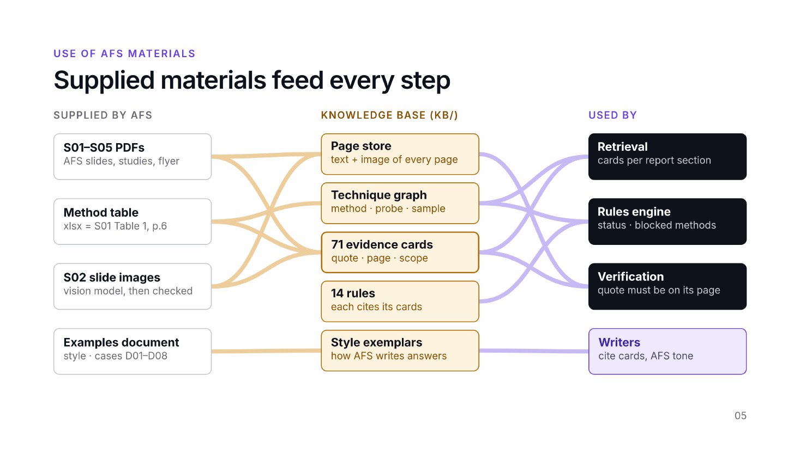

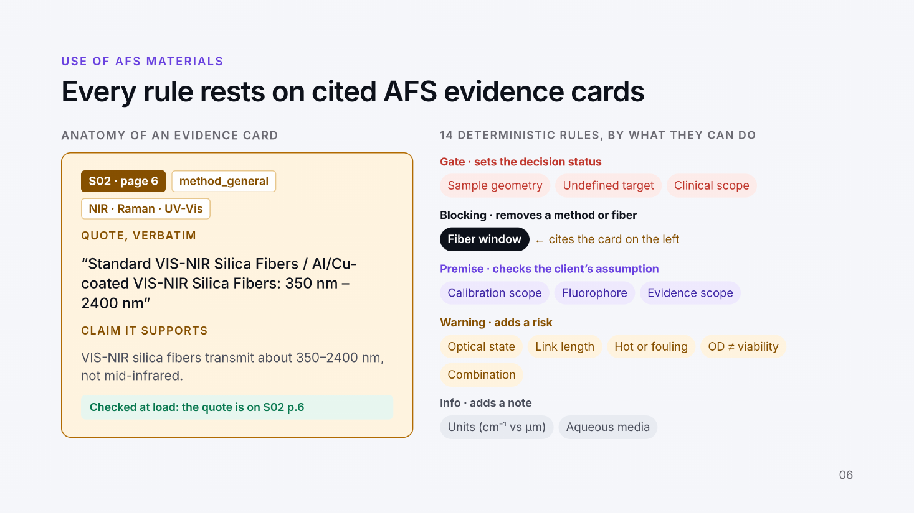

## Results

**H01–H06** (generated with the `openai` profile, deep mode; [outputs/index.md](outputs/index.md)):

| Case | Topic | Status | Key point |
|---|---|---|---|
| H01 | New formulation after an NIR pilot | Provisional | Test the old calibration on the new blend first |
| H02 | Two dairy streams | Provisional | Transmission for clear whey, reflection for the opaque concentrate |
| H03 | Fluorescence for glucose and biomass | Provisional | Fluorescence not recommended without a fluorescent target |
| H04 | Silica link for MIR ATR | Insufficient information | Silica fiber reuse contradicted (0.35–2.4 µm vs 2.5–25 µm); not approved |
| H05 | Undefined off-spec liquid | Insufficient information | Screening experiment and deciding questions before any configuration |
| H06 | Research sensor for surgery | Outside supported scope | An in-vitro study is not proof of clinical readiness |

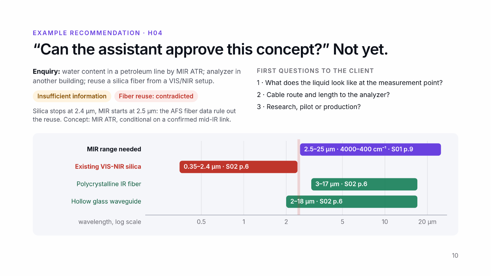

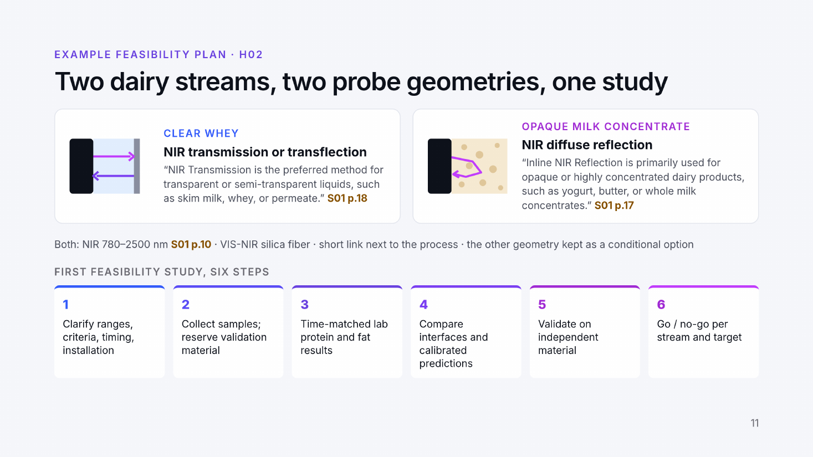

**Development cases D01–D08** (live, gold answers; [docs/EVAL_RESULTS.md](docs/EVAL_RESULTS.md)): decision status 8/8, method family 7/7, traps handled 8/8, premise verdicts 6/7, must-cite pages 81 %, **0 invented numbers**, 100 % of citations real and quotes verbatim.

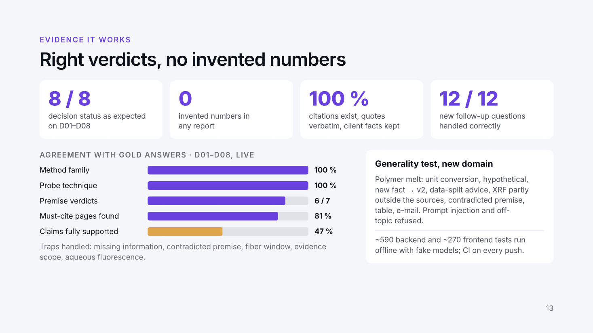

**Cost and time per query** (OpenAI list prices, measured token counts):

| Query | Time | Model calls | Cost |
|---|---|---|---|
| Verdict preview and clarifying questions | ~1.6 s | 1 | < $0.01 |
| Clicking an answer option | < 0.1 s | 0 | $0 |
| Full report (standard mode) | ~20 s | 7 | ~$0.08 |
| Follow-up turn (average) | 4–30 s | 1–8 | ~$0.09 |

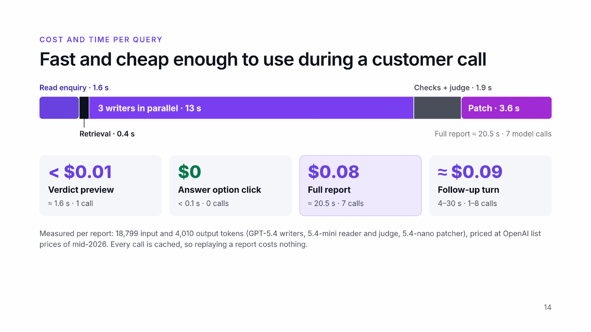

## Quick start

PRISM needs the supplied challenge materials, which are **not** in this repository. Copy them into `materials/` first:

```
materials/
  S01_Multispectral_Laboratory.pdf      S02_AFS_Process_Control_Slides.pdf   S03_LED_Kidney_Study_2017.pdf
  S04_Combi_MIR_Fluorescence_2021.pdf   S05_AFS_Flyer.pdf                    S06_Laboratory_Link.txt
  AFS_method_comparison_table.xlsx      AFS_Examples_and_Reference.docx      customer_scenarios_for_final_evaluation.txt
```

**Docker** (recommended):

```bash
cp .env.example .env          # add OPENAI_API_KEY (or another profile's key), or set PRISM_REPLAY=1 for replay only
docker compose up --build     # http://localhost:5173 (API: http://localhost:8000/api/health)
```

The `api` image installs `requirements.lock` and runs `make ingest` at build time. `.env` is passed to the `api` container only, never copied into an image. With `PRISM_REPLAY=1` the API answers only from the committed cache (`outputs/llm_cache`), without a key or network.

**Local development** (Python ≥ 3.12, GNU make, Node 24):

```bash
make setup ingest test        # .venv, dependencies, build kb/, run pytest
cp .env.example .env          # then add your key
make api                      # FastAPI on http://localhost:8000
make web                      # second terminal: Vite on http://localhost:5173 (proxies /api)
```

Frontend checks: `cd frontend && npm ci && npm test && npm run build && npm run lint`. The tests never call a real LLM; without `materials/`, the tests that read the materials are skipped.

## Reproducing the answers

```bash
make answers                  # H01–H06 → outputs/ (reports, index, compliance table, run_manifest.json)
make verify-outputs           # replay from outputs/llm_cache (no key, no network) and diff against the committed files
make eval                     # evaluation on the development and synthetic cases
```

Every LLM call made by `make answers` is stored in `outputs/llm_cache/`. `make verify-outputs` regenerates every case from that cache with the profile recorded in the run manifest and exits non-zero if any committed file differs. CI runs it whenever the materials are present.

## Configuration

### LLM profiles

Code requests a role from `prism.llm.gateway.LLMGateway`: `extractor`, `writer`, `writer_deep`, `judge`, `judge_deep`, `patcher`, `classifier`, `agent`, `vision` or `embedder`. The old names `generator`, `generator_deep`, `critic` and `critic_deep` still work; the gateway resolves them to the new ones. LLM profiles live in `config/llm.yaml`, which maps each role to models. Model IDs appear nowhere else. The gateway is thread-safe (parallel writers share one cache and one request budget), sends identical in-flight requests once, retries on rate limits and falls back to the next model of the role.

- `openai` produced the committed answers: GPT-5.4 for writing and the assistant, GPT-5.4-mini for reading enquiries and judging claims, GPT-5.4-nano for small classification and patch calls, gpt-6.1-sol and GPT-5.5 in deep mode, `text-embedding-3-large`, and `gpt-4o-transcribe` for voice input. Key: `OPENAI_API_KEY`.
- `gemini` is an alternative profile: Gemini through the official `google-genai` SDK (pinned in `pyproject.toml` and `requirements.lock`). Mid tier (agent, extractor, writer) is Flash, fast tier (judge, patcher, classifier) is Flash-Lite, deep roles and vision use the top model, embeddings use `gemini-embedding-001`. It uses structured output, function calling with thought signatures, thinking levels, and Gemini's implicit context caching (the gateway records cached token counts in `usage`).
- `project` is the project's own provider, used later. Fill in its roles in `config/llm.yaml`, then set `PRISM_LLM_PROFILE=project`, `PRISM_LLM_API_KEY` and `PRISM_LLM_BASE_URL` in `.env`.

#### Using Gemini

1. Create an API key in [Google AI Studio](https://aistudio.google.com/apikey) and put it in `.env` as `GEMINI_API_KEY=...` (optional fallback keys `GEMINI_API_KEY_2` … `_9` take over when a key runs out of quota).
2. Select the profile with `PRISM_LLM_PROFILE=gemini` in `.env`, or per command: `make probe PROFILE=gemini`, `make answers PROFILE=gemini`.
3. Run `make probe PROFILE=gemini`. For Gemini the probe is deep (about 5 requests per model): it checks JSON-schema output, a full tool-calling round trip with the thought signature, and the lowest and highest thinking level declared in `config/llm.yaml`. The result is written to `config/probe.gemini.json`.
4. Optional latency check: `.venv/bin/python scripts/bench_llm.py --profile gemini --parallel 3 --reasoning low` (uses Gemini's OpenAI-compatible endpoint; time to first token includes thinking).

Model names and thinking levels per model are listed under `capabilities` in `config/llm.yaml`; change them there when Google renames or retires a model. Without a key, replay mode (`PRISM_REPLAY=1`) still serves cached responses and never touches the network.

**Data use.** On Google AI Studio's free tier, prompts and responses may be used to improve Google's products. For confidential client enquiries use a paid (billing-enabled) Gemini API project, where the data is not used for product improvement; check the current terms before sending real client data.

Run `make probe` to check which models of the active profile support JSON schema, tools, vision and thinking. You can also pick a profile per command, for example `make probe PROFILE=project`. The probe bypasses the cache and uses about 2 requests per model.

Keys are read only from environment variables (`.env` is git-ignored). Never commit them.

### Web search with verified sources (optional)

PRISM can search the internet for external resources. It is off by default and every source is verified before it can be cited.

- **Turn it on:** `POST /api/sessions/{id}/runs` with `{"web": true}` (combine with `"deep": true` as needed), or `prism assess --case D01 --web`. Chat re-runs keep the flag, and the chat agent then gets the tools `web_search` and `verify_source`.
- **What happens:** after retrieval, a `web` stage builds up to 3 generic queries from the requirements sheet, reads the best sources, asks the `extractor` role for one verbatim quote per source and checks in code that the quote is on the page, the domain is allowed, the title matches and the quote has 30–400 characters. Only verified quotes become `EXTERNAL` evidence (at most 4 per report). Each one shows its domain, trust tier and retrieval date. `GET /api/runs/{run_id}/web-sources` also lists the rejected sources.
- **No key needed:** OpenAlex, Crossref and Europe PMC are searched by default (scholarly records with abstracts). Settings, trust tiers and the domain blocklist are in `config/web.yaml`.
- **Optional environment variables** (put them in `.env`; none is required):
  - `PRISM_SEARXNG_URL`: base URL of a SearXNG instance with the JSON format enabled (general web search)
  - `TAVILY_API_KEY`: enables the Tavily provider
  - `BRAVE_API_KEY`: enables the Brave Search provider
  - `PRISM_WEB_MAILTO`: contact e-mail sent to OpenAlex and Crossref (their polite pool)
- **Replay:** HTTP responses are cached in `$PRISM_CACHE_DIR/web`. With `PRISM_REPLAY=1` no web request is ever made; a web run then simply finds no sources.
- **Privacy:** search providers receive only generic query terms (targets, matrix, domain, candidate methods), never the enquiry text.
- **Live check:** `python scripts/web_smoke.py` searches, verifies one real quote and checks that a fabricated quote and a blocked site are refused.

## Project structure

```
backend/prism/          Python package (FastAPI app: prism.api:app)
  assist/               workflow (prepare / answer / write), clarify gate, section writers, sentence patcher,
                        assistant harness (turns, tools, approvals), living-report revisions
  rules/                deterministic rule engine (physics, geometry, process, premises)
  stages/               scope guard, extraction, normalisation, retrieval, verification, checks, rendering
  llm/                  provider-agnostic gateway, profiles, cache, budget, adapters, prompts
  kb/                   ingest of the materials, card loader
  sources/ connectors/  user source import and MCP client
  export.py             Markdown, JSON, print HTML and A4 PDF export
config/                 llm.yaml (profiles and role routing), web.yaml, connectors.yaml, prices.yaml
kb/                     AFS knowledge base built from the materials: pages, Table 1 graph, cards, rules, ontology
outputs/                H01–H06 answers, run manifest and LLM cache (replayable)
eval/                   evaluation harness, gold development cases, synthetic trap cases
frontend/               React + TypeScript + Vite UI (served by nginx in Docker)
tests/                  pytest suite (fakes only, no network)
slides/                 presentation (PDF) and video script
docs/                   architecture, evaluation, sources, MCP, research and design notes
```

## Documentation

- [docs/ASSISTANT_ARCHITECTURE.md](docs/ASSISTANT_ARCHITECTURE.md): requirements and the assistant architecture
- [docs/ARCHITECTURE_V2.md](docs/ARCHITECTURE_V2.md): retrieval and verification design
- [docs/EVAL_RESULTS.md](docs/EVAL_RESULTS.md): evaluation results
- [docs/SOURCES.md](docs/SOURCES.md) · [docs/MCP.md](docs/MCP.md): source import and MCP integration
- [docs/SOLUTION_PLAN.md](docs/SOLUTION_PLAN.md): challenge analysis and requirements traceability
- [docs/research/](docs/research/): design research notes · [docs/design/](docs/design/): product and design system

## Limitations

- The knowledge base covers 71 curated cards; 129 drafted cards await expert review, and S05/S06 are business context only.
- Under half of the judged claims are fully supported by their quote; the rest are hedged or marked in the report.
- No measured spectra and no OCR; a single-user prototype without accounts. Enquiry text is sent to the chosen LLM provider; use a provider and terms that fit the customer's NDA.
