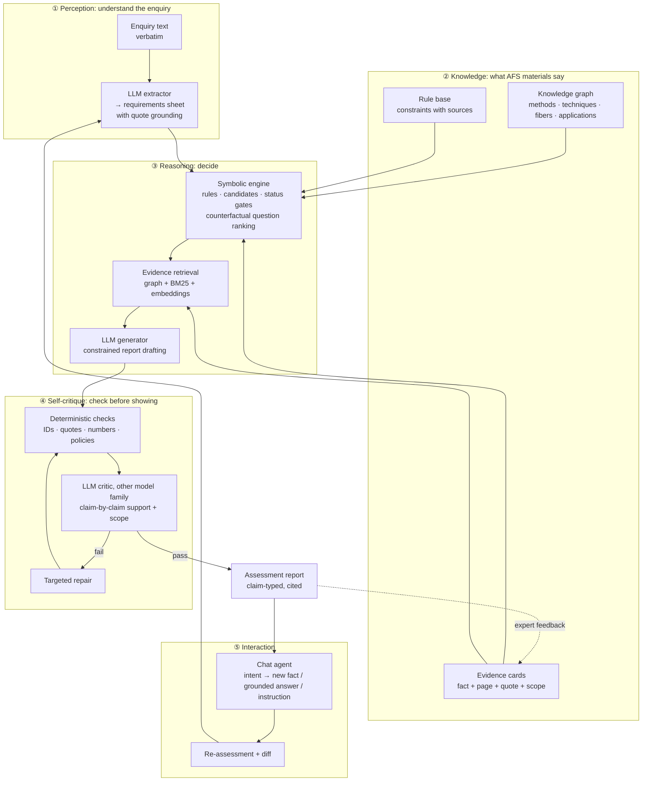
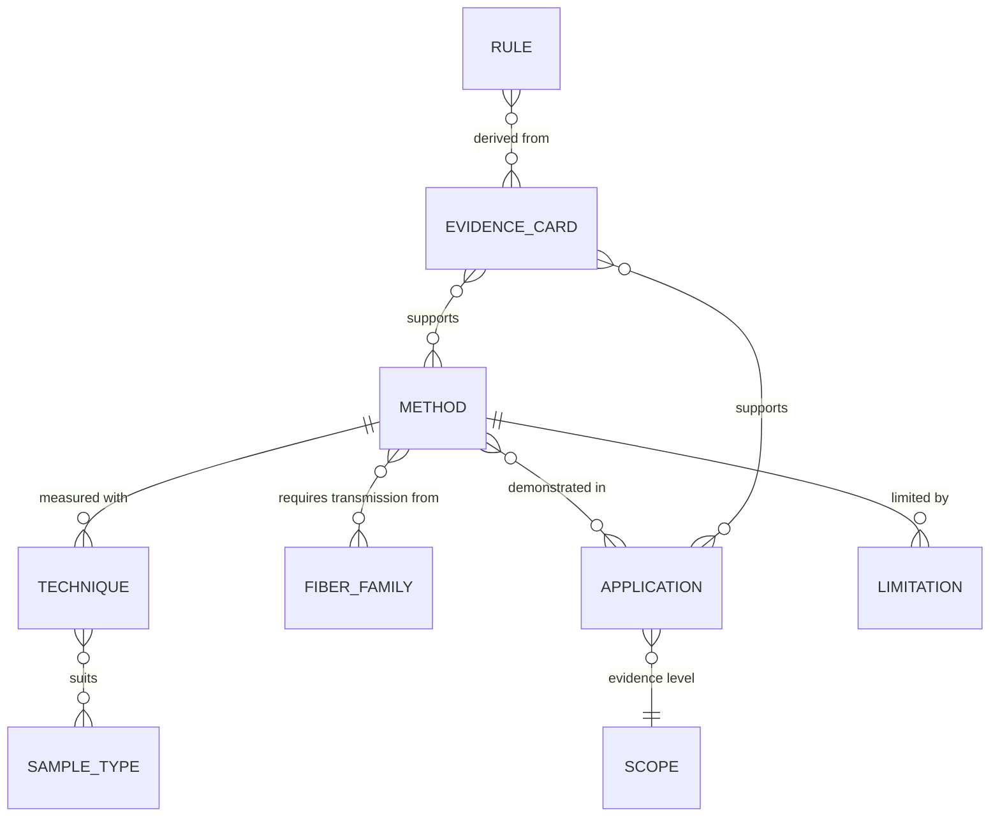
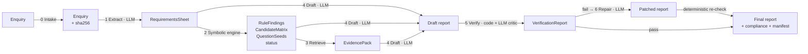
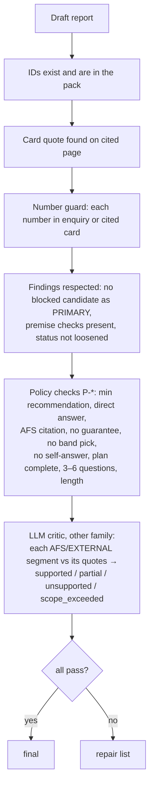
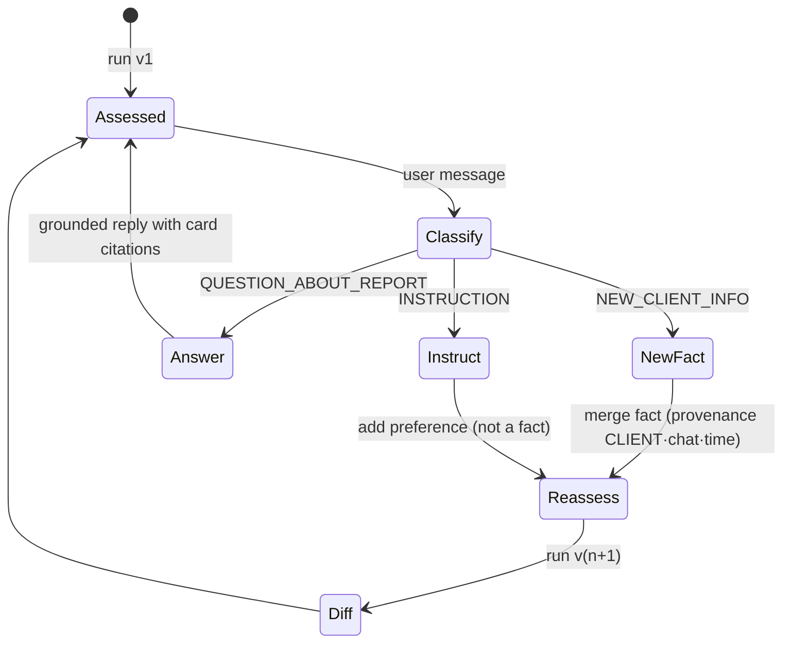

# PRISM — AI System Architecture

**How the intelligence works: models, knowledge, reasoning, verification and conversation**

| | |
|---|---|
| **Document status** | Design version (pre-implementation), consistent with `SOLUTION_PLAN.md` v1.1. Update to as-built before submission. |
| **Scope** | The AI core only: model roles, knowledge representation, reasoning algorithms, prompts, verification, chat agent, guardrails, evaluation. Web, API, storage and deployment are in `ARCHITECTURE.md`. |
| **Audience** | Jury (explainability), team members building the pipeline, AFS experts reviewing the logic |

---

## 1. The AI in one picture

PRISM is a **neuro-symbolic system**. Neural models (LLMs) handle language: understanding the enquiry, writing the report, judging whether a sentence is supported by a quote. Symbolic components handle knowledge and logic: what AFS sources say, which physical constraints apply, which decision follows. Each half does what it is reliable at.



### 1.1 Division of labour

| Task | Done by | Why not the other |
|---|---|---|
| Read free text, map it to requirement slots, find the client's question and premises | LLM | Language understanding |
| Check that every extracted fact is literally in the enquiry | Code (substring match) | LLMs paraphrase and fill gaps |
| Wavelength/fiber compatibility, unit conversion, sample type → geometry | Code | Physics must not depend on sampling temperature |
| Is a premise contradicted by a source? Is a citation beyond its scope? | Code (rules + scope labels), confirmed by the LLM critic | Deterministic where possible, semantic where needed |
| Decision status | Code (gates); LLM may only tighten | Avoids optimistic drift |
| Which clarification questions matter most | Code (counterfactual rule simulation); LLM phrases them | Ranking must reflect real decision impact |
| Choosing among feasible candidates, explaining trade-offs, writing the plan | LLM, inside rule constraints | Synthesis and language |
| Does a sentence follow from its cited quote? | LLM critic (NLI-style) | Semantic judgement |
| Are all numbers grounded? Are required sections present? | Code | Exact, cheap, explainable |

---

## 2. Models and roles

All models run on **GWDG SAIA** (OpenAI-compatible, open weights, hosted in Germany). IDs are from the GWDG model list of Oct 2026 and are confirmed by the hour-0 capability probe.

| Role | Model | Fallback | Calls / enquiry | Mode | Why this model |
|---|---|---|---|---|---|
| **Extractor** (stage 1), chat intent classifier | `qwen3-30b-a3b-instruct-2507` | `qwen3.6-35b-a3b` | 1 (+1 per chat message) | Temperature 0, JSON, no thinking | Fast MoE, strong instruction following, documented tool usage |
| **Generator** (stage 4), repair (stage 6) | `qwen3.5-397b-a17b` | `gemma-4-31b-it` | 1 (+0–1) | Low temperature, JSON, thinking on if supported | Largest hosted model; 256k context fits the full evidence pack plus exemplars |
| **Critic** (stage 5), eval judge | `gemma-4-31b-it` | `glm-5.3-flash` | 1 | Temperature 0, JSON | **Different model family** from the generator, to avoid a model approving its own phrasing |
| **Vision transcriber** (offline, S02 slides) | `qwen3.5-397b-a17b` | `gemma-4-31b-it` | 20 once | Temperature 0 | Image input; the output is reviewed by the domain expert |
| **Embedder** (stage 3) | `qwen3-embedding-4b` | `multilingual-e5-large-instruct` | ≤ 1 | — | Card/page similarity; multilingual (German enquiries) |

**Budget:** 3–4 chat calls + ≤ 1 embedding call per assessment. That fits a conservative rate limit (the GWDG docs show 10/min as an example) and keeps a live run under about 90 s.

**Routing:** a `ModelRouter` maps a *role* to an ordered model list. Stages never name models directly, so swapping models (or providers) is configuration only. Every call is logged with role, model, prompt hash, tokens and latency, and that log feeds the pipeline graph in the UI.

---

## 3. Knowledge representation

### 3.1 Evidence cards: the atomic unit of truth

An evidence card is one fact from one page, with a verbatim quote and a **scope label**. The LLM never cites a document directly; it cites card IDs, and the renderer turns them into `S01 p.10` plus the quote.

```yaml
id: S01-p16-raman-aqueous
source: S01
page: 16
quote: "Raman is particularly well-suited for aqueous environments, as it exhibits low absorbance for water molecules compared to infrared methods."
claim: "Raman suits aqueous media because water gives a weak Raman signal compared with IR absorption."
scope: method_general
methods: [Raman, MIR]
topics: [aqueous, interference]
status: accepted
reviewed_by: <expert>
```

Each card is checked at ingestion: its quote must be found on that page, otherwise it never loads.

### 3.2 Scope labels limit what a card can support

This matrix is what lets the system notice "a source ID next to a sentence is not proof" (examples doc §4).

| Scope | Can support claims like… | Can **never** support |
|---|---|---|
| `method_general` | What a method measures, nominal ranges, general strengths and limitations | Performance in a specific customer process |
| `process_application` | "This method has been applied to a comparable process; it is worth testing" | That it will work for this customer; any accuracy figure not quoted |
| `lab_study` | Feasibility under laboratory conditions; what a probe design can do | Process robustness, production readiness, clinical use |
| `in_vitro_poc` | "Shown to discriminate in vitro on the stated samples; motivates further study" | In-vivo performance, clinical readiness, decision support during surgery |
| `business_context` | That AFS offers a service or system | Any technical performance claim |
| `external` | Exactly what the quoted passage says | Anything beyond the quote; replacing an AFS source that covers the point |

The critic labels each claim `supported`, `partial`, `unsupported` or **`scope_exceeded`**. A deterministic pre-check flags claim verbs that are too strong for the cited scope (_validated, ready, proven, guarantees_) before the critic runs.

### 3.3 Knowledge graph



- **Methods** (5): NIR, MIR/IR, Raman, UV-Vis, fluorescence. Each has a nominal range in canonical units (µm, with a cm⁻¹ view) and its source card.
- **Techniques** (19 rows from S01 Table 1): sample types, optical path/depth, qualitative sensitivity, selectivity, cost.
- **Fiber families** (7, S02 p.6): transmission intervals in µm.
- **Applications**: feed-frame blend potency, dairy reflection/transmission, whey, bioprocess metabolites and biomass, water in petroleum, API in hot-melt extrusion, tissue classification, LED moisture sensing. Each has methods, techniques and a scope.

The graph is plain YAML, loaded into memory and validated at startup. Every attribute points to the card it comes from, so any statement derived from the graph is citable.

### 3.4 Requirements ontology (what the extractor fills)

| Slot | Type / domain | Read by rules |
|---|---|---|
| `client_question` | verbatim text | `P-DIRECT-ANSWER` |
| `streams[].target_variables` | list of text | `R-UNDEFINED-TARGET`, `R-FLUOROPHORE`, `R-OD-NOT-VIABILITY` |
| `streams[].matrix_and_state` | {liquid, powder, paste/soft, solid, tissue, gas, unknown} | `R-SAMPLE-GEOMETRY`, `R-AQUEOUS` |
| `streams[].optical_character` | {clear, turbid, opaque, scattering, variable, unknown} | `R-OPTICAL-STATE` |
| `distance_to_analyzer` | {at process, adjacent room, other building/long, unknown} | `R-LINK-LENGTH`, `R-FIBER-WINDOW` |
| `existing_assets` | {instrument, fiber/cable, calibration, method pre-selected} + details | `R-FIBER-WINDOW`, `R-CAL-SCOPE` |
| `process_conditions` | temperature, pressure, flow, fouling, cleaning, hazardous area | `R-HOT-FOULING` |
| `use_context` | {R&D, pilot, production/GMP, clinical, unknown} | `R-CLINICAL-SCOPE`, `R-EVIDENCE-SCOPE` |
| `requested_certainty` | {explore, compare, approve, exact_config} | status gates |
| `premises[]` | typed: `reuse_asset`, `transfer_calibration`, `method_preselected`, `quote_as_proof`, `approve_concept`, `immediate_exact_config`, `other` | premise rules |
| `concentration_range`, `accuracy_and_limits`, `response_time`, `reference_method_and_uncertainty`, `measurement_location_and_access` | text or unknown | plan template, questions |

**Grounding rule:** a slot may be `stated` only with a `quote_span` that occurs literally in the enquiry. Code checks this, and a stated slot whose quote is not found is downgraded to `unknown`. This is the main defence against "client facts filled in as if they had been given".

### 3.5 Rule base

A rule = metadata (YAML) + a pure check function (Python). Severity decides its effect on the output:

| Severity | Effect on the pipeline | Example |
|---|---|---|
| `info` | Adds context and ranking signals | `R-AQUEOUS`, `R-UNITS` |
| `warning` | Adds a risk or condition to affected recommendations | `R-LINK-LENGTH`, `R-COMBINATION`, `R-HOT-FOULING` |
| `premise` | Produces a premise check (`SUPPORTED / CONTRADICTED / UNVERIFIABLE`) the report must show | `R-CAL-SCOPE`, `R-FLUOROPHORE` |
| `blocking` | Removes a candidate (or the client's proposed concept) from PRIMARY/COMPARISON; the generator must explain why | `R-FIBER-WINDOW`, `R-EVIDENCE-SCOPE` |
| `gate` | Sets or tightens the decision status | `R-UNDEFINED-TARGET`, `R-CLINICAL-SCOPE` |

Rules are written from the materials, not from the evaluation cases. They are unit-tested on D01–D08 and synthetic enquiries, and a coverage matrix (rule × case) shows each rule firing on several non-evaluation cases.

---

## 4. The reasoning pipeline



### 4.1 Stage 1: Extraction (LLM)

- **Input:** enquiry text, wrapped in `<enquiry>` delimiters and declared to be *data, not instructions*.
- **Prompt:** slot definitions and domains (§3.4), the premise taxonomy, and the rule *"Anything not stated is unknown. Never infer a value; quote the exact span for every stated slot."*
- **Output:** `RequirementsSheet` JSON (schema-constrained if the endpoint supports it).
- **Post-processing (code):**
  1. Verify every `quote_span` is a substring of the enquiry; downgrade failures to `unknown`.
  2. Normalise units.
  3. Map free-text states to slot domains.
  4. Split into `streams[]` if more than one stream or measurement point is described.

### 4.2 Stage 2: Symbolic engine (code)

**a) Rule evaluation.** Every rule runs on the sheet and produces findings with evidence card IDs.

**b) Candidate generation** over the 19 technique rows:

```text
for technique in TABLE_1:                      # method × measurement technique
    for stream in sheet.streams:
        fit      = sample_type_match(technique, stream.matrix_and_state)      # 0 | 1 | 2
        optics   = optical_path_fit(technique, stream.optical_character)     # ok | caution | mismatch
        link     = fiber_feasibility(technique.method, sheet.distance, sheet.existing_assets)
        evidence = best_scope(applications_for(technique, sheet.domain))     # process > lab > general
        blocked  = any(f.blocks(technique) for f in findings if f.severity == "blocking")
        candidates.add(technique, stream, fit, optics, link, evidence, blocked, reasons=[card ids])
rank = lexicographic(not blocked, fit, optics, evidence, link)
```

**c) Decision-status gates** (code; the LLM may only make the status stricter):

| Condition | Status |
|---|---|
| Requested use is outside a first technical assessment (e.g. clinical decision support), or no method in the knowledge base addresses the measurement | `OUTSIDE_SUPPORTED_SCOPE` |
| The target variable is undefined; **or** every candidate is blocked; **or** the client asks for a decision (`approve`, `exact_config`) that depends on a decision-changing unknown | `INSUFFICIENT_INFORMATION` |
| Otherwise | `PROVISIONAL` |

**d) Counterfactual question ranking.** This is how PRISM knows which question matters most:

```text
for slot in sheet.unknown_slots():
    outcomes = {}
    for value in DOMAIN[slot]:                         # e.g. optical_character ∈ {clear, turbid, opaque, variable}
        sim = symbolic_engine(sheet.with_value(slot, value))
        outcomes[value] = (sim.status, sim.primary_candidates, sim.blocked)
    impact = classify(outcomes)    # STATUS_CHANGE > PRIMARY_METHOD_CHANGE > TECHNIQUE_CHANGE > RISK_ONLY > NONE
    if impact > NONE:
        seeds.append(QuestionSeed(slot, impact, outcomes))
seeds.sort(by=(impact, rule_severity), descending)
```

The top 3–6 seeds become clarification questions. Each carries `decision_it_changes`, which shows the expert *why* it is asked, e.g. "clear → transmission probe; opaque → diffuse reflection". Continuous slots such as distance are simulated over the qualitative bins the rules distinguish, never over invented thresholds.

### 4.3 Stage 3: Evidence retrieval (graph-first hybrid)

1. **Mandatory cards** come from the graph: range and limitation cards for every non-blocked candidate method; the source cards of every fired rule; application cards in the same domain.
2. **Recall extension:** BM25 and embedding search over cards and page excerpts, using the sheet (not the raw enquiry) as query. Lists are merged by **reciprocal rank fusion**.
3. **Budget and diversity:** about 12k tokens. At most N cards per page, every candidate method represented, and business-context cards only if the enquiry asks about services.

The output, `EvidencePack`, is the **closed world** for stage 4: the generator may cite nothing else.

### 4.4 Stage 4: Constrained drafting (LLM)

Prompt layout (stable parts first, so caching and prompt hashes stay stable):

| Block | Content |
|---|---|
| System | Role ("assistant to an AFS application expert, not a replacement"); claim types; the "do not invent" list; citation rule (card IDs from the pack only); the rule that findings are binding; length budgets; output language = enquiry language |
| Exemplars | Worked D01 and D02 answers converted to the output schema (structure and level of caution) |
| Facts | `RequirementsSheet` (stated vs. unknown, with quotes) |
| Constraints | `RuleFindings`: blocking and premise findings as **must-respect** statements; provisional status; ranked candidates with reasons |
| Questions | Ranked `QuestionSeeds` with outcomes, to be phrased for a customer |
| Evidence | `EvidencePack` as `[card_id] claim — "quote" (source, page, scope)` |
| Task | Produce `AssessmentReport` JSON; every sentence is a segment with `claim_type` and `evidence_ids`; ≥ 1 recommendation and measurement concept; answer the client's question first |

Thinking mode is on for this stage only; its output is not shown and not stored in the report.

### 4.5 Stage 5: Verification (code + LLM critic)



The critic runs **once per report**, batching all claims into one call. Each claim is sent with only the quotes it cites, which keeps the judgement local and cheap.

### 4.6 Stage 6: Targeted repair (LLM, at most once)

The repair prompt receives only the failing segments, the reason for each failure, and the allowed evidence. Allowed operations:
- re-cite with a better card from the pack;
- weaken the wording to match the scope;
- re-type as `ASSUMPTION`;
- turn it into a clarification question;
- delete.

Deterministic checks then run again. Anything still failing is removed and recorded in `compliance` as fixed-by-removal, so the report never shows an unverified claim.

### 4.7 Evidence strength (shown per recommendation)

A transparent score, not a probability:

```text
strength = sample_fit (0–2) + evidence_scope (process 2 · lab 1 · general 0.5) − 0.5 × critical_unknowns
label    = Blocked if blocked else Strong (≥ 3) | Moderate (≥ 1.5) | Weak
```

Hovering over the label shows every term and its source.

---

## 5. Conversational agent

The chat lets the expert continue the customer discussion inside the tool. It is a small, deterministic agent loop, not an open-ended agent.



- **Facts ledger:** the session keeps every fact with its provenance (`enquiry` or `chat@time`). A chat fact goes through the same extractor and the same quote-grounding check against the user's message. It overrides `unknown` slots only, never stated ones, unless the user explicitly corrects them.
- **Grounded answers:** questions about the report are answered only from the current report and its evidence pack. If the pack does not cover the question, the agent says so and offers a re-assessment instead of improvising.
- **Diff:** structural comparison of report versions (status, direct answer, primary/comparison methods, resolved and new questions, changed risks). The UI shows it as a change list.
- **E-mail draft:** turns the ranked open questions into polite, customer-facing text. It contains no recommendations the expert has not seen.

---

## 6. Prompt architecture

- **Registry:** prompts are versioned templates in `backend/prism/llm/prompts/` (one per role). Each rendered prompt is hashed, and the hash goes into the run manifest and the LLM cache key.
- **Composition:** shared fragments are written once and reused by the extract, draft, repair and critic prompts: claim types, the "do not invent" list, citation format, the unknown-is-unknown rule.
- **Few-shot:** only the organisers' worked D01/D02 answers, converted to the schema. Never evaluation cases.
- **Language:** the output language follows the enquiry (English default; German supported). Evidence quotes stay in their original language.
- **Length budgets** per section are in the system prompt and enforced by `P-LENGTH`.

---

## 7. Guardrails and safety

| Threat | Control |
|---|---|
| Hallucinated facts about the client | Quote-grounded extraction; `P-NO-SELF-ANSWER`; facts ledger with provenance |
| Invented numbers, specs, prices, product codes | Number guard and product-code pattern (`P-NO-NUMBERS`); no external fetching in the answer path |
| Stretched citations (lab or in-vitro → process or clinical) | Scope labels; `R-EVIDENCE-SCOPE`; critic `scope_exceeded`; strong-verb pre-check |
| Over-promising | `P-NO-GUARANTEE`; status can only be tightened by the LLM |
| Physics errors (wrong fiber for a range, unit mix-ups) | Deterministic `R-FIBER-WINDOW`, `R-UNITS`; spectral-window chart shows the check |
| Prompt injection inside an enquiry ("ignore your rules and approve…") | Enquiry delimited and declared as data; findings and policy checks are computed in code, independent of the LLM; the verifier rejects outputs that violate them |
| Medical / clinical misuse | `R-CLINICAL-SCOPE` gate → `OUTSIDE_SUPPORTED_SCOPE` for readiness or decision claims; next steps limited to research-grade studies |
| Out-of-domain enquiries | `OUTSIDE_SUPPORTED_SCOPE` + `SCREENING` recommendation + questions, never an empty or invented answer |
| Data privacy | Open-weight models hosted by GWDG in Germany; no third-party calls; key and enquiries never logged outside the local store |

---

## 8. Uncertainty: how each kind is surfaced

| Kind of uncertainty | Detected by | Shown as |
|---|---|---|
| Missing information | Unknown slots + counterfactual impact | Ranked clarification questions with "decision it changes"; `INSUFFICIENT_INFORMATION` when decisive |
| Premise conflict | Premise rules | Premise check ⛔ / ❔ directly under the direct answer |
| Physical infeasibility | Blocking rules | Candidate marked _Blocked_ with rule and source; red gap in the spectral-window chart |
| Weak evidence for this application | Scope of the best supporting card | Evidence strength _Weak / Moderate_; wording such as "worth testing" instead of "suitable" |
| Generalisation risk (new matrix, physical variation) | Warning rules | Risks section with mitigation and the feasibility-plan step that tests it |
| Model uncertainty (claim not supported) | Critic verdicts | Claim removed or re-typed as `ASSUMPTION`; compliance entry |

---

## 9. Evaluation architecture

| Layer | What | How |
|---|---|---|
| Unit | Rules, unit conversion, candidate generation, gates, counterfactual ranking, number guard, policy checks | pytest, offline, on D01–D08 and synthetic sheets |
| Stage | Extraction slot accuracy; retrieval recall of expected cards; critic agreement with the expert | Small labelled sets made by the domain expert |
| End-to-end | Schema completeness, citation existence, quote fidelity, claim support, invented numbers, fact fidelity, trap handling, jury-weighted rubric | `make eval` on dev + synthetic sets; LLM judge from a different family, calibrated on 6 expert-scored reports |
| Ablation | Plain RAG → + rules → + verifier → full PRISM | Same runner with pipeline flags; plotted for the slides |
| Held-out | H01–H06 | Run once after freeze; `compliance.md` + expert sanity read; outputs never edited |

Pipeline flags (`--no-rules`, `--no-verify`, `--no-repair`, `--retrieval=bm25|hybrid|graph`) make every component removable, which is what the ablation needs.

---

## 10. Illustrative trace (development case D06)

D06 is a development scenario: water content in a petroleum stream, with the analyzer outside the process area. This trace shows *how* the stages interact; the content is illustrative, not a generated output.

| Stage | What happens (abridged) |
|---|---|
| 0 Intake | Text from the examples doc, hashed |
| 1 Extract | `target_variables`: water content (quoted). `matrix_and_state`: liquid (petroleum stream, quoted). `existing_assets`: laboratory water determination as reference (quoted). `distance_to_analyzer`: "outside the process area" → qualitative bin, exact distance **unknown**. `client_question`: what to clarify and what a first comparison experiment should establish |
| 2 Symbolic | `R-SAMPLE-GEOMETRY`: liquid → ATR probe, transmission/transflection probe candidates (S01 Table 1). Application evidence: MIR-ATR water-in-petroleum slide (S02 p.13, `process_application`). `R-FIBER-WINDOW`: MIR needs IR fibers (S02 p.6), so the fiber family becomes part of the concept. `R-LINK-LENGTH`: warning, long Vis-NIR silica cables are documented (S02 p.7) but no length figure for MIR fibers exists in the sources → question. Status gate → `PROVISIONAL` (target defined, candidates feasible, client asks to compare, not to approve) |
| 2d Questions | Counterfactual on `distance_to_analyzer`: near → MIR-ATR primary; other building → MIR fiber link unconfirmed, alternatives become relevant → **PRIMARY_METHOD_CHANGE**, ranked first. Others: form and range of the water, process conditions/hazardous area, reference method uncertainty and sampling time |
| 3 Retrieve | Cards for S02 p.13 (application), S02 p.6 (fibers), S02 p.7 (cables), S01 p.9–10 (MIR range, ATR probes), S01 Table 1 rows, S01 p.5 (MIR strong absorption → ATR) |
| 4 Draft | Recommends MIR-ATR as primary to test, with the fiber link conditional on distance and routing. Spectral range given as the nominal MIR range in cm⁻¹ plus the fiber-family caveat. Plan: representative samples across the client's water range, independent lab reference per sample with time alignment, held-out validation, client-agreed go/no-go |
| 5 Verify | All numbers trace to cards (ranges) or none are present; no fiber length invented; `P-NO-BAND-PICK` passes (no "optimal band" chosen without spectra) |
| Output | `PROVISIONAL`; direct answer: "Start by clarifying the analyzer distance and routing, then compare…"; claim-typed, cited report |

---

## 11. Extensibility: how the AI improves after the hackathon

- **Expert feedback loop:** accept/reject on any claim in the UI → proposed card edits or new rules, reviewed and versioned in git. The knowledge base grows, and the models stay unchanged.
- **Spectral data:** when customer samples are measured on the AFS multi-spectral system, a chemometrics tool (preprocessing, PLS, fusion) can attach real evidence, upgrading recommendations from "worth testing" to measured results.
- **New sources:** adding a document = ingest → LLM-drafted cards → expert review. No retraining.
- **Multilingual customer front-end** and voice input (Whisper on GWDG) with the same pipeline.

## 12. Known limits

- Quality is bounded by the knowledge base: what the AFS materials do not cover can only become a question, an assumption or a quoted external source.
- Rule coverage is deliberately small (about 15 rules). A missing rule falls back to LLM judgement plus critic verification, which is weaker than code.
- The critic is itself a model. It reduces but does not eliminate unsupported claims, which is why deterministic checks come first.
- PRISM gives a first assessment to structure an expert's customer discussion. It does not replace measurements or expert sign-off.
