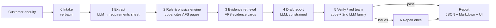
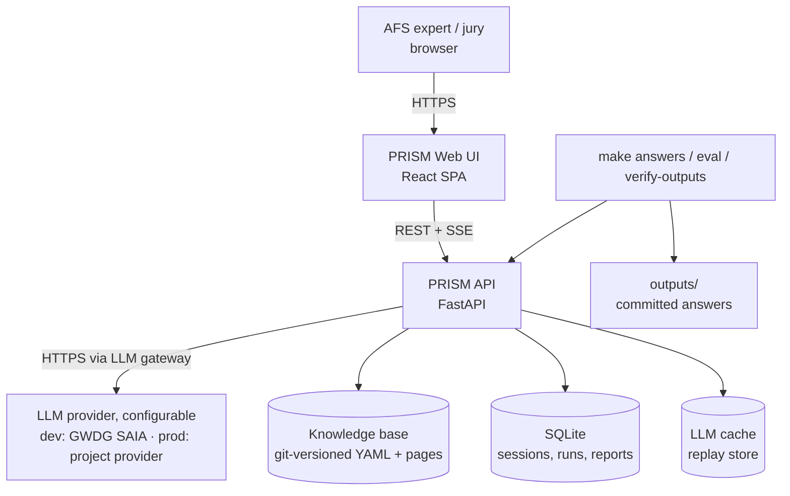
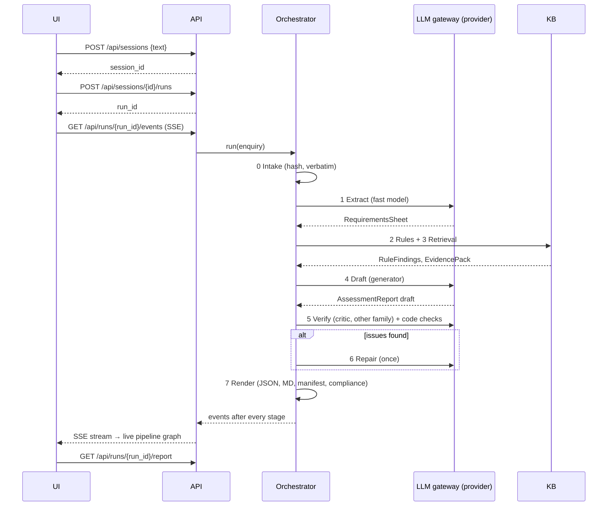

# PRISM — System Architecture

**AI assistant for in-line spectroscopy solution design. Art Fiber Systems challenge, SchubKI National AI Hackathon 2026**

| | |
|---|---|
| **Document status** | Design version (pre-implementation). Derived from `docs/SOLUTION_PLAN.md` v1.1. **Update to the as-built system before submission** (checklist in §13). |
| **Audience** | Jury (§1 is the required "short description"), team members implementing the system (§2 onwards) |
| **Related** | `docs/AI_ARCHITECTURE.md` (deep dive into the AI: models, knowledge, reasoning, verification, chat agent), `docs/SOLUTION_PLAN.md` (why and plan), `docs/KB_COVERAGE.md` (generated: use of AFS materials in numbers), `outputs/` (generated answers) |

---

## 1. One-page summary (for the jury)

**What it does.** An AFS expert pastes a customer enquiry. PRISM returns a structured first technical assessment:
- a direct answer to the client's question;
- a decision status: _provisional_, _insufficient information_ or _outside the supported scope_;
- checks of the client's premises;
- the stated requirements kept apart from the unknowns;
- prioritised clarification questions;
- recommended spectroscopy method(s) with probe geometry, fiber link and spectral range;
- risks, and a short feasibility plan.

Every statement is tagged as a _client fact_, an _AFS source_ (document + page + verbatim quote), an _external source_, an _assumption_ or a _proposal_.

**How it works.** A neuro-symbolic pipeline. LLMs do language work; code does everything that can be checked deterministically.



**How AFS materials are used.**
- S01–S05 and the method table become about 100 expert-reviewed **evidence cards**. Each card is one fact with its page, a verbatim quote and a **scope label** (method knowledge, process application, lab study, in-vitro proof of concept, business context).
- A YAML **knowledge graph** links methods, measurement techniques (S01 Table 1), fiber families (S02 p.6) and application cases.
- About 15 **rules** encode constraints stated in the materials. Examples: a fiber must transmit the method's range; sample type decides the probe geometry; fluorescence needs a defined fluorophore; a study cannot support claims beyond its scope.
- The LLM may cite only the cards it was given, and a verifier checks every citation, quote and number.

**Why it is trustworthy.**
- The decision status is computed by rules and can only be tightened by the LLM.
- Numbers must appear in the enquiry or a cited card.
- Over-claiming language and scope-stretched citations are flagged.
- Each report carries a compliance block against the brief's requirements.

**Runs on** any LLM provider, through a provider-agnostic gateway. Development uses the strongest open-weight models on GWDG (German academic cloud). The real project's provider and key plug in as a configuration profile. A replay cache regenerates all committed answers without an API key.

---

## 2. Architectural drivers

| Driver | Source | Architectural consequence |
|---|---|---|
| Recommendations grounded in AFS materials, with sources shown | Brief: minimal requirements, rules | Evidence cards are the only citation unit; AFS-first citation policy |
| Knows when information is insufficient; does not invent | Brief: evaluation criteria; examples doc §3 | Rule-computed decision status; number, guarantee and self-answer checks |
| Traceable, easy for an expert to review | Brief: explainability | Claim-typed segments; run trace; "Why?" evidence graph |
| H01–H06 generated, no manual editing, no hard-coding, verbatim inputs | Brief: rules; H file | Verbatim intake, manifest with hashes, replay cache, `verify-outputs` |
| Live demo, including a new enquiry | Brief: rules | Streaming pipeline (SSE), < 90 s target, replay fallback |
| LLM provider not fixed: GWDG key now, the project's provider later; GWDG caps 30/min · 200/h · 3,000/month | Team constraint | Provider-agnostic gateway with config profiles, capability records, budget meter, cache/replay, fallback chain, capability probe |
| 1.5 build days | Hackathon | Few moving parts: SQLite, in-memory retrieval, YAML knowledge base, no graph or vector DB |

---

## 3. System context



External dependency: **one LLM provider**, chosen by configuration (GWDG SAIA in development). Everything else is local and file-based.

---

## 4. Components

| Component | Responsibility | Main interface | Depends on |
|---|---|---|---|
| **Web UI** (`frontend/`) | Enquiry editor, report view, chat, pipeline graph, charts, evidence viewer | REST + SSE client | API |
| **API** (`backend/prism/api.py`) | Sessions, runs, chat, exports, KB lookups; streams run events | §8 endpoints | Orchestrator, Store |
| **Orchestrator** (`orchestrator.py`) | Runs stages 0–7 in order, emits events, persists the trace | `run(enquiry, context) → Report` | Stages, Store |
| **Stage 0: Intake** (`stages/intake.py`, `scripts/load_cases.py`) | Accept text verbatim; parse the official case files; hash inputs | `Enquiry` | — |
| **Stage 1: Extract** (`stages/extract.py`) | Text → `RequirementsSheet` (slots, streams, premises, client question) | LLM JSON call | LLM gateway |
| **Stage 2: Rule engine** (`stages/rules.py`, `rules/*.py`, `kb/rules.yaml`) | Deterministic findings, candidate matrix, question seeds, provisional status | `evaluate(sheet) → RuleFindings` | KB loader |
| **Stage 3: Retrieval** (`stages/retrieve.py`) | Choose evidence cards via graph edges + BM25/embeddings | `retrieve(sheet, findings) → EvidencePack` | KB loader, LLM gateway (embeddings) |
| **Stage 4: Draft** (`stages/draft.py`) | Constrained report generation | LLM JSON call | LLM gateway |
| **Stage 5: Verify** (`stages/verify.py`) | Citation, quote, number and scope checks; policy checks P-*; critic LLM | `verify(report, pack, sheet) → VerificationReport` | LLM gateway, page store |
| **Stage 6: Repair** (`stages/repair.py`) | Patch or remove failing claims (one pass) | LLM JSON call | LLM gateway |
| **Stage 7: Render** (`stages/render.py`) | JSON → Markdown (worked-example layout), manifest, compliance | pure functions | — |
| **LLM gateway** (`llm/`) | Provider-agnostic: role → profile → model routing; adapters (OpenAI-compatible, Anthropic); capability records; budget meter + rate limiting; retries; fallback chain; cache/replay | `complete(role, messages, schema, reasoning) → parsed`; `embed(texts)` | Configured provider, cache |
| **KB loader** (`kb/loader.py`) | Load and validate pages, cards, graph, rules, external cards; compute the KB hash | in-memory `KnowledgeBase` | `kb/` files |
| **Ingestion** (`kb/ingest.py`, `kb/vlm_transcribe.py`) | PDF → page text + PNG; S02 slides → VLM notes; quote auto-check for cards | offline `make ingest` | PyMuPDF, LLM gateway |
| **Store** (`store.py`) | Sessions, messages, runs, reports, events | SQLModel | SQLite |
| **Eval runner** (`eval/run_eval.py`) | Dev/synthetic/held-out runs, metrics, judge rubric, ablations | `make eval` | Orchestrator |

**Design rule:** each stage is a pure function of its inputs plus the KB and the LLM gateway. Stages exchange Pydantic models only. This makes stages unit-testable, replayable and visible in the UI as separate nodes.

---

## 5. Runtime flow

### 5.1 New assessment



### 5.2 Chat follow-up

1. `POST /api/sessions/{id}/messages` → the fast model classifies the message:
   - `NEW_CLIENT_INFO`: e.g. "the line is 200 m from the analyzer";
   - `QUESTION_ABOUT_REPORT`;
   - `INSTRUCTION`.
2. `NEW_CLIENT_INFO` is appended to the enquiry context as a `CLIENT (chat, timestamp)` fact. A new run starts with version n+1, and `GET /api/sessions/{id}/diff?from=n&to=n+1` returns the changed status, recommendations and resolved questions.
3. `QUESTION_ABOUT_REPORT` is answered from the current report + evidence pack, citing card IDs. No new run.

### 5.3 Batch generation of the official answers

`make answers`:
1. `load_cases.py` reads the H file and the docx verbatim.
2. The orchestrator runs every case (cache on).
3. Writes `outputs/<case>.json|.md`, `outputs/index.md`, `outputs/compliance.md` and `outputs/run_manifest.json`.

`make verify-outputs` re-renders from the replay cache and fails on any diff with the committed files.

---

## 6. Knowledge layer and use of AFS materials

### 6.1 Source → artefact mapping

| Source | What is used | Processing | Becomes | Cited in reports as |
|---|---|---|---|---|
| **S01** Multispectral Laboratory (19 p.) | Method principles (p.2–6), Table 1 (p.6), combinations and data fusion (p.7–9), probes (p.10–12), application cases (p.13–18) | PyMuPDF page text + PNG; LLM-drafted cards, expert-reviewed | Evidence cards; `Method`, `Application` nodes; rules (geometry, optical state, fluorophore, aqueous, combination) | `S01 p.N`, `S01 Table 1 (p.6)` |
| **Method table** (xlsx) | 19 technique rows: sample type, path/depth, sensitivity, selectivity, cost | Direct load | `kb/graph/techniques.yaml` | `S01 Table 1 (p.6)` |
| **S02** Process-control slides (20) | Fiber transmission (p.6), Vis-NIR cables (p.7), PIR/HWG (p.9–10), LED moisture sensor (p.12), water in petroleum (p.13), polymer extrusion (p.14), combi probes (p.15–16), IoT vs. analyzer (p.18) | Slides rendered → VLM transcription → **expert review** | `FiberFamily` nodes, link-length and hot/fouling rules, application cards | `S02 p.N` (= slide N) |
| **S03** LED kidney study | Sample basis (p.1), ex-vivo caveat (p.3), proof-of-concept conclusions (p.14) | Page text | Cards with scope `in_vitro_poc`; evidence-scope rule | `S03 p.N` |
| **S04** Combi MIR + fluorescence probe | Probe design and model-tissue demonstration (p.1, 3–5) | Page text | Cards with scope `lab_study`; combination rule | `S04 p.N` |
| **S05** Flyer, **S06** lab link | Company services, multi-method testing offer | Page text | Cards with scope `business_context` (never technical evidence) | `S05 p.N` (context only) |
| **Examples doc** (D01–D08, worked D01/D02, §3–§5) | Answer structure, good practice, "do not invent" list, dev scenarios | Parsed | Dev set; few-shot exemplars; policy checks P-*; system-prompt rules | **Not cited**: reports cite the underlying S-pages |
| **H file** (H01–H06) | Final evaluation enquiries | Parsed verbatim, hashed | Held-out test inputs only; never used in prompts, rules or code | — |
| **Websites, literature** | Instrument ranges, calibration transfer, MIR fiber loss, clinical-evidence principle | Curated once, verbatim quote + URL + snapshot hash | External cards (`scope: external`) | `[EXT] <url>` + quoted passage |

`docs/KB_COVERAGE.md` is **generated**. For every source page it shows the number of cards, the number of rules citing it, and which case reports used it. Pages never used are listed too.

### 6.2 Evidence card schema

```yaml
id: S02-p06-silica-visnir      # stable, human-readable
source: S02                    # S01..S05 | TABLE | EXT
page: 6                        # 1-based PDF page / slide number
quote: "..."                   # verbatim; auto-checked against the page at ingestion
claim: "..."                   # normalised statement the LLM may rely on
scope: method_general          # method_general | process_application | lab_study | in_vitro_poc | business_context | external
methods: [NIR]
topics: [fiber, spectral_range]
reviewed_by: <expert>          # required for status: accepted
status: accepted               # draft | accepted | rejected
```

### 6.3 Knowledge graph (YAML)

| Node | Key attributes | File |
|---|---|---|
| `Method` | nominal range + units, phenomenon, typical limitations | `kb/graph/methods.yaml` |
| `Technique` | method, sample types, optical path/depth, sensitivity, selectivity, cost | `kb/graph/techniques.yaml` |
| `FiberFamily` | transmission range (µm) | `kb/graph/fibers.yaml` |
| `Application` | domain, methods, techniques, scope | `kb/graph/applications.yaml` |
| `Instrument` (optional) | instrument range (external card) | `kb/graph/instruments.yaml` |

Edges (`supports`, `limited_by`, `requires_fiber`, `demonstrated_in`, `cited_by`) live as ID lists on the nodes. Every node attribute references the card IDs it comes from.

### 6.4 Rules

`kb/rules.yaml` holds the metadata. Each rule is backed by one Python check function:

```yaml
id: R-FIBER-WINDOW
severity: blocking             # info | warning | premise | gate | blocking
reads_slots: [existing_assets, target_variables, matrix_and_state]
sources: [S02-p06-silica-visnir, S02-p06-pir, S01-p09-mir-range]
check: prism.rules.physics:fiber_window
```

A check returns `Finding{rule_id, severity, message, evidence_ids, affects: [method|technique|status], slots_unknown}`. `slots_unknown` feeds question prioritisation: if an unknown slot would change a rule outcome, the question is _decision-changing_. The full catalogue is in SOLUTION_PLAN §4.4. Rules are generic, and unit tests exercise them on D01–D08 and synthetic cases only.

---

## 7. Data model

### 7.1 Core Pydantic models

| Model | Produced by | Key fields |
|---|---|---|
| `Enquiry` | Stage 0 | `case_id`, `title`, `text`, `sha256`, `origin` (ui / case_file / chat) |
| `RequirementsSheet` | Stage 1 | `client_question`, `streams[]`, slots (`stated` + quote span, or `unknown`), `premises[]`, `domain` |
| `RuleFindings` | Stage 2 | `findings[]`, `candidates[]` (method × technique with feasibility), `question_seeds[]`, `provisional_status` |
| `EvidencePack` | Stage 3 | `cards[]`, `pages[]` (excerpts), `selection_reasons` |
| `AssessmentReport` | Stages 4/6/7 | Full schema in SOLUTION_PLAN §4.5 (direct answer, status, premises, streams, questions, recommendations, concept, ranges, risks, plan, decision basis, sources, compliance) |
| `VerificationReport` | Stage 5 | Per-claim verdicts (supported / partial / unsupported / scope-exceeded), number-guard hits, policy-check results |
| `RunManifest` | Stage 7 | Input hash, KB hash, model IDs, prompt hashes, git commit, output hashes, timings |

All free text in `AssessmentReport` is stored as segments `{text, claim_type, evidence_ids}`. The claim type is one of `CLIENT | AFS | EXTERNAL | ASSUMPTION | PROPOSAL | UNKNOWN`.

### 7.2 Persistence (SQLite)

| Table | Columns (main) |
|---|---|
| `sessions` | id, title, case_id?, created_at |
| `messages` | id, session_id, role (user / assistant), kind (enquiry / new_client_info / question / instruction / answer), text, run_id?, created_at |
| `runs` | id, session_id, version, status (running / done / failed), started_at, finished_at, manifest_json |
| `reports` | run_id, report_json, report_md |
| `events` | run_id, seq, event_json (replayable pipeline trace) |

---

## 8. API

| Method & path | Purpose |
|---|---|
| `GET /api/health` | Status: active LLM profile and provider reachability, remaining request budget, replay mode, KB hash, model routing |
| `GET /api/cases` | Pre-loaded dev and evaluation cases (D01–D08, H01–H06), loaded verbatim |
| `POST /api/sessions` · `GET /api/sessions` · `GET /api/sessions/{id}` | Create, list and read sessions (with message history and report versions) |
| `POST /api/sessions/{id}/runs` | Start an assessment run → `run_id` |
| `GET /api/runs/{run_id}/events` | **SSE** stream of pipeline events |
| `GET /api/runs/{run_id}/report` · `…/report.md` · `…/report.pdf` | Report as JSON, Markdown or PDF |
| `POST /api/sessions/{id}/messages` | Chat message → classification → answer or new run |
| `GET /api/sessions/{id}/diff?from=&to=` | Structured diff between report versions |
| `POST /api/sessions/{id}/email-draft` | Client-facing clarification e-mail |
| `GET /api/kb/cards/{id}` | Card with quote, scope, source |
| `GET /api/kb/pages/{doc}/{page}?highlight={card_id}` | Page PNG + quote bounding boxes for the evidence viewer |
| `GET /api/kb/spectral` | Method, fiber and instrument ranges for the spectral-window chart |

**SSE event shape:** `{type, run_id, seq, ts, stage, payload}`. Types:
- `stage_started`, `stage_completed` (duration, model, tokens)
- `rule_fired`, `evidence_selected`
- `issue_found`, `repaired`
- `run_completed`, `run_failed`

The UI's pipeline graph is a pure projection of this stream. A finished run can be re-played from the `events` table.

---

## 9. LLM integration (provider-agnostic gateway)

The AI core is **not tied to any provider**. Stages request a *role*, and `config/llm.yaml` maps each role to a provider, a model list and settings for the active profile:
- **`gwdg`** is the development profile (key available now).
- **`project`** holds the provider and key the real project supplies.

Switching providers means changing configuration, re-running the probe and re-running the eval suite, with no code change.

| Layer | Responsibility |
|---|---|
| **Gateway API** | `complete(role, messages, schema=None, reasoning=off/low/high, max_tokens)` and `embed(texts)` |
| **Router** | Role → ordered model list of the active profile; falls back down the list on errors or timeouts |
| **Adapters** | `openai_compatible`: GWDG SAIA, OpenAI, Azure OpenAI, vLLM, Ollama, Mistral and other OpenAI-style APIs. `anthropic`: Claude Messages API. Each adapter translates JSON-schema output, reasoning controls, image inputs and usage fields |
| **Capability records** | Per model: `json_schema`, `tools`, `vision`, `reasoning_toggle`, `max_context`. Without schema support → prompted JSON + Pydantic validation + one repair retry |
| **Budget meter + limiter** | Reads `x-ratelimit-*` headers (or configured limits), token bucket, backoff that respects `ratelimit-reset`; exposes remaining budget to the UI and the eval runner |
| **Cache / replay** | Key = `sha256(provider, model, messages, params, schema)`. With `PRISM_REPLAY=1`, a cache miss is an error, so committed outputs regenerate byte-identically without network or key |

### 9.1 Current profile: best GWDG models

Selected from the live `/v1/models` list and a probe run with the team's key on 2026-10-17:

| Role | Primary | Fallback | Settings |
|---|---|---|---|
| Generator (draft, repair) | `qwen3.5-397b-a17b` | `deepseek-v4-flash-0731` | Thinking on, large `max_tokens`; drops to low/off if the live latency budget is exceeded |
| Extractor | `qwen3.5-397b-a17b` | `qwen3-30b-a3b-instruct-2507` | Thinking off, JSON schema, temperature 0 |
| Critic, eval judge | `deepseek-v4-flash-0731` (different family) | `glm-5.3-flash` | JSON schema |
| Chat intent classifier | `gemma-4-31b-it` | `qwen3-30b-a3b-instruct-2507` | Thinking off, JSON schema |
| Vision (S02 slides, offline) | `qwen3.5-397b-a17b` | `glm-5.3-flash` | Image input |
| Embeddings | `qwen3-embedding-4b` | `multilingual-e5-large-instruct` | — |

Probe results:
- JSON-schema output, tool calling, the Qwen thinking toggle and all three embedding models work.
- Limits per key: 30/min, 200/h, 1,000/day, **3,000/month**.
- Call budget: 3–4 calls per assessment (+ ≤ 1 embedding call). The monthly cap makes the cache and the budget meter mandatory during development.

### 9.2 Adding the project's provider

1. Fill in the `project` profile: adapter, `base_url`, `api_key_env`, and one model per role. The critic must be a different model family from the generator.
2. `make probe PROFILE=project` writes the capability records.
3. `make eval PROFILE=project` and compare with the GWDG baseline.
4. Regenerate answers with `make answers PROFILE=project` only if the results hold. The manifest records which profile produced every committed output.

## 10. Frontend

- **Stack:** Vite + React + TypeScript + Tailwind + shadcn/ui; TanStack Query (REST); native `EventSource` (SSE); React Flow (pipeline graph, "Why?" graph); Plotly.js (spectral-window chart, method heatmap).
- **Layout:**
  - left: sessions (D, H and the user's own enquiries, with search);
  - centre: report tabs (Overview, Requirements, Questions, Methods, Concept, Spectral, Risks, Plan, Sources, Trace) with the live pipeline strip;
  - right: evidence viewer and chat.
- **Theme:** AFS tokens as CSS variables:
  - `--afs-navy-950 #00031D`, `--afs-navy-800 #001070`;
  - `--afs-prism-600 #0040C0`, `--afs-prism-500 #0050E0`;
  - fiber accents: cyan (AFS source), orange (assumption), magenta (external);
  - Manrope + JetBrains Mono; dark default, light toggle.

  Every claim chip pairs colour with an icon and a text label.
- **State:** server state in TanStack Query; the current run's events in a small store, so the pipeline graph and the report tabs update incrementally.
- **Fallback:** a Streamlit UI consuming the same API (no backend change).

---

## 11. Deployment, reproducibility and operations

| Concern | Mechanism |
|---|---|
| Local run | `docker compose up` (api :8000, web :5173) or `make dev` |
| Setup | `make setup` (venv + `pip install -r requirements.lock` + `npm ci`), `make probe` (capability report for the active LLM profile), `make ingest` (pages, PNGs, S02 notes, card quote checks) |
| Official answers | `make answers` → `outputs/` + manifest; `make verify-outputs` (replay, diff = fail) |
| Quality gates | `make test` (offline unit tests: rules, schema minimums, policy checks, number guard), `make eval` (metrics, judge, ablations) |
| CI | GitHub Actions in replay mode: `make test` + `make verify-outputs`, no API key |
| Pinning | `requirements.lock`, `package-lock.json`, model IDs and prompt hashes in the manifest |
| Secrets | `.env` git-ignored (`SAIA_API_KEY` for GWDG, `PRISM_LLM_API_KEY` for the project provider); keys never logged; cache entries store requests and responses, never headers |
| Privacy | Enquiries go only to the configured LLM provider. Dev profile: open-weight models hosted by GWDG (German academic cloud). Production: per the project provider's data terms. No third-party analytics |
| Observability | Per-run event log in SQLite; timings, token counts and model per stage shown in the UI |

---

## 12. Error handling and degradation

| Failure | Behaviour |
|---|---|
| LLM provider 429 / 5xx / timeout | Backoff → fallback model → stage marked "degraded" in the UI. In demo, switch to replay mode. |
| Invalid JSON from the LLM | Pydantic error fed back for one repair retry; then the stage fails visibly (no silent partial report) |
| Verification failures after repair | Failing claims removed or downgraded to `ASSUMPTION`; `compliance` shows the failed check; UI badge |
| Retrieval returns no card for a needed claim | Claim is phrased as `ASSUMPTION` or turned into a clarification question; never cited without evidence |
| Unknown or out-of-scope enquiry | Status `OUTSIDE_SUPPORTED_SCOPE`, `SCREENING` recommendation, questions; never an empty report |
| KB validation error (bad quote, missing page) | `make ingest` fails; the card stays `draft` and is never loaded |

---

## 13. Key decisions (ADR summary)

| # | Decision | Alternatives rejected | Reason |
|---|---|---|---|
| ADR-1 | Neuro-symbolic pipeline (rules + LLM + verifier) | Plain RAG; multi-agent panel | Robust on false premises and missing info; testable; 3–4 calls per enquiry |
| ADR-2 | Evidence cards are the only citation unit | Free-text chunks | Scope-aware, verifiable, expert-reviewable citations |
| ADR-3 | Critic on a different model family | Self-critique | Reduces self-preference bias |
| ADR-4 | YAML graph + in-memory BM25/embeddings | Neo4j, vector DB, GraphRAG, hosted RAG (Arcana) | Corpus is about 60 pages; fewer moving parts; full control over citations |
| ADR-5 | SSE for pipeline events | WebSockets, polling | One-way stream is enough; trivial in FastAPI and the browser |
| ADR-6 | Disk cache doubling as replay | Re-run on demand | Byte-identical regeneration of committed outputs; demo resilience |
| ADR-7 | React + FastAPI (Streamlit fallback) | Streamlit only | Requested rich, branded scientist UI; the API contract keeps the fallback cheap |
| ADR-8 | VLM transcription of S02 + expert review | ColPali visual retrieval | 20 slides: one-time, auditable transcription is cheaper |
| ADR-9 | Provider-agnostic LLM gateway with config profiles and two thin adapters (OpenAI-compatible, Anthropic) | Hard-wired GWDG/OpenAI calls in stages; LiteLLM | GWDG is only the development provider and the project will supply its own; two small adapters cover the major API styles without a heavy dependency |

### Before submission: update this document to as-built

- [ ] Replace model IDs and settings with the ones in `outputs/run_manifest.json`, and name the profile that produced the committed outputs
- [ ] Record the hour-0 probe result (JSON-schema support, rate limits) in §9
- [ ] Insert real card, rule and page counts from `docs/KB_COVERAGE.md` into §1 and §6
- [ ] Remove any component that was cut (see SOLUTION_PLAN §9.3) and mark the fallbacks actually used
- [ ] Add a screenshot of the UI and of one pipeline trace
