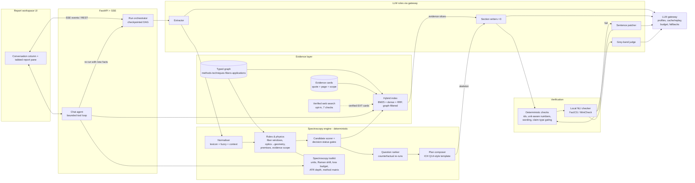

# PRISM v2: target architecture

**Status:** proposal for review (2026-10-17). Supersedes the generation and verification parts of `docs/AI_ARCHITECTURE.md`. Keeps its knowledge layer, rules and decision logic.
**Evidence:** research brief `reports/Grounded spectroscopy assistant architecture.md` (5 research notes in `research_notes/`), plus first-hand measurements on the GWDG endpoint (§2).

---

## 0. Decision in one page

PRISM v2 is an **evidence-first, engine-led pipeline**. A deterministic spectroscopy engine decides; LLMs extract and write, in short parallel pieces; layered verifiers check every sentence.

| Concern | v1 (today) | v2 (decision) | Why |
|---|---|---|---|
| Orchestration | Fixed pipeline | **Keep a fixed, checkpointed DAG.** The only agent is in chat, as a bounded tool loop. | Known steps. Agents cost about 4–15× the tokens and succeed under 50 % on hard tasks. |
| Knowledge | Evidence cards + typed graph + BM25/dense RRF | **Keep.** Add deterministic context headers on cards. Put the whole card catalogue in context where the provider caches it. **No** GraphRAG, LightRAG, RAPTOR or ColPali. | A tiny curated corpus. Plain retrieval matches graph methods on fact lookup. LLM-built graphs miss about 34 % of entities and rarely abstain. |
| Generation | One monolithic JSON draft (about 2,200 tokens, 24 s) | **Engine skeleton, then 3 section writers in parallel, then streamed into the UI.** Code fills every field it can. The model returns prose plus card IDs only. | The model decodes at 114 tok/s; one long sequential call is the bottleneck. 4 parallel calls finish in 6.7 s. |
| Verification | LLM critic on every sentence (8 s), then a whole-report repair (about 2,200 tokens, 30 s) | **Layered checks:** deterministic and unit-aware numbers, then claim-type gating, then a small local NLI checker, then an LLM judge only for the grey band. A **per-sentence patch** replaces whole-report repair. | Small checkers (0.4–0.8 B) score like 70 B judges on LLM-AggreFact. Patching keeps about 80 % of the text. Full repair was the slowest step. |
| Decision status and questions | Engine-owned | **Keep.** Formalise question ranking as counterfactual engine re-runs with expert priors (value of information). | Model confidence is overconfident; structural signals are reliable. |
| Domain tools | Rules plus spectral chart | **Add a deterministic spectroscopy toolkit:** unit and Raman-shift conversion, fiber window and loss budget, ATR penetration depth, method matrix, validation-plan checker. The engine and the chat agent share it. | ChemCrow pattern: tools beat fluent text for experts. |
| Web | Opt-in, verified (7 checks) | **Keep.** Trigger it in CRAG style only when AFS evidence for the application is thin. | AFS materials stay the main source (challenge rule). |
| Presentation | Chat-like flowing report | **Report workspace with tabs** (Overview · Methods · Spectral · Concept · Plan · Questions · Evidence · Checks). Sections stream into their tabs. | Scientists compare and check; tabs fill progressively. |

**Latency target** (standard mode):
- First verdict on screen ≤ 5 s.
- Full verified report ≤ 15–18 s, against 40–72 s today.
- Deep mode ≤ 45 s.

**Budget:** 4–6 LLM calls per report, against 4–5 today. That stays inside 200 requests/hour and 3,000/month.

The same architecture is best on any state-of-the-art model (Claude, GPT, Gemini or open-weight). The provider changes capability adapters, not the design (§6).

---

## 1. Requirements the architecture must satisfy

Sources: the challenge brief (pages 1–2), `AFS_Examples_and_Reference.docx` §3–4, and `docs/SOLUTION_PLAN.md` §8.

| # | Requirement | Architectural consequence |
|---|---|---|
| F1 | Extract requirements and constraints from natural language | A typed extractor with verbatim quote grounding; code verifies every quote. |
| F2 | Ask important clarification questions when information is missing | Unknown slots are detected deterministically. Questions are ranked by how much they would change the decision. |
| F3 | Recommend method(s) or combinations worth testing, at least one always | The engine produces feasible candidates. Even INSUFFICIENT_INFORMATION and OUTSIDE_SUPPORTED_SCOPE carry a SCREENING recommendation. |
| F4 | High-level probe and measurement concept | Rules map optical state to probe geometry, plus a fiber link check per stream. |
| F5 | Explain recommendation, limitations, uncertainty | Rationale cites cards; the decision status comes from rules; limitations come from the method matrix. |
| F6 | Short feasibility-study plan | A template from AFS practice and ICH Q14 logic: required performance, then representative samples, then reference method, then single-method models, then a go/no-go agreed with the client. |
| G1 | AFS materials are the main source; every important recommendation shows its source | Evidence cards (page plus verbatim quote). `P-AFS-CITATION`. External sources only quoted and verified. |
| G2 | No invented spectra, figures, detection limits, prices, guarantees, or client facts | A unit-aware number guard, wording guard, and claim-type gating. Code fills client facts from the extraction. |
| G3 | H01–H06 generated by the assistant; no manual editing; no case-specific hard-coding | Generic rules with citations. The replay cache and manifest hashes give `verify-outputs`. |
| G4 | The jury may ask for a live run | **Latency is a requirement**: a verdict in seconds, a full report in under 20 s, and replay when there is no network. |
| G5 | Structured output: requirements, questions, recommendation, risks, plan | The `AssessmentReport` schema, plus Markdown in the worked-example layout. |
| Q1 | Explainable and easy to review (10 %) | Pipeline trace, "why" links from rule to card, a Checks tab, and provenance on every value. |
| Q2 | Provider-agnostic; the GWDG key is temporary | A role-based gateway and per-provider profiles (§6). |
| Q3 | Fits the provider budget (measured: 30/min, 200/h, 1000/day, 3000/month; **the monthly cap binds**: 500–750 reports a month at 4–6 calls each) | At most 6 calls per report; deterministic scope, a local verifier and expert-authored question text save calls. Cache and replay; the budget meter is already in place. |

---

## 2. Diagnosis of v1 (measured)

**Stage timings.** These come from a stored live run on GWDG (D01, 72 s) and the run manifests. Eval mean: 56 s.

| Stage | Time | Type | What happens |
|---|---|---|---|
| scope | 0.0 s | deterministic | Signals (an LLM classifier runs only when ambiguous) |
| extract | 4.2 s | LLM (Qwen3.5-397B) | Requirements sheet |
| normalise, rules, retrieve | < 0.1 s | deterministic | Engine, candidates, evidence pack |
| **draft** | **24.2 s** | LLM (Qwen3.5-397B) | **One JSON report, median 2,180 output tokens** |
| verify | 7.7 s | deterministic + LLM (Gemma 4 31B) | Critic judges every sentence |
| **repair** | **36.1 s** | LLM (Qwen3.5-397B) | **Regenerates the whole report** (runs on most enquiries) |

**Endpoint benchmark** (2026-10-17, streaming, thinking off, about 500 output tokens):

| Model | Time to first token | Decode speed |
|---|---|---|
| Qwen3.5-397B-A17B | 0.16 s | 114 tok/s |
| DeepSeek V4 flash | 0.12 s | 142 tok/s |
| Qwen3-30B-A3B | 0.15 s | 219 tok/s |
| Gemma 4 31B | 0.14 s | 55 tok/s |

- **4 parallel Qwen3.5 calls:** 6.7 s wall clock for about 1,900 tokens.
- **JSON-schema vs JSON-object mode:** 94.5 vs 95.3 tok/s, no measurable difference between the two constrained modes. That doesn't prove zero overhead against free text, but schema decoding is not what makes v1 slow.

**Root causes:**
1. **Decode-bound monolith.** Every report waits for about 2,200 tokens from one sequential call, about 20–25 s at about 95 tok/s. One run hit the 12,000-token cap, about 2 minutes.
2. **Whole-report repair.** One failing sentence makes the model rewrite all 2,200 tokens.
3. **Sequential everything.** Nothing overlaps; the UI shows nothing until the end.
4. **Critic over-scoring.** A binary judge scores ASSUMPTION, PROPOSAL and UNKNOWN sentences, which have no quote to support them. That explains part of the 0.65 claim-support rate and triggers needless repairs.
5. **The LLM writes fields that code knows:** requirements, spectral ranges, plan structure and evidence strength. Task 21b already showed that code-filled fields are more correct and remove tokens.

The deterministic core is not the problem: it runs in under 0.1 s. The LLM work must become **smaller, parallel, targeted and streamed**.

---

## 3. Target architecture

### 3.1 Components and how they connect



**Data contracts**, all Pydantic and versioned in the manifest:
- **`RequirementsSheet`:** streams, targets, matrix, optics, conditions, premises, client question, unknown slots, each with a verbatim quote.
- **`EngineResult`:**
  - findings and candidates with scores;
  - decision status;
  - ranked questions with what each changes;
  - spectral windows;
  - plan skeleton;
  - an evidence slice per section.
- **`ReportSkeleton`:** every code-filled field, plus empty prose slots, each slot tagged with its section, allowed claim types and allowed card IDs.
- **`SectionDraft`:** prose segments `{text, claim_type, card_ids}` for one section.
- **`ClaimVerdict`:** `{path, layer, verdict: supported | partial | unsupported | not_applicable, score, action}`.
- **`AssessmentReport`:** unchanged public schema (the frontend and outputs keep working).

### 3.2 Run timeline and latency budget (standard mode, open-weight profile)

```text
time (s)      0    1    2    3    4    5    6    7    8    9   10   11   12   13   14   15
scope         ▌                                                    deterministic signals
extract       ░░░░░░░░░░░░░░░░                                     LLM, ~350 tokens
engine                         ▌                                   rules, scores, status, questions, skeleton
UI                             ★ verdict + candidates + spectral chart + questions on screen (~4 s)
writer A                        ░░░░░░░░░░░░░░░░░░░░░░░░░░░░░░░░    answer + recommendations (≤ ~650 tokens)
writer B                        ░░░░░░░░░░░░░░░░░░░░░░░░░░░         concept + spectral caveats + risks
writer C                        ░░░░░░░░░░░░░░░░░░░░░░░░░░░         plan + questions + decision basis
verify                                                     ▓▓▓▓▓   deterministic + local NLI, per section as it lands
patch (if any)                                                  ░░░░░░░░  failing sentences only, fast model
UI                                                         ★ sections fill their tabs; ★ full report ≈ 12–15 s
```

| Milestone | v1 | v2 target | How |
|---|---|---|---|
| Something useful on screen | 72 s | **≈ 4 s** | The engine result streams as soon as extraction ends: status, candidates, spectral chart, questions, evidence list. |
| Full report, no fixes needed | 40–56 s | **≈ 12 s** | Parallel writers; at most about 650 tokens each; code-filled fields. |
| Full report with 1 patch round | 56–72 s | **≈ 15 s** | Sentence-level patches on the fast model (Qwen3-30B, 219 tok/s). |
| Deep mode | 90 s+ | **≤ 45 s** | Reasoning on, only for writer A and the grey-band judge. |

**Calls per report:**

| Call | Count |
|---|---|
| Extract | 1 |
| Writers | 3 |
| Grey-band judge | 0–1 |
| Patch | 0–1 |
| Scope classifier (ambiguous enquiries only) | 0–1 |

That is **4–6 calls**, against 4–5 today, so 200/hour still allows 33–50 reports per hour.

### 3.3 The stages in detail

1. **Intake and scope guard (deterministic first).** Keyword and lexicon signals cover most enquiries in milliseconds. The Gemma classifier runs only in the ambiguous band. Off-topic or unsafe input gets a refusal with suggestions. No other stage runs.

2. **Extraction (one LLM call, typed).**
   - It returns a `RequirementsSheet` under JSON-schema decoding, with evidence fields before conclusion fields.
   - Every value carries a verbatim quote; code rejects quotes not found in the enquiry.
   - New fields come from the domain research:
     - required performance (accuracy, range, response time), as the ICH Q14 "analytical target profile";
     - reference method and its error;
     - GMP impact (release vs monitoring);
     - sampling location and access.

     Unknown values stay unknown, never guessed.

3. **Spectroscopy engine (deterministic, < 100 ms).**
   - **Kept:** normalisation, the 14 rules, and candidate scoring.
   - **Added:**
     - (a) the toolkit (§3.5) as engine functions;
     - (b) **question ranking as value of information.** For each unknown slot, re-run the engine over 2–4 plausible values set by expert priors. Rank by how often the primary method, technique or status changes. This formalises today's question seeds; they become measurable;
     - (c) **plan composition from the template**, with steps parameterised by streams, targets, reference method and candidates;
     - (d) a **skeleton** that pins every factual field, so writers only write prose.
   - The status is computed here; an LLM may only make it stricter. This is enforced as a **monotone merge** (`final = max_strictness(engine, llm)`) with a property test over random inputs.

4. **Evidence selection (graph-first, then hybrid recall).**
   - The graph selects the mandatory cards per candidate (method range, technique, fiber, application).
   - BM25 + dense + RRF adds recall over cards with **deterministic context headers** (document, page, section, method, application, scope). This is the zero-cost version of contextual retrieval.
   - Each writer gets only its **evidence slice**, about 6–15 cards with IDs and verbatim quotes. On providers with prompt caching, the **whole card catalogue** (about 15–25k tokens) sits in a cached prefix and the slice is listed as "preferred cards". That is cache-augmented generation without losing precision.
   - **CRAG-style trigger:** if no `process_application` card matches the domain and target, the run marks "AFS evidence thin" and, if Web is on, calls the verified web stage. Otherwise the gap becomes an explicit unknown.

5. **Section writers (3 parallel LLM calls, streamed).**
   - The writers:
     - **A:** direct answer and recommendation rationale;
     - **B:** measurement concept, spectral caveats, risks and limitations;
     - **C:** plan wording, question wording, decision basis.
   - Each call returns `SectionDraft` JSON with `max_tokens` around 900, which ends runaway outputs.
   - Prompts carry the shared report state: status, candidates and the skeleton. That keeps the sections consistent, which is the known weakness of skeleton-of-thought.
   - The writers may cite only the card IDs they were given. Code attaches quote and page (the model never copies quotes).
   - Each section is emitted as an SSE `section_ready` event the moment it passes verification.

6. **Layered verification (about 1–2 s, mostly local).**
   1. Deterministic checks (< 10 ms): IDs exist and are allowed for that slot, claim-type rules, guarantee and over-claim wording, and "no optimal band without spectra".
   2. A **unit-aware number guard** (< 50 ms). Every number with its unit must appear in a cited quote, the client's text, or a tool result marked `computed`. Numbers are normalised across units (nm ↔ µm ↔ cm⁻¹, °C ↔ K).
   3. **Claim-type gating.** Only CLIENT, AFS and EXTERNAL sentences are checked for support. ASSUMPTION, PROPOSAL and UNKNOWN are checked only for honest labelling.
   4. A **local NLI checker**: FactCG-DeBERTa-L (0.4 B) or MiniCheck-Flan-T5-L (0.8 B, MIT), run on (cited quotes, sentence) and batched. Thresholds come from a 150–300-sentence expert-labelled set, with a **grey band** instead of a single cut-off.
   5. An **LLM judge only for the grey band.** It uses a 3-level rubric (supported / partial / unsupported) with expert few-shot examples. Gemma or DeepSeek; deep mode uses `critic_deep`.

7. **Targeted patching (0–1 call).**
   - Only failing sentences are sent, each with its cited quotes. Allowed actions, in order:
     - relabel the claim type, for example to ASSUMPTION;
     - hedge;
     - rewrite constrained to the quote, with an edit-size cap;
     - delete.
   - Partially supported sentences are split, and the supported clause is kept verbatim.
   - Re-verify, at most 2 rounds. Anything still failing is removed and logged in the Checks tab.
   - Runs on the fast model (Qwen3-30B-A3B).

8. **Assemble, render and record.**
   - Merge skeleton and verified sections into `AssessmentReport`.
   - Compute compliance from the final body.
   - Render Markdown in the worked-example layout.
   - Write the manifest: models, prompt hashes, timings, verdicts, budget.
   - Replay mode reproduces this bit for bit.

### 3.4 Chat assistant (the one agent)

- **Shape:** a single bounded tool loop with a step cap of 6, read-only or idempotent tools, and the same verifier on every answer.
- **Tools:**
  - `kb.search`, `kb.card`, `report.section`;
  - `engine.explain_rule`, `engine.what_if(slot=value)`, which runs the counterfactual engine without an LLM;
  - the spectroscopy toolkit;
  - `web.search` and `web.verify` (when Web is on);
  - `run.reassess(new_facts)`.
- **Client answers:** when the user pastes a reply, the agent maps the answers to slots, shows a preview of what changes (`what_if`), and then re-runs.
- **Escalation:** the agent hands over to the human when the engine and the LLM disagree, when the result is out of scope, or when a premise is contradicted.

### 3.5 Spectroscopy toolkit (deterministic, unit-tested)

| Tool | Example (test value) | Used by |
|---|---|---|
| `convert(value, from, to)` | 785 nm = 12,738.9 cm⁻¹ | engine, chat, number guard |
| `raman_absolute(shift_cm1, excitation_nm)` | 1000 cm⁻¹ at 785 nm = 851.9 nm; at 532 nm = 561.9 nm | spectral windows, detector and fiber checks |
| `fiber_window(fiber, method)` | silica ≈ 0.18–2.4 µm vs MIR 2.5–25 µm, so blocked | `R-FIBER-WINDOW` |
| `loss_budget(fiber, length_m, dB_per_m)` | Needs a cited dB/m and never invents one; otherwise it returns "ask" | link-length rule |
| `atr_depth(n1, n2, angle, wavenumber)` | Diamond/ZnSe at 1000 cm⁻¹ = 2.01 µm (matches the Specac table) | concept, chat |
| `method_matrix(target, matrix, optics)` | Table 1 (xlsx); each cell is cited or marked as judgement | scorer, Methods tab |
| `validation_plan_check(plan)` | Applies only cited rules and never recommends a sample count | plan composer |

Every tool result carries provenance `computed`, so the number guard accepts it and the UI labels it.

### 3.6 Presentation (implemented in parallel)

- **Layout:** the conversation column sits on the left. The **report pane** on the right has a sticky header (status, verdict, key facts, actions) and tabs: **Overview · Methods · Spectral · Concept · Plan · Questions · Evidence · Checks**.
- **During a run:** the verdict, candidates and spectral chart appear at about 4 s from the engine event. The other tabs fill as their `section_ready` events arrive.
- **Provenance:** every value carries a label, as recommended by the PAT documentation norms. The labels are client, AFS source (with page), external (verified), computed, assumption and unknown.

---

## 4. Decisions and the alternatives we rejected

| Decision | Chosen | Rejected and why |
|---|---|---|
| Orchestration | Deterministic checkpointed DAG; agent only in chat | **ReAct or plan-and-execute for the report:** about 4–15× tokens, lower reliability (τ-bench under 50 %), not reproducible for `verify-outputs`. **Multi-agent:** most failures are coordination (MAST 2025). |
| Retrieval | Curated cards + typed graph + hybrid RRF + context headers; cached catalogue where available | **GraphRAG or LightRAG:** 70–115 M indexing tokens on comparable corpora, entity coverage about 66 %, abstention 19 % vs 96 % for RAG. **RAPTOR:** its summaries paraphrase, which breaks verbatim citation. **ColPali / ColQwen:** valuable at 10× corpus size; at 60 pages, reviewed VLM transcriptions plus cards are cheaper and citable. **Pure long context:** good at 20–40k tokens, but RAG is better on unanswerable questions (LaRA), and we must abstain. |
| Generation | Engine skeleton + 3 parallel writers + streaming | **Monolithic draft:** decode-bound (§2). **Free skeleton-of-thought:** an extra call and weak coherence; our skeleton is deterministic and free. **Speculative decoding:** server-side only, outside our control. |
| Structured output | JSON schema per section; evidence before conclusion fields | **Free text then parse:** schema decoding showed no measurable cost against JSON-object mode (94.5 vs 95.3 tok/s), and free text brings more parse failures. |
| Verification | Layered: deterministic → NLI → grey-band judge → patch | **Judge every sentence:** slower, binary, and as accurate as a 0.4–0.8 B checker. **Regenerate all:** 30 s, and it can introduce new errors. **Self-correction without a verifier:** unreliable (Huang et al., 2024). |
| Questions | Counterfactual engine re-runs (value of information) | **LLM-ranked questions:** LLMs rarely ask good clarifying questions unprompted, and their confidence is overconfident. |
| Model choice | Static routing per role | **Per-query routers (RouteLLM):** they optimise cost, not latency, and the router itself errs (about 55 % in Adaptive-RAG). |
| Domain model | General LLM + retrieval + deterministic tools | **Chemistry-tuned LLMs:** general models with retrieval beat them on lab benchmarks (ACL 2026 findings), and SpecX shows LLMs lack spectral grounding. |

---

## 5. Quality and evaluation

- **Golden set.** D01–D08, 12 synthetic traps, and 30–50 new enquiries, each with gold card IDs, expected status and expected premise verdicts. H01–H06 stay held out.
- **Claim set for calibration.** 150–300 sentences labelled by the domain expert as supported, partial or unsupported. It sets the NLI thresholds and the grey band, and supplies few-shot examples for the judge. Report agreement with confidence intervals (ARES-style prediction-powered inference).
- **Metrics:**
  - decision-status accuracy;
  - trap handling;
  - citation existence and quote fidelity, which must be 1.0 by construction;
  - claim support by layer;
  - invented numbers, which must be 0;
  - question value: the share of top-3 questions that change the decision in a counterfactual;
  - plan completeness;
  - **time to verdict, time to full report, calls per report.**
- **Ablations for the slides:**
  - v1 vs v2;
  - with and without the NLI layer;
  - with and without the cached catalogue;
  - section-parallel vs monolithic.
- **Regression gate.** Run `make eval` on every KB, rule or prompt change. A drop greater than the confidence interval blocks the freeze.

---

## 6. Provider profiles: the same architecture on any state-of-the-art model

A stronger model (Claude, GPT, Gemini, or a newer open-weight model) raises the quality of extraction and writing. It does **not** remove the need for the deterministic engine. Five challenge requirements depend on the engine, not on model strength:
- traceable, reviewable reasoning;
- status rules that are not hard-coded per case;
- reproducible H outputs (`verify-outputs`);
- no invented numbers;
- physics checks such as fiber windows.

The architecture is therefore **capability-based**. Each gateway profile declares which capabilities its provider has (the `capabilities` block in `config/llm.yaml` already exists). Each stage uses a capability when it is present and a fallback when it is not.

### 6.1 Capabilities PRISM can use, with fallbacks

| Capability | What PRISM uses it for | Fallback when the provider lacks it |
|---|---|---|
| **Structured outputs** (JSON schema) | Extraction, section drafts, grey-band verdicts | Prompted JSON, then validate, then one JSON repair (already in the gateway) |
| **Document citations that return the exact source span** | Writers cite evidence cards natively, and the quote comes back verbatim | **Card IDs only; code attaches quote and page** (today's design, works everywhere) |
| **Prompt / context caching** | The whole card catalogue and system prompt as a cached prefix (cache-augmented generation) | Per-writer evidence slices (about 6–15 cards) |
| **Fast, cheap model tier** | Scope classifier, extraction, grey-band judge, sentence patcher | The main model with tight `max_tokens` |
| **Reasoning control** (effort or thinking on/off) | Deep mode only: writer A + judge; standard mode keeps reasoning low/off for speed | Use separate deep-model role |
| **Streaming** | Section text streams into the report tabs | Section events after each call (still parallel) |
| **Batch API** | Evaluation runs at lower cost, outside interactive rate limits | Sequential eval under the budget meter |
| **Server-side web search with citations** | Optional external search | PRISM's own scholarly search + 7-check verifier (always applied anyway) |
| **Hosted file search (managed RAG)** | Not used for answers: PRISM selects evidence itself (graph + rules) so selection is explainable and abstention works | — |
| **Long context (≥ 200k tokens)** | Full catalogue in context; long chat sessions | Slices + retrieval |

### 6.2 How the main providers map (verify model IDs and prices before switching)

| Part | Open-weight via vLLM (GWDG today: Qwen3.5-397B, DeepSeek V4 flash, Gemma 4, Qwen3-30B) | Anthropic Claude (Haiku 5.5 / Sonnet 5.5 / Opus 5.5) | OpenAI (fast / flagship / reasoning tiers) | Google Gemini (Flash / Pro tiers) |
|---|---|---|---|---|
| Extraction, scope, judge, patch | Qwen3-30B or Gemma; JSON schema via guided decoding | Haiku 5.5 with structured outputs | Fast tier with strict JSON-schema structured outputs | Flash tier with a response schema |
| Section writers | Qwen3.5-397B; card IDs and code-attached quotes | Sonnet 5.5 (deep: Opus 5.5) with the **Citations API**, where each card is one block of a "custom content" document, so a citation is a block index, which is a card ID, with a verbatim `cited_text` that is not billed as output. Citations and structured outputs can't be combined in one call, so writers return cited prose and code fills the fields. | Flagship tier with structured outputs; card IDs and code-attached quotes. The hosted file search cites at file level only (`file_citation`: file id + index), not the exact span. | Pro tier with a response schema; card IDs and code-attached quotes. The hosted File Search gives page-level citations (May 2026 update), still coarser than our card-level quotes. |
| Evidence context | Slices (prefix caching unreliable for this hybrid-attention model on vLLM) | Prompt caching of the catalogue prefix; reads are about 0.05–0.1× the input price and don't count toward input rate limits | Automatic prompt caching of long shared prefixes | Implicit or explicit context caching |
| Web | Own search + verifier | Web search / fetch server tools (domain allow-lists), then our verifier | Web search tool (URL citations), then our verifier | Google Search grounding, then our verifier |
| Eval | Sequential, budget meter | Message Batches API | Batch API | Batch mode |

### 6.3 Which provider is best for this case?

- **Groundedness and citation fidelity.** Native span-level document citations fit PRISM's card model directly. Today that favours **Claude**: card-level, verbatim, valid by construction. With other providers, PRISM keeps "card IDs + code-attached quotes", which is equally verbatim. The model just doesn't get native help in choosing spans.
- **Latency.** What matters is decode speed of the writer tier and parallel throughput, not brand. Run `scripts/bench_llm.py` (TTFT, tokens/s, 4-way parallel) on each candidate profile. Today's GWDG numbers (114 tok/s, 6.7 s for 4 parallel sections) already meet the 15–18 s target.
- **Data terms.** AFS promises "your data stays yours". Choose the provider whose retention, region (EU) and NDA terms fit. An open-weight model on EU infrastructure is the strictest option.
- **Decision rule.** Run the same golden-set eval (§5) and benchmark on 2–3 candidate profiles. Pick the one that meets the quality bars at the lowest latency and cost and that passes the data-terms review. The architecture, schemas, engine, verifier and UI do not change; only `config/llm.yaml` and one adapter (if a provider-specific feature such as Claude Citations is used) change.

---

## 7. What makes it a good assistant for spectroscopy scientists

Beyond answering the challenge, the domain research says experts need these:

1. **Required performance first.** Ask for target accuracy, range, reference method and its error, response time, and GMP impact. Go/no-go is a comparison of target accuracy, reference-method error and the RMSEP shown in the study. No standard gives a fixed rule, so PRISM never invents one; it proposes the comparison and asks the client to agree the threshold.
2. **Known traps as rules, with citations:**
   - water absorption (NIR/MIR) vs Raman for aqueous systems;
   - fluorescence in Raman;
   - fiber windows and cable length;
   - representativeness of the sampling point;
   - fouling, temperature band shifts, particle size and scatter;
   - calibration transfer across matrices;
   - chance correlations between analytes.
3. **Calculators instead of prose** for anything numeric (§3.5).
4. **Provenance everywhere**, and unknowns shown as unknowns.
5. **Expert in the loop.** A review queue for draft cards and rule messages, versioned KB releases, and feedback ("correct this sentence") that becomes test cases and cards, never silent prompt drift.
6. **Corrected references.**
   - USP 〈1119〉 is now split, with 〈856〉 for qualification and validation.
   - USP 〈1120〉 was replaced by 〈858〉/〈1858〉.
   - Ph. Eur. 2.2.48 (Raman) was revised and took effect in 2022.
   - ASTM E1655 sample counts are paywalled and must not be hard-coded.

---

## 8. Migration plan (each phase ships on its own)

| Phase | Scope | Expected effect | Effort |
|---|---|---|---|
| **A. Stop the bleeding** | `max_tokens` caps per call. The critic scores only CLIENT/AFS/EXTERNAL sentences. Repair patches failing sentences only, with whole-report repair removed. More code-filled fields (plan structure, decision basis). | 72 s → about 30 s; claim support up; no runaways. | 0.5–1 day |
| **B. Parallel and streamed** | Skeleton contract, 3 parallel writers, `section_ready` SSE events, and engine result streamed first. UI tabs fill progressively. | Verdict in about 4 s, full report in about 12–15 s. | 1–1.5 days |
| **C. Verification stack** | Local NLI checker (FactCG or MiniCheck, CPU), unit-aware number guard, grey-band judge, expert claim set and calibration. | Calibrated support metric; verification about 1–2 s. | 1 day + expert time |
| **D. Toolkit and value of information** | Spectroscopy toolkit, counterfactual question ranking with expert priors, the new extraction fields (required performance, reference error, GMP impact), and chat `what_if`. | Better questions (15 %) and plans (15 %); numeric honesty. | 1–1.5 days |
| **E. Provider profiles** | Capability adapters (native citations, prompt caching, batch) for the chosen frontier provider(s); a provider bake-off running the same benchmark and golden-set eval on 2–3 profiles. | Ready for the project's real provider. | 0.5–1 day per provider |
| **F. Expert loop** | Review queue for cards and rules, feedback capture, KB release versioning. | Sustainable quality after the hackathon. | 1–2 days |

**Hackathon cut-line:** A + B before the freeze (they change latency and quality the most and keep the public schema). C and D if time allows. E and F after.

---

## 9. Risks and open questions

| Risk | Mitigation |
|---|---|
| Parallel sections disagree with each other | Shared skeleton and status in every prompt; code owns all facts; a cross-section consistency check (same methods, same status). |
| Local NLI checker accuracy on spectroscopy prose is unknown (trained on news and Wikipedia) | Calibrate on the expert claim set; grey band goes to the LLM judge; report agreement with confidence intervals. |
| More calls per report under 200/hour | At most 6 calls; replay cache; batch eval on Claude; the budget meter warns before deep runs. |
| Expert priors for question ranking are guesses | Start uniform over plausible values; the expert edits priors in YAML; rankings are shown with the outcome changes they imply. |
| Provider caching or speed differs from today's benchmark | Run `scripts/bench_llm.py` on each profile before switching; the architecture does not depend on caching. |

**Open questions for the team:**
1. Is the NLI checker allowed to run on the demo laptop's CPU? It needs `torch` and a model download of about 1.6 GB.
2. Does the jury demo need Web on? It adds about 10–20 s, and the external calls are not cached on first use.
3. Which provider will AFS use in production? This decides whether phase E comes before C.
