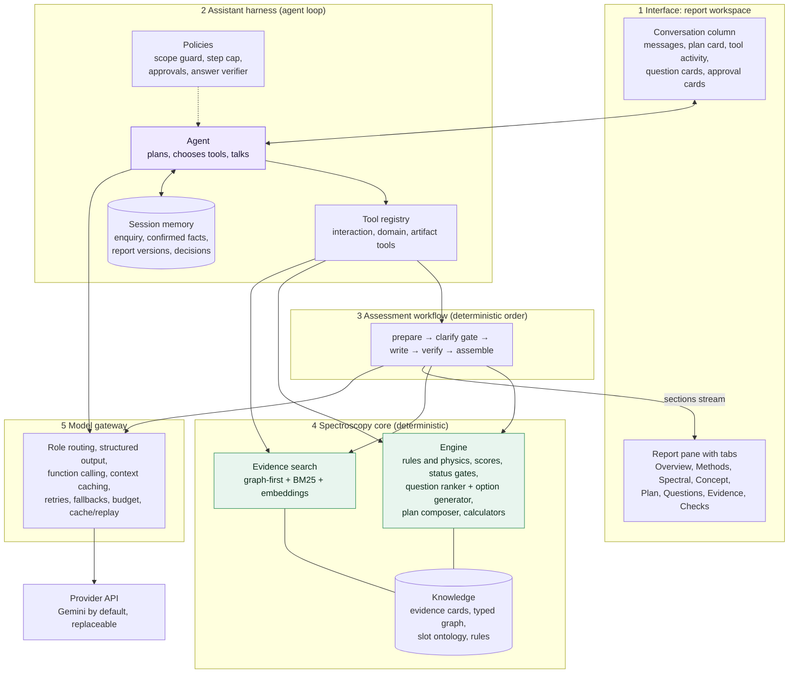
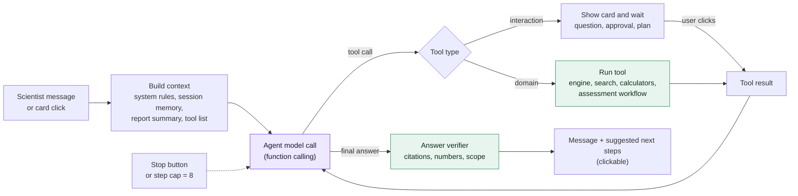
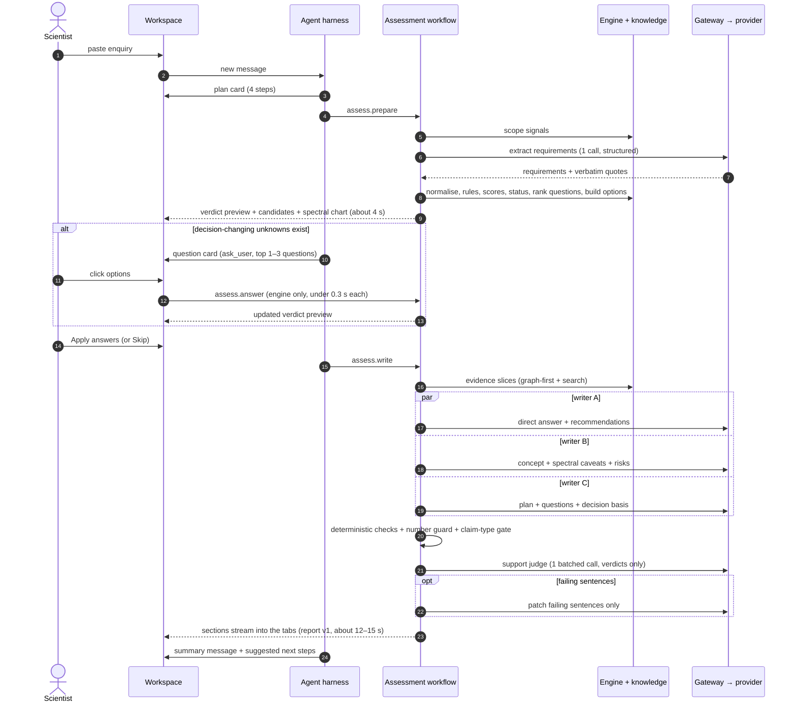
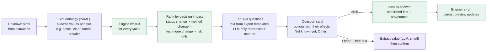

# PRISM Assistant: requirements and architecture pipeline

**Status:** proposal for review (2026-10-18). Nothing in this document is implemented yet.

**What it is:** a professional assistant for spectroscopy scientists, built like Claude Code.

- It plans, uses tools, and shows what it is doing.
- It asks questions with options you can click.
- It produces a cited feasibility report.

**How it relates to the other architecture docs:**

- `docs/ARCHITECTURE_V2.md` is the detailed design of the assessment workflow this assistant calls (latency analysis, verification cascade, research decisions).
- `docs/AI_ARCHITECTURE.md` describes the current system (v1).

**Model provider:** Gemini (Google AI Studio key) is the default profile. Models are configured per role in `config/llm.yaml`, so any provider can replace it later. No local models are used.

---

## Part A. Requirements

Each requirement gives its source and how it is checked. Source codes:

- **B:** the challenge brief.
- **X:** `AFS_Examples_and_Reference.docx`.
- **H:** the notes in the evaluation-scenario file.
- **U:** your requests in this project.

### A.1 What the assistant must do (functional)

| ID  | Requirement                                                                                                                                                                                                       | Source  | Acceptance check                                                                             |
| --- | ----------------------------------------------------------------------------------------------------------------------------------------------------------------------------------------------------------------- | ------- | -------------------------------------------------------------------------------------------- |
| F1  | Accept a customer or process description in natural language (pasted text or attached file).                                                                                                                      | B       | Any enquiry text starts an assessment.                                                       |
| F2  | Extract the main process requirements and constraints. Keep the facts the client stated separate from key unknowns. Never fill in missing facts.                                                                  | B, X, H | Every stated fact carries a verbatim quote from the enquiry. Unknowns are listed as unknown. |
| F3  | Ask important clarification questions when information is missing. Ask first the ones that could change the method or setup.                                                                                      | B, X    | 3–6 questions, ranked by decision impact, each saying what it would change.                  |
| F4  | **Ask interactively, like Claude:** questions arrive as cards with options to click (plus "Not known yet" and "Other…"). The answers update the assessment.                                                       | U       | One click updates the verdict in under 0.5 s. Answers are stored with their provenance.      |
| F5  | Recommend at least one spectroscopy method or combination worth testing, with reasons and conditions. "Insufficient information" with a screening plan is a valid answer.                                         | B, X    | Every report has at least 1 recommendation, even with INSUFFICIENT_INFORMATION.              |
| F6  | Suggest a high-level probe and measurement concept: geometry, measurement location, fiber link.                                                                                                                   | B, X    | At least one concept per process stream.                                                     |
| F7  | Give spectral ranges in correct units. A nominal range is not an instrument range. State Raman excitation separately from Raman shift.                                                                            | X       | Unit checks pass; no "optimal band" is picked without spectra.                               |
| F8  | Explain the recommendation, its limitations and uncertainty. List risks and the assumptions it rests on.                                                                                                          | B, X    | Risks, assumptions and limitations sections are present.                                     |
| F9  | Propose a short first feasibility-study plan: representative samples, independent reference results, what is compared, a go/no-go basis agreed with the client.                                                   | B, X    | Plan-completeness check passes, with at most 6 steps.                                        |
| F10 | Answer the client's direct question (yes / no / not yet / conditional) and give a decision status (provisional / insufficient information / outside supported scope).                                             | X, H    | The direct answer and status appear first.                                                   |
| F11 | Notice premises the sources contradict, and enquiries outside the sources.                                                                                                                                        | X       | The trap cases in the test set are handled.                                                  |
| F12 | Show the source for every important recommendation. Cite as `S01 p.10`, slides by number, the table as `S01 Table 1 (p.6)`. The page must support the claim at its scope.                                         | B, X    | Every cited ID exists, every quote is verbatim, and claim support is checked.                |
| F13 | AFS materials stay the main source. An external citation includes the quoted passage and the link. Web search is opt-in, and only verified sources are used.                                                      | B, X, U | External claims cite verified web cards only.                                                |
| F14 | Follow-up conversation: answer questions about the report, take new client facts, re-assess, and keep report versions with a diff.                                                                                | U       | Report v2 shows what changed.                                                                |
| F15 | Stay within scope (in-line spectroscopy assessment). Off-topic requests get a polite refusal with in-scope suggestions.                                                                                           | U       | The scope test cases pass.                                                                   |
| F16 | Structured output per case: requirements, questions, recommendation, risks, feasibility plan, as JSON, Markdown and the web view.                                                                                 | B       | The schema validates; Markdown follows the worked-example layout.                            |
| F17 | Generate the H01–H06 answers with the assistant, with no manual editing and no case-specific hard-coding, and commit them.                                                                                        | B       | `make answers` produces them; `make verify-outputs` reproduces them from the cache.          |
| F18 | The jury can run a scenario or a short new enquiry live.                                                                                                                                                          | B       | A live run finishes inside the performance budget, and replay works offline.                 |
| F19 | Read the image-only slides (S02) and use the xlsx method table.                                                                                                                                                   | X       | The slide transcriptions are reviewed; Table 1 cards come from the xlsx.                     |
| F20 | **Professional assistant UX, like Claude Code:** a visible plan with progress, transparent tool activity, approval prompts for costly or external actions, a stop button, and suggested next steps you can click. | U       | All interaction types exist in the UI (§B.4).                                                |
| F21 | Report workspace with tabs, charts, pipeline view and session history; AFS logo; Lumeo-style look.                                                                                                                | U       | Already built (`frontend/`).                                                                 |

### A.2 Quality targets (non-functional)

| ID  | Quality                   | Target                                                                                                                                                                    | Why                                                                         |
| --- | ------------------------- | ------------------------------------------------------------------------------------------------------------------------------------------------------------------------- | --------------------------------------------------------------------------- |
| Q1  | **Accuracy: decisions**   | The decision status agrees with the expert on the test set; 100 % of trap cases handled.                                                                                  | Technical quality is 30 % of the score; clarification and uncertainty 15 %. |
| Q2  | **Accuracy: grounding**   | 0 invented numbers; 100 % of cited IDs exist; 100 % of quotes verbatim; claim support ≥ 0.9 against the expert-calibrated judge.                                          | AFS knowledge counts 20 %; scientists check sources.                        |
| Q3  | **Performance**           | Question card or verdict preview ≤ 5 s; an option click updates the verdict in ≤ 0.5 s; full verified report ≤ 15–20 s; chat reply ≤ 6 s; deep mode ≤ 45 s.               | Live demo; scientists won't wait a minute per turn (today 40–72 s).         |
| Q4  | **Cost**                  | ≤ 8 LLM calls and about 40k tokens per interactive assessment (most of the input cached); ≤ 2 calls per chat turn. Cost = tokens × the chosen provider's price.           | Predictable spend on any provider; rate limits.                             |
| Q5  | **Reproducibility**       | The same input, knowledge base and models give the same report (cache and replay); the manifest records models, prompts and hashes.                                       | No manual editing of H outputs must be provable.                            |
| Q6  | **Explainability**        | Every value carries its provenance (client, confirmed in conversation, AFS source, external, computed, assumption, unknown). A pipeline trace and a Checks tab are shown. | Explainability counts 10 %; expert review.                                  |
| Q7  | **Privacy**               | Client enquiries are treated as confidential: provider data terms are checked (for example, a paid tier that does not train on the data); no secrets in logs.             | AFS: "Your data stays yours."                                               |
| Q8  | **Reliability**           | If the model fails or hits a rate limit: retry, fall back to another model, and always show the engine's result.                                                          | Demo safety.                                                                |
| Q9  | **Maintainability**       | The expert edits cards, rules and question options in YAML without code; every change runs the test set as a regression gate.                                             | Knowledge improves after the hackathon.                                     |
| Q10 | **Provider independence** | Gemini by default; switching to any other provider means changing configuration, plus at most one adapter. No local models.                                               | The project's provider and key may change.                                  |

---

## Part B. Architecture pipeline

### B.1 The idea in one paragraph

A **conversational agent** (the harness, like Claude Code) talks to the scientist, keeps a plan, and calls **tools**. The most important tool is a **deterministic assessment workflow**:

1. Extract requirements.
2. Run the spectroscopy engine.
3. Ask the questions that change the decision.
4. Write sections in parallel.
5. Verify every sentence.

The agent never decides spectroscopy facts on its own. **The engine decides the decision status and the candidate methods. The knowledge base supplies every citation. The LLM writes, explains and asks.** This combination gives the flexibility of an assistant with the accuracy of a rule-checked, cited pipeline.

### B.2 Layered architecture



| Layer       | Responsibility                                                                                              | Key rule                                                                      |
| ----------- | ----------------------------------------------------------------------------------------------------------- | ----------------------------------------------------------------------------- |
| 1 Interface | Shows the conversation and the report. Renders interactive cards (questions, plan, approvals, suggestions). | Every card is answered by a click. Free text is always possible.              |
| 2 Harness   | Runs the agent loop: understand the message, update the plan, call tools, stream events, answer.            | The agent can ask, explain and run tools. It cannot override the engine.      |
| 3 Workflow  | Produces a report in a fixed order. It can pause at the clarify gate for answers.                           | The same order in interactive and batch mode, so H outputs stay reproducible. |
| 4 Core      | Spectroscopy logic and knowledge: decisions, numbers, options and citations.                                | Deterministic, unit-tested, edited by the expert in YAML.                     |
| 5 Gateway   | Talks to the model provider by role.                                                                        | Provider-agnostic; Gemini profile by default.                                 |

### B.3 The agent loop (Claude-Code-style harness)



**Tools the agent can call:**

| Group       | Tool                                           | What it does                                                                                                     | Cost             |
| ----------- | ---------------------------------------------- | ---------------------------------------------------------------------------------------------------------------- | ---------------- |
| Interaction | `ask_user(questions[])`                        | Shows a question card. Each question has 2–5 options, plus "Not known yet" and "Other…"; single or multi-select. | no LLM           |
| Interaction | `update_plan(steps[])`                         | Shows and updates the plan checklist ("Understand enquiry ✓ · Clarify 2 questions · Write assessment · Verify"). | no LLM           |
| Interaction | `request_approval(action, why, cost)`          | Asks before costly or external actions: web search, deep mode, re-assessment.                                    | no LLM           |
| Interaction | `suggest_next(options[])`                      | Clickable follow-ups after an answer ("Draft client e-mail", "Compare NIR vs Raman").                            | no LLM           |
| Domain      | `assess.prepare(enquiry)`                      | Scope, extraction, engine → verdict preview and ranked questions with options.                                   | 1 LLM call       |
| Domain      | `assess.answer(slot, value)`                   | Applies a confirmed fact and re-runs the engine.                                                                 | no LLM, < 0.3 s  |
| Domain      | `assess.write(mode)`                           | Evidence, parallel writers, verification, report version.                                                        | 4–5 LLM calls    |
| Domain      | `engine.what_if(slot, value)`                  | Previews how an answer would change the decision, without saving it.                                             | no LLM           |
| Domain      | `engine.explain(rule_or_candidate)`            | Explains why a rule fired or a method scored as it did, with cards.                                              | no LLM           |
| Domain      | `kb.search(query)` / `kb.card(id)`             | Searches the AFS evidence and returns cards with quote and page.                                                 | embeddings only  |
| Domain      | `calc.*`                                       | Unit and Raman-shift conversion, fiber window, loss budget, ATR depth.                                           | no LLM           |
| Domain      | `web.search` / `web.verify`                    | Verified external literature (only after approval).                                                              | 1–3 calls + HTTP |
| Artifact    | `report.section(name)` / `report.diff(v1, v2)` | Reads the current report for answers.                                                                            | no LLM           |
| Artifact    | `draft_email()` / `export(format)`             | Customer e-mail draft; Markdown, JSON or PDF.                                                                    | 0–1 LLM call     |

**Harness rules:**

- At most 8 tool steps per user message.
- Interaction tools pause the loop until the scientist answers.
- Every final answer goes through the answer verifier: cited cards exist, numbers come from sources or tools, and the answer stays in scope.
- Engine results are shown as data, never re-stated from model memory.

### B.4 What the scientist sees (interaction types)

```text
┌ Plan ─────────────────────────────────────────────┐
│ ✓ Understand the enquiry          (3.1 s)         │
│ ● Clarify 2 open points            ← waiting       │
│ ○ Write the assessment                             │
│ ○ Verify every sentence                            │
└────────────────────────────────────────────────────┘
┌ 2 questions that change the recommendation ───────┐
│ 1. What does the product look like optically?      │
│    ( ) Clear liquid      → transmission probe      │
│    ( ) Turbid / opaque   → diffuse reflection probe│
│    ( ) Powder / solid    → reflection probe        │
│    ( ) Not known yet     ( ) Other…                │
│ 2. Is the result used for batch release (GMP)?     │
│    ( ) Yes, release      → stricter validation plan│
│    ( ) No, monitoring    ( ) Not known yet         │
│                       [ Skip ]  [ Apply answers ]  │
└────────────────────────────────────────────────────┘
⚙ Searched AFS sources · 12 cards        (expand)
⚙ Ran rules engine · 3 candidates, 1 premise flagged
┌ Approval ─────────────────────────────────────────┐
│ Search scholarly literature for in-line NIR in     │
│ powder blends? Uses about 3 extra calls.           │
│                        [ Skip ]  [ Search ]        │
└────────────────────────────────────────────────────┘
Next: [Draft client e-mail] [Compare NIR vs Raman] [Re-run deep]
```

- **Each option shows its effect.** The text comes from the engine's what-if run, so scientists see why a question matters (decision impact made visible).
- **Clicking an option updates the verdict preview at once.** The engine re-runs with no LLM call.
- **Answers are stored with provenance** "confirmed in conversation by ⟨scientist⟩". They are never mixed with the client's own words.
- **"Not known yet"** keeps the slot unknown. The report then states the assumption or lists the question for the client.

### B.5 The assessment pipeline (end to end, interactive mode)



**Stage by stage:**

| #   | Stage        | Type                                  | What happens                                                                                                                                                                                                                               | Time    |
| --- | ------------ | ------------------------------------- | ------------------------------------------------------------------------------------------------------------------------------------------------------------------------------------------------------------------------------------------ | ------- |
| 1   | Scope guard  | code (+ fast model only if ambiguous) | In scope, partial, off-topic or unsafe. Off-topic stops with suggestions.                                                                                                                                                                  | < 0.1 s |
| 2   | Extract      | LLM, mid tier, structured output      | Requirements sheet: streams, targets, matrix, optics, conditions, premises, client question, required performance, reference method, GMP impact. Every value has a verbatim quote, checked in code.                                        | 2–4 s   |
| 3   | Engine       | code                                  | Normalise terms; run rules and physics (fiber windows, optics to geometry, premises, evidence scope); score candidates; set the decision status.                                                                                           | < 0.1 s |
| 4   | Clarify gate | code + interaction                    | For each unknown slot, run the engine over the slot's options (value of information) and rank by how often the method, technique or status changes. Interactive mode asks the top 1–3; batch mode records them as questions in the report. | < 0.2 s |
| 5   | Evidence     | code + embeddings                     | Graph-first mandatory cards per candidate, plus BM25 and embedding search with RRF, one slice per writer. The whole card catalogue is a cached prefix where the provider supports caching.                                                 | < 0.5 s |
| 6   | Write        | LLM, 3 parallel calls                 | Each writer fills only prose slots of a code-built skeleton and cites card IDs. Code attaches quotes and pages and fills every factual field.                                                                                              | 6–8 s   |
| 7   | Verify       | code + 1 LLM call                     | Deterministic checks, unit-aware number guard, claim-type gate, then one batched support judge for AFS and external sentences.                                                                                                             | 2–3 s   |
| 8   | Patch        | LLM, 0–1 call                         | Only failing sentences: relabel, hedge, rewrite to the quote, or delete. At most 2 rounds; anything left is removed and logged.                                                                                                            | 0–3 s   |
| 9   | Assemble     | code                                  | Report JSON and Markdown, compliance, manifest, versioning, SSE `section_ready` / `run_completed`.                                                                                                                                         | < 0.1 s |

### B.6 Clarify gate: how questions and options are made



- **Options come from the ontology, not from the model.** They are always valid engine inputs, cost no tokens, and are the same every run.
- **Questions not asked in the conversation** (the scientist skipped them, or batch mode) go into the report's Questions tab as questions for the client, still ranked by impact.

### B.7 Modes

| Mode                      | Used for                                             | Clarify gate                                     | Models (Gemini profile, configurable)                                     |
| ------------------------- | ---------------------------------------------------- | ------------------------------------------------ | ------------------------------------------------------------------------- |
| **Interactive** (default) | Scientists in the workspace                          | Asks the top 1–3 questions as cards              | Mid tier for agent, extraction and writers; fast tier for judge and patch |
| **Batch**                 | H01–H06 official answers, evaluation, `make answers` | Records the questions in the report; never waits | Same roles, temperature 0, cache and replay → reproducible                |
| **Deep** (approval)       | Hard or high-stakes cases                            | As interactive                                   | Top tier with high thinking for writer A and the judge                    |
| **Web** (approval)        | Thin AFS evidence for the application                | As interactive                                   | Adds the verified web stage (search, fetch, 7 checks)                     |

### B.8 Model routing (Gemini profile; models replaceable in `config/llm.yaml`)

| Role                                           | Tier             | Gemini default                                       | Why this tier                                                                                    |
| ---------------------------------------------- | ---------------- | ---------------------------------------------------- | ------------------------------------------------------------------------------------------------ |
| Agent (conversation, tool choice)              | mid              | Gemini Flash, thinking low                           | Fast turns and reliable function calling                                                         |
| Extractor                                      | mid              | Gemini Flash, thinking low, structured output        | Quote-grounded extraction needs accuracy                                                         |
| Section writers ×3                             | mid (deep: top)  | Gemini Flash (deep: Gemini Pro-class, thinking high) | Parallel speed; deep mode for hard cases                                                         |
| Support judge                                  | fast (deep: top) | Gemini Flash-Lite, verdicts only                     | Short outputs; ideally a different model than the writer, so any second provider can be set here |
| Patcher, scope classifier, "Other…" extraction | fast             | Gemini Flash-Lite                                    | Small, frequent tasks                                                                            |
| Embeddings                                     | —                | Gemini embedding model                               | Card and query vectors (cached per KB version)                                                   |
| Slide transcription (ingest only)              | top, vision      | Gemini Pro-class                                     | One-off, expert-reviewed                                                                         |

**Gemini features used when present:**

- structured output (JSON schema) for extraction, sections and verdicts;
- function calling for the agent;
- context caching for the card catalogue and system prompt;
- thinking level per role;
- batch mode for evaluation.

Google Search grounding is **not** used for answers. External sources go through PRISM's verifier so every citation carries a checked quote.

### B.9 Performance, cost and accuracy

**Performance budget** (interactive; times are targets projected from measured model speeds; end-to-end measurement is part of the build):

| Moment                                         | Target  | How                                                   |
| ---------------------------------------------- | ------- | ----------------------------------------------------- |
| Paste → plan + verdict preview + question card | ≤ 5 s   | One extraction call, then the engine in code          |
| Click an option → updated verdict              | ≤ 0.5 s | Engine re-run only, no LLM                            |
| Apply → first report section                   | ≤ 8 s   | Three parallel writers with short outputs             |
| Apply → full verified report                   | ≤ 15 s  | One batched judge; patches only for failing sentences |
| Chat answer                                    | ≤ 6 s   | 1–2 calls on the mid tier; tools are code             |
| Deep mode report                               | ≤ 45 s  | Top tier only where it matters                        |

**Cost budget** (provider-agnostic; cost = tokens × the chosen model's price):

| Step                              | LLM calls | Tokens in / out (approx.)                       |
| --------------------------------- | --------- | ----------------------------------------------- |
| Prepare (extract)                 | 1         | 4k / 0.5k                                       |
| Clarify ("Other…" only)           | 0–1       | 1k / 0.1k                                       |
| Agent turns around the assessment | 2         | 2 × 6k / 0.4k (mostly cached context)           |
| Writers                           | 3         | 3 × 6k / 0.7k (card catalogue cached)           |
| Support judge                     | 1         | 4k / 0.5k                                       |
| Patch                             | 0–1       | 2k / 0.3k                                       |
| **Interactive assessment**        | **7–9**   | **about 40k in (most cached) / about 4.5k out** |
| **Batch assessment (no agent)**   | **5–6**   | **about 28k in / about 3.5k out**               |
| Chat answer                       | 1–2       | 6–12k in / 0.3–0.6k out                         |

**Cost levers** (in order of effect):

1. Cut output tokens: code fills fields, writers write only prose, the judge returns verdicts only.
2. Context caching of the knowledge prefix.
3. Fast tier for small jobs.
4. Batch API for evaluation.
5. Zero-LLM clicks: options and what-if run in the engine.

**Accuracy mechanisms → metrics:**

| Mechanism                                                                                                               | Protects                | Metric (test set)                                    |
| ----------------------------------------------------------------------------------------------------------------------- | ----------------------- | ---------------------------------------------------- |
| Engine owns status, candidates and physics; the LLM may only make a decision stricter (monotone merge, property-tested) | Decisions, traps        | Status agreement with expert; trap handling = 100 %  |
| Verbatim quotes checked in code (enquiry and cards)                                                                     | Client facts, citations | Quote fidelity = 100 %; fact fidelity = 100 %        |
| Card IDs only, with code attaching quote and page                                                                       | Citation existence      | Citation existence = 100 %                           |
| Unit-aware number guard + calculators marked `computed`                                                                 | Invented numbers        | Invented numbers = 0                                 |
| Claim-type gate + calibrated support judge + sentence patch                                                             | Claim support           | Claim support ≥ 0.9 against expert labels            |
| Ranked questions with options; confirmed facts kept apart from the client's words                                       | Clarification           | Share of top-3 questions that change the decision    |
| Expert review queue for cards, rules and options; regression gate                                                       | Knowledge quality       | No metric drop beyond the confidence interval        |
| Provider bake-off on the same test set                                                                                  | Model choice            | All of the above per provider, plus latency and cost |

### B.10 How the current system maps to this design

| Today (v1)                                                          | In this design                                                                                        |
| ------------------------------------------------------------------- | ----------------------------------------------------------------------------------------------------- |
| One fixed pipeline per enquiry; questions only listed in the report | The same workflow, now a tool with a **clarify gate** that can ask with options                       |
| Separate chat agent with tools                                      | Becomes the **harness**: plan card, tool activity, approvals, suggestions, step cap, answer verifier  |
| Monolithic draft + whole-report repair (40–72 s)                    | Parallel writers + sentence patches (`ARCHITECTURE_V2.md` phases A–B)                                 |
| Question seeds from rules                                           | Value-of-information ranking over a **slot ontology** with clickable options                          |
| the development endpoint profile                                                        | Gemini profile by default; any provider by configuration                                              |
| Report workspace with tabs (built)                                  | Gains the plan card, question cards, approval cards and tool-activity rows in the conversation column |

### B.11 Build plan (each step ships on its own)

| Step             | Delivers                                                                                                                                | Main files                                                                        |
| ---------------- | --------------------------------------------------------------------------------------------------------------------------------------- | --------------------------------------------------------------------------------- |
| 1 Gemini profile | Gemini adapter (structured output, function calling, thinking level, context caching), role routing, a benchmark and eval run on Gemini | `config/llm.yaml`, `backend/prism/llm/adapters/gemini.py`, `scripts/bench_llm.py` |
| 2 Fast workflow  | Output caps, code-filled skeleton, 3 parallel writers, batched judge, sentence patches, `section_ready` events                          | `orchestrator.py`, `stages/draft.py`, `stages/verify.py`, `stages/repair.py`      |
| 3 Clarify gate   | Slot ontology YAML, value-of-information ranker with option effects, `assess.prepare` / `assess.answer`, batch-mode recording           | `kb/ontology.yaml`, `rules/engine.py`, new `assist/workflow.py`                   |
| 4 Harness        | Agent loop with interaction tools (ask, plan, approval, suggest), step cap, answer verifier, event types                                | new `assist/harness.py`, `assist/tools.py`, `api.py`                              |
| 5 UI cards       | Question card, plan card, approval card, tool-activity rows, suggestion chips, stop button                                              | `frontend/src/components/workspace/Conversation.tsx` + new cards                  |
| 6 Accuracy loop  | Expert claim set and judge calibration; test set extended to 50 enquiries; metrics dashboard; provider bake-off                         | `eval/`, `docs/EVAL_RESULTS.md`                                                   |

**Order for the hackathon:**

1. Steps 1 and 2: Gemini, plus speed and accuracy of the report.
2. Step 3: the clarify gate with options, which is the most visible feature for the jury.
3. Steps 4 and 5: the full harness UX.
4. Step 6: runs alongside, and is needed before the H01–H06 freeze.
