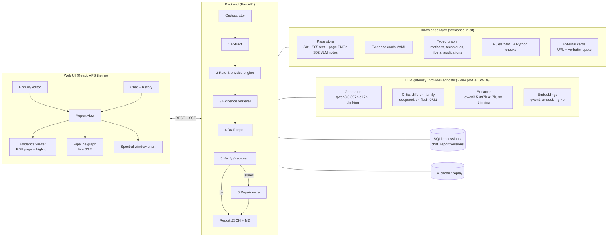
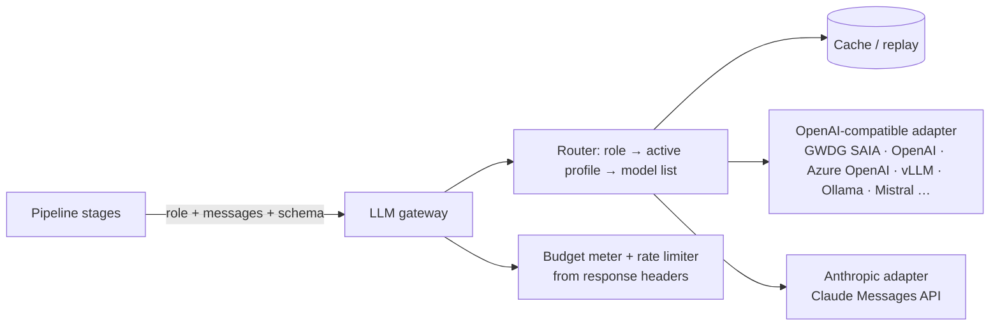

# PRISM — AI Assistant for In-line Spectroscopy Solution Design

**Solution proposal for the SchubKI National AI Hackathon 2026, Art Fiber Systems (AFS) challenge**

|                  |                                                                                                                 |
| ---------------- | --------------------------------------------------------------------------------------------------------------- |
| **Working name** | **PRISM**: _Process Requirements → In-line Spectroscopy Method_. The name echoes the prism in the AFS logo.     |
| **Status**       | Proposal **v1.1**: reviewed against every requirement in the brief, the examples doc and the H-scenario file. Traceability in §8, gaps and fixes in §13. Not yet implemented. |
| **Date**         | 2026-10-17 (work days: Oct 17–18, evaluation: Oct 19–20)                                                        |
| **LLM provider** | Provider-agnostic gateway (§4.8). Development profile: GWDG SAIA with its best open-weight models (key available now). Production: the project's own provider and key, added as a config profile |
| **Team**         | Mixed team including a spectroscopy domain expert                                                               |
| **Prototype**    | Web app with a structured report view, chat history, rich visualisations, a live pipeline view and AFS branding |

---

## 0. TL;DR

PRISM is **not a chatbot that "knows spectroscopy"**. It is a **neuro-symbolic assessment pipeline**:

1. **Extract.** An LLM turns the customer's text into a structured _requirements sheet_. Every slot is marked as _stated_ (with the exact quote) or _unknown_.
2. **Rules.** A deterministic **rule & physics engine**, built from the AFS materials, checks hard facts. Examples: _does this fiber transmit this method's wavelength range?_, _which geometry suits this sample type?_, _is this premise contradicted by a source?_, _is a lab study being stretched into clinical proof?_
3. **Evidence.** A curated **evidence-card knowledge base** links every reusable fact to its source and page (`S01 p.10`) and labels its scope (lab study, process demo, in-vitro proof of concept, business context).
4. **Draft.** An LLM writes the report under constraints. It may only cite evidence cards it was given, and it may not contradict a blocking rule.
5. **Verify.** A different model plus deterministic code checks every citation and every number, then flags invented facts. One repair pass follows if needed.
6. **Show.** A scientist-grade **web UI** in AFS colours shows the report. Each sentence carries a colour-coded chip (_client fact / AFS source / external / assumption / proposal_). The UI also shows a live pipeline graph, a **spectral-window chart** (method vs. fiber vs. instrument ranges), an evidence viewer with the highlighted PDF page, and a chat. Answering a clarification question in the chat **re-runs the assessment and shows a diff**.

**Why this wins on the jury's criteria:**

- **Technical quality and clarification & uncertainty (45% together):** the H01–H06 enquiries are built around _false premises_ and _missing information_. Rules plus verification catch these reliably; prompting alone does not.
- **Use of AFS knowledge and explainability (30%):** page-level, scope-aware citations cover both.
- **Prototype & presentation (10%):** the visual pipeline and the visual evidence carry it.

---

## 1. Understanding the challenge

### 1.1 What the jury scores, and how PRISM targets each criterion

| Criterion (weight)                | What judges look for                            | PRISM mechanism                                                                                                                                                                         |
| --------------------------------- | ----------------------------------------------- | --------------------------------------------------------------------------------------------------------------------------------------------------------------------------------------- |
| Technical quality (30%)           | Reasonable recommendations                      | Rule engine built from S01 Table 1 + fiber windows (S02 p.6). LLM ranking within rule-feasible candidates. Few-shot exemplars from the worked D01/D02 answers.                          |
| Use of AFS knowledge (20%)        | Grounded in supplied materials                  | Evidence cards (AFS-first). Every claim links to `Sxx p.N` with a verbatim quote. External sources only as quoted, flagged cards.                                                       |
| Feasibility plan (15%)            | Practical, useful first experiments             | Plan template: representative samples → independent references → single-method models → fusion only if justified → client-agreed go/no-go. No invented numbers.                         |
| Clarification & uncertainty (15%) | Good questions, knows when info is insufficient | Slot-based unknown detection. **Decision-impact ranking** of questions. Premise checker. Explicit decision status (_Provisional / Insufficient information / Outside supported scope_). |
| Explainability (10%)              | Clear, traceable, easy to review                | Claim-type chips, a "Why?" evidence graph per recommendation, pipeline trace, source viewer with highlighted page.                                                                      |
| Prototype & presentation (10%)    | Works, easy to demo                             | Branded web app, live pipeline animation, replay cache (demo survives Wi-Fi/API outages), 5-minute scripted demo.                                                                       |

### 1.2 Key insights from the materials

1. **The organisers explicitly reward caution.** The examples document (§3) says _"'Insufficient information' can be the right answer"_ and lists what must never be invented: spectra, accuracy figures, detection limits, fiber lengths, product codes, prices, guarantees. It also names the common mistakes: invented specs, stretched citations, client facts filled in. → **This is a grounding and calibration problem, not a creativity problem.** Creativity belongs in the UX and the reasoning transparency.
2. **Citations must be scope-correct, not just present.** _"A source ID next to a sentence is not proof."_ (examples doc §4). → Every evidence card carries a **scope label**, and the verifier checks that the claim does not exceed it.
3. **A nominal range is not an instrument range.** NIR is nominally 780–2500 nm (S01 p.10). The fiber decides which wavelengths reach the probe (S02 p.6), and the Mir Photonics lab page lists its NIR spectrometer as 780–1800 nm (external; verify and quote when curating). → A deterministic **spectral-window check** is both a correctness feature and a great visual.
4. **S02 is image-only.** Its text extraction returns titles only. Slides 6, 7, 9, 10, 12, 13, 14, 15, 16 and 18 carry key facts: fiber transmission ranges, 100–300 m silica Vis-NIR cables, the water-in-petroleum ATR application, polymer extrusion, combined probes, and IoT sensors vs. a multiplexed analyzer. → Transcribe the slides with a **vision LLM**, then have the domain expert review them.
5. **AFS's own business model is "test several methods, then choose".** Sources: S02 p.3, p.5; S05; afs.art. When the target is undefined, the most AFS-aligned answer is a **multi-method screening study on the AFS Multi-Spectral Fiber (MSF) system**, not a guess. (S01 p.3 §2.2: testing several approaches _"is crucial for solving complex analytical problems, such as analyzing natural and industrial samples of incompletely known composition"_.)
6. **Privacy is part of the AFS brand.** afs.art: _"Privacy-first. NDA available. Your data stays yours."_ → Data handling must be a deliberate choice. In the development profile, enquiries stay on open-weight models in a German academic cloud (GWDG). For production, the gateway makes the provider a configuration decision, so AFS can pick one whose data terms fit customer NDAs.

### 1.3 What the evaluation cases H01–H06 test

> ⚠️ **For human understanding only.** This table must **never** go into prompts, rules or code. The brief forbids case-specific hard-coding. We treat H01–H06 as a **held-out test set** (see §7). The right column lists the _generic_ mechanism that covers each pattern; each mechanism is also exercised by the D cases and by our synthetic cases.

| Case | Pattern (the "trap")                                                                        | Generic PRISM mechanism                                                                                                                                                                                                               |
| ---- | ------------------------------------------------------------------------------------------- | ------------------------------------------------------------------------------------------------------------------------------------------------------------------------------------------------------------------------------------- |
| H01  | Calibration reuse across a new formulation. "Adding Raman keeps the old calibration valid." | Premise rule `R-CAL-SCOPE`: calibrations are matrix-specific (S01 p.5, p.10). A combination is a hypothesis to test (S01 p.7–9).                                                                                                      |
| H02  | Two streams with different optics (clear whey vs. opaque concentrate)                       | Optical-state → geometry rule (S01 p.16–18, Table 1 p.6), applied **per stream**.                                                                                                                                                     |
| H03  | Fluorescence requested with no fluorescent target                                           | Premise rule `R-FLUOROPHORE` (S01 p.5: _"most chemicals do not exhibit this property"_; S01 p.16 NADH, tryptophan, riboflavin; S01 Table 1: low selectivity).                                                                         |
| H04  | Silica fiber reused for MIR ATR; analyzer in another building                               | Physics rule `R-FIBER-WINDOW` (S02 p.6: silica ≤ 2.4 µm vs. MIR 2.5–25 µm). Distance rule `R-LINK-LENGTH` (S02 p.7, with no MIR length evidence → ask). Premise verdict **CONTRADICTED**: the concept cannot be approved as proposed. |
| H05  | Undefined contaminant, yet an "exact configuration immediately" is demanded                 | Gate `R-UNDEFINED-TARGET` → status _Insufficient information_, plus a multi-method screening plan (S01 p.3, S02 p.3/p.5).                                                                                                             |
| H06  | Research paper quoted as proof of surgical readiness                                        | Evidence-scope rule `R-EVIDENCE-SCOPE` (S03 p.1: 14 in-vitro samples from 7 patients; S03 p.14: proof of concept, false negatives unacceptable) → _Outside supported scope_ for readiness claims.                                     |

### 1.4 Constraints & assumptions

- **Time:** about 1.5 build days (afternoon of Oct 17 plus Oct 18). Scope is ruthlessly MoSCoW-ed (§9.3).
- **LLM:** provider-agnostic (§4.8).
  - **Development:** GWDG SAIA (OpenAI-compatible) with the key the team has now.
  - **Production:** the real project will supply its own provider and key.
  - **GWDG probe (2026-10-17):** JSON-schema output, tool calling, the Qwen thinking toggle and the embedding models all work. Limits are **30/min, 200/h, 1,000/day, 3,000/month** per key.
  - **Best GWDG models:** `qwen3.5-397b-a17b` (generator, extractor, vision), `deepseek-v4-flash-0731` (critic), `gemma-4-31b-it` (classifier), `qwen3-embedding-4b` (embeddings).
- **Corpus is tiny** (about 60 pages plus one table plus one docx). This favours _curated evidence + long context_ over heavy vector infrastructure.
- **Language:** English output by default. German input and output is a cheap differentiator for a Berlin company (stretch goal).

---

## 2. Design principles

1. **Facts, sources, assumptions and proposals are visibly separate.** Every rendered sentence carries exactly one claim type.
2. **Physics before prose.** Anything that can be checked deterministically (wavelength windows, units, sample-type ↔ geometry, evidence scope) is checked in code, never left to the LLM's judgement.
3. **AFS materials first.** External knowledge enters only as pre-curated cards with a verbatim quote and URL, flagged _EXTERNAL_.
4. **"I don't know yet" is a first-class answer.** The decision status and the premise verdicts are part of the output schema, not an afterthought.
5. **No case-specific logic.** Rules are domain rules with source citations. They are tested across D01–D08 and synthetic cases. H01–H06 stay held-out.
6. **Reproducible by construction.** Pinned model IDs, prompt hashes, KB hash and an LLM response cache are committed, and a replay mode regenerates H01–H06 without an API key.
7. **Designed for an expert reviewer.** Density with clarity. Everything is clickable down to the source page.

---

## 3. Solution approaches considered

### Approach A — "Grounded RAG, single shot"

Chunk the PDFs → hybrid retrieval → one LLM call returns the full JSON report with citations → schema validation.

- ➕ Fastest to build (half a day), few API calls, simple to explain.
- ➖ The LLM alone decides physics and premises, so it is fragile on the traps: models tend to "help" by approving the silica fiber or the fluorescence idea. Citations are often scope-stretched. Weak explainability (no visible reasoning chain).

### Approach B — "Neuro-symbolic evidence pipeline with a critic" ✅ **Recommended**

Curated evidence cards + a typed mini knowledge graph + a deterministic rule & physics engine + a multi-stage LLM pipeline (extract → reason → draft → verify → repair) + citation and number verification.

- ➕ Robust on false premises and missing information, which is exactly what H01–H06 test. Every recommendation has an inspectable chain _client fact → rule → method → evidence → page_. Deterministic parts are unit-testable. The pipeline stages map one-to-one to the requested **pipeline visualisation**.
- ➖ More components. Needs the domain expert's time for evidence cards and rules (about 4–6 h). 3–4 LLM calls per enquiry.

### Approach C — "Multi-agent expert panel"

One agent per method (NIR, MIR-ATR, Raman, fluorescence, UV-Vis) argues its case. A _Skeptic_ agent attacks the arguments and a _Moderator_ synthesises.

- ➕ Very demo-friendly ("watch the experts debate"), naturally explores alternatives.
- ➖ 7–10+ LLM calls per enquiry, which is risky under API rate limits (GWDG: 30/min, 3,000/month). Less deterministic, harder to reproduce, and debates can _talk themselves into_ unsupported claims. More prompt engineering than the time allows.

### Comparison

|                           | A: RAG single-shot | **B: Neuro-symbolic + critic**   | C: Agent panel |
| ------------------------- | ------------------ | -------------------------------- | -------------- |
| Trap / premise robustness | Low                | **High**                         | Medium         |
| Citation correctness      | Medium             | **High** (verified)              | Medium         |
| Explainability            | Low                | **High** (rule + evidence graph) | Medium-high    |
| LLM calls / enquiry       | 1                  | **3–4**                          | 7–10+          |
| Build effort (1.5 days)   | Low                | **Medium**                       | High           |
| Demo appeal               | Low                | **High** (pipeline viz)          | High           |
| Reproducibility           | High               | **High**                         | Low            |

**Decision:** build **B**. Borrow C's best idea cheaply: the _Verify_ stage acts as a **skeptic** and runs on a **different model family**. It is presented in the UI as "Red-team review". Approach A is our **ablation baseline** for the presentation ("here's what a plain RAG bot says about H-style traps vs. PRISM").

Further options considered and rejected:

- **Fine-tuning:** no training data, no time.
- **GraphRAG / Neo4j:** overkill for about 60 pages. A YAML-typed graph gives the same explainability.
- **Provider-hosted RAG (e.g. GWDG "Arcana"):** provider lock-in and less control over page-level citations and scope.
- **ColPali/ColQwen visual retrieval:** elegant for image-heavy slides, but with only 20 slides a one-time VLM transcription plus expert review is cheaper and auditable.

---

## 4. Recommended architecture

### 4.1 System overview



### 4.2 Knowledge layer

#### 4.2.1 Page store (raw, citable)

- `S01`, `S03`, `S04`, `S05`: per-page text via PyMuPDF. Page numbers are **1-based PDF pages**, matching the official citation convention (`S01 p.10`). Each page is also rendered to PNG at 150 dpi for the evidence viewer. Quote highlighting uses PyMuPDF `search_for()` bounding boxes.
- `S02` (image slides): render each slide → a vision LLM (`qwen3.5-397b-a17b`) transcribes _all visible text, axis labels, legends, numeric ranges, and a neutral figure description, inferring nothing_ → `kb/pages/S02/p06.md` with front-matter `transcribed_by: <model>`, `reviewed_by: <expert>`, `review_status`. The examples doc already transcribes p.6 fiber ranges; use those values as the reference.
- `Table` (`AFS_method_comparison_table.xlsx`) → `kb/graph/techniques.yaml` (19 rows), cited as `S01 Table 1 (p.6)`.
- Examples doc (D01–D08, worked D01/D02, §3 rules, §5 overview) → dev set + few-shot exemplars + system-prompt rules.
- **Citation policy.**
  - Reports cite only S01–S05 pages and `S01 Table 1 (p.6)`.
  - The examples doc is _guidance_, not evidence. Rules may reference it internally, but report citations always resolve to the underlying S-pages (e.g. fiber ranges → `S02 p.6`).
  - Web pages (afs.art, mirphotonics.com, literature) enter only as EXTERNAL cards with a verbatim quote and link.
  - S05/S06 are business context only.
- **Evaluation inputs are read verbatim.**
  - `scripts/load_cases.py` splits `customer_scenarios_for_final_evaluation.txt` on its `Hxx | title` headers and passes title + body unchanged. No summarising or rewriting happens before extraction.
  - The file's SHA-256 (`53903aea…`) and each case's text hash go into the run manifest.
  - D01–D08 are parsed the same way from the docx.
  - The file's global note (_"Anything not stated is unknown: ask about it or state it as an assumption, do not treat it as fact"_) is part of the system prompt.

#### 4.2.2 Evidence cards (the citation unit)

Small, atomic, human-reviewed facts. **The LLM may cite only card IDs.** Rendering converts them to `S01 p.10` and shows the verbatim quote on hover.

```yaml
- id: S01-p10-nir-range
  source: S01
  page: 10
  quote: "NIR spectra (780–2500 nm) contain predominantly overtones and component bands of fundamental vibrations"
  claim: "Nominal NIR method range is 780–2500 nm."
  scope: method_general # method_general | process_application | lab_study | in_vitro_poc | business_context | external
  methods: [NIR]
  topics: [spectral_range]

- id: S03-p1-sample-size
  source: S03
  page: 1
  quote: "Two sensor prototypes were tested using 14 in vitro clinical samples of 7 different patients."
  claim: "The LED NIR kidney sensor was tested on 14 in-vitro samples from 7 patients."
  scope: in_vitro_poc
  methods: [NIR, LED_sensor]
  topics: [evidence_level, medical]
```

Target: **about 80–120 cards**, drafted by an LLM from the page store, then **accepted, edited or rejected by the domain expert** in a simple review UI or YAML diff. Scope labels let the verifier block _"in-vitro proof of concept cited as clinical evidence"_ and _"business flyer cited as technical proof"_ (S05/S06 = `business_context`).

**Automatic quote check at ingestion:** a card is rejected unless its `quote` is found (normalised, fuzzy ≥ 0.95) on the stated page. The expert then reviews only the `claim` wording and the `scope` label, not the transcription. Review priority:
1. S01 p.5–6, 10–12, 14–18
2. S02 p.6, 7, 13, 14
3. S03 p.1, 3, 14
4. S04 p.1, 4

#### 4.2.3 Typed mini knowledge graph (YAML, no graph DB)

| Node type               | Examples                                                                                                                                       | Key attributes                                                   | Source                                      |
| ----------------------- | ---------------------------------------------------------------------------------------------------------------------------------------------- | ---------------------------------------------------------------- | ------------------------------------------- |
| `Method`                | NIR, MIR/IR, Raman, UV-Vis, Fluorescence                                                                                                       | nominal range (with units), phenomenon, notes                    | S01 p.5, 9–12; examples doc §5              |
| `Technique`             | ATR probe, diffuse reflection probe, transmission/transflection probe, Raman probe, fluorimetric probe …                                       | sample types, optical path/depth, sensitivity, selectivity, cost | S01 Table 1 (p.6)                           |
| `FiberFamily`           | UV-Vis silica, Vis-NIR silica, CIR (As-S), PIR (AgHal), HWG, InF₃, ZrF₄                                                                        | transmission range in µm                                         | S02 p.6                                     |
| `Application`           | blend potency/feed frame, milk fat/protein, whey, bioprocess metabolites, water in petroleum, API in hot-melt extrusion, tissue classification | methods, techniques, evidence scope                              | S01 p.13–18, S02 p.13–14, S03, S04          |
| `Instrument` (optional) | Mir lab NIR/FTIR/Raman/fluorescence/UV-Vis                                                                                                     | instrument range                                                 | mirphotonics.com/laboratory (external card) |

Edges (`supports`, `limited_by`, `requires_fiber`, `demonstrated_in`, `cited_by`) power the candidate generator and the **"Why?" evidence graph** in the UI.

#### 4.2.4 External cards (sparingly)

Pre-curated during the build, never fetched live in the answer path, so every quote is verified and reproducible. Each card stores `url`, `retrieved_at`, a **verbatim quote** and a snapshot hash. Candidate topics:

- calibration transfer / model maintenance (for the H01 pattern);
- MIR fiber loss per metre and typical probe lengths (for distance questions);
- the medical-device clinical-evidence principle (for the H06 pattern);
- the Mir lab instrument ranges.

**Rule:** an external card can _add context_ but never _replace_ an AFS source when one covers the point.

### 4.3 The reasoning pipeline

| #   | Stage                     | Type                    | Input → Output                                                                                                                                                                                                                                                                                                                                                                                                                                        | Model / call budget |
| --- | ------------------------- | ----------------------- | ----------------------------------------------------------------------------------------------------------------------------------------------------------------------------------------------------------------------------------------------------------------------------------------------------------------------------------------------------------------------------------------------------------------------------------------------------- | ------------------- |
| 0   | **Intake**                | code                    | raw text (UI, chat, or case file parsed verbatim) → `Enquiry` {case_id, title, text, sha256}. No rewriting, summarising or translating before extraction | 0 calls |
| 1   | **Extract**               | LLM (JSON)              | enquiry text → `RequirementsSheet` (≈15 slots, each `stated` with exact quote span, or `unknown`) + `client_question` (verbatim) + `streams[]` (one per process stream / measurement point) + `premises[]` (claims or requests the client makes, e.g. "reuse calibration", "approve concept", "exact config immediately") + `domain`                                                                                                                                                                                                            | fast model, 1 call  |
| 2   | **Rule & physics engine** | Python                  | sheet → `RuleFindings` (blocking / warning / info, each with source cards) + `CandidateMatrix` (methods × techniques, feasibility + reasons) + `QuestionSeeds` (unknown slots that change a decision) + provisional decision status                                                                                                                                                                                                                   | 0 calls             |
| 3   | **Evidence retrieval**    | hybrid                  | sheet + candidates → `EvidencePack`: cards selected by graph edges (candidate methods, applications, rules fired) + BM25/embedding top-k over cards and pages for anything else                                                                                                                                                                                                                                                                       | 0–1 embedding call  |
| 4   | **Draft**                 | LLM (JSON, thinking on) | sheet + findings + candidates + evidence pack + D01/D02 exemplars → `AssessmentReport` (schema §4.5). Rules: cite only card IDs from the pack; never contradict a blocking finding; numbers only if present in a card or in the enquiry                                                                                                                                                                                                               | generator, 1 call   |
| 5   | **Verify ("red team")**   | code + LLM              | report → `VerificationReport`: (a) every citation ID exists and is in the pack; (b) quote string actually found on that page (fuzzy match); (c) **number guard**: every number appears in the enquiry or a cited card; (d) no blocking rule contradicted; (e) LLM-NLI check of each claim vs. its card (_supported / partial / unsupported / scope-exceeded_) on a **different model family**; (f) stated facts not invented (diff against the sheet) | critic, 1 call      |
| 6   | **Repair** (conditional)  | LLM                     | report + issues → patched report. Unresolvable claims are removed or downgraded to _ASSUMPTION_                                                                                                                                                                                                                                                                                                                                                       | generator, 0–1 call |
| 7   | **Render**                | code                    | → JSON, Markdown, UI events, run manifest                                                                                                                                                                                                                                                                                                                                                                                                             | 0 calls             |

Every stage emits **SSE events** (`stage_started`, `stage_completed`, `rule_fired`, `evidence_selected`, `issue_found`, `repaired`). These drive the live pipeline graph and are stored as the run trace.

#### Requirements sheet slots (stage 1)

`client_question` (verbatim; may be several). **Per stream** (`streams[]`, at least one; an enquiry describing two process streams gets two): `target_variables`, `matrix_and_state` (liquid / powder / paste / solid / tissue / gas), `optical_character` (clear / turbid / opaque / scattering / variable). **Global:** `concentration_range`, `accuracy_and_limits`, `response_time`, `measurement_location_and_access`, `distance_to_analyzer`, `process_conditions` (temperature, pressure, flow, fouling, cleaning/CIP, hazardous area), `existing_assets` (instrument, fiber, calibration), `reference_method_and_uncertainty`, `use_context` (R&D / pilot / GMP production / clinical), `requested_certainty` (explore / compare / approve / exact config), `stated_premises`, `domain`.

#### Clarification-question prioritisation

Each rule declares which slots it reads. When a slot is unknown **and** a rule's outcome would branch on it, the question is **decision-changing** and goes to the top. Example: an unknown optical character flips transmission ↔ diffuse reflection. The UI shows each question with _"Why it matters"_ and _"Decision it changes"_. This implements the examples doc's guidance _"first the questions whose answers could change the method or the setup."_ **Bounds:** 3–6 questions, priority-ordered. A question with no `decision_it_changes` is dropped, unless it asks the client to confirm a stated premise.

### 4.4 Rule & physics engine (catalogue v1)

Rules live in `kb/rules.yaml` (metadata, sources, severity, slots read) plus small Python check functions. **Every rule is generic and cites its source.**

| ID                   | Rule (generic)                                                                                                                                                                                     | Severity               | Sources                                                         |
| -------------------- | -------------------------------------------------------------------------------------------------------------------------------------------------------------------------------------------------- | ---------------------- | --------------------------------------------------------------- |
| `R-SAMPLE-GEOMETRY`  | Map matrix/state → admissible techniques (e.g. powder → diffuse reflection/Raman probe; clear liquid → transmission/transflection; paste/soft → ATR)                                               | info / ranking         | S01 Table 1 (p.6)                                               |
| `R-OPTICAL-STATE`    | Clear → transmission/transflection; opaque/concentrated → diffuse reflection; very high OD → ATR; **variable → compare geometries**                                                                | warning                | S01 p.16–18                                                     |
| `R-FIBER-WINDOW`     | Fiber family must transmit the method's working range (interval overlap in µm, with cm⁻¹ ↔ µm conversion)                                                                                          | **blocking**           | S02 p.6; S01 p.9–10                                             |
| `R-LINK-LENGTH`      | Long distance: silica Vis-NIR cables of 100–300 m are documented; **no length figure in sources for MIR fibers → must ask; propose alternatives** (analyzer closer, NIR alternative, local sensor) | warning                | S02 p.7, p.9, p.18                                              |
| `R-UNITS`            | Wavelength (nm/µm) vs. wavenumber (cm⁻¹); Raman shift stated separately from excitation wavelength                                                                                                 | info                   | S01 p.11; examples doc §5                                       |
| `R-CAL-SCOPE`        | Calibrations are matrix/formulation-specific; reuse needs new or extended calibration + validation; adding a method does not preserve validity                                                     | **premise**            | S01 p.5, p.10; external card                                    |
| `R-FLUOROPHORE`      | Fluorescence only with a defined fluorescent species or justified indicator                                                                                                                        | **premise**            | S01 p.5, p.6, p.16                                              |
| `R-AQUEOUS`          | Aqueous media: Raman suited (low water signal); note water absorption in IR                                                                                                                        | info                   | S01 p.16                                                        |
| `R-OD-NOT-VIABILITY` | Optical density / turbidity tracks cell density, not viability                                                                                                                                     | warning                | S01 p.16; examples doc §5                                       |
| `R-EVIDENCE-SCOPE`   | A cited source cannot support a claim beyond its scope label (in-vitro PoC ≠ clinical readiness; flyer ≠ performance)                                                                              | **premise / blocking** | S03 p.1, p.3, p.14; examples doc §4                             |
| `R-UNDEFINED-TARGET` | If the analyte/quality variable is undefined → status _Insufficient information_ + multi-method screening plan                                                                                     | **gate**               | S01 p.3; S02 p.3, p.5                                           |
| `R-COMBINATION`      | Combinations only after single-method assessment; gain is a hypothesis; align sampling spot and timing                                                                                             | warning                | S01 p.7–9, p.14–15; S04                                         |
| `R-HOT-FOULING`      | Hot/fouling interfaces: ATR/robust probes are documented applications, but ratings must be confirmed with AFS, never invented                                                                      | warning                | S02 p.13–14                                                     |
| `R-CLINICAL-SCOPE`   | Clinical decision support is outside the supported scope of a first technical assessment                                                                                                           | **gate**               | S03 p.3, p.14; examples doc §3 (lab study ≠ clinical readiness) |
| `R-NO-INVENT`        | Accuracy, LOD, response time, fiber length, prices and product codes only if a card states them                                                                                                    | verifier               | examples doc §3                                                 |

**Anti-hard-coding evidence for the jury:** rule unit tests use D01–D08 and synthetic cases. A coverage matrix shows each rule firing on several non-H cases.

#### 4.4.1 Output-policy checks (run in stage 5, Verify)

Domain rules decide _what_ to recommend. Policy checks enforce the _form_ the organisers require. Each check produces pass/fail per case. A failure goes to the repair pass; a failure that survives repair is shown in the UI and in `outputs/compliance.md`.

| ID                     | Check                                                                                                                                                                                                                     | Type                       | Requirement source                                                                                         |
| ---------------------- | ------------------------------------------------------------------------------------------------------------------------------------------------------------------------------------------------------------------------- | -------------------------- | ---------------------------------------------------------------------------------------------------------- |
| `P-MIN-RECOMMENDATION` | ≥ 1 recommendation and ≥ 1 measurement concept in **every** report, including _Insufficient information_ and _Outside supported scope_ (roles `SCREENING` / `CONDITIONAL` allowed)                                        | deterministic              | Brief, minimal requirements: _"Recommend at least one spectroscopy approach"_; per-case tasks 3–4           |
| `P-DIRECT-ANSWER`      | `direct_answer` present and responsive to `client_question`                                                                                                                                                               | deterministic + critic LLM | Each enquiry ends with an explicit question (implicit requirement)                                         |
| `P-AFS-CITATION`       | Each recommendation, spectral range and measurement concept has ≥ 1 AFS card (S01–S05 / Table). EXTERNAL cards only in addition, always with quote + link                                                                 | deterministic              | Brief: _"Show the source or AFS material used for important recommendations"_; rules on external sources  |
| `P-NO-NUMBERS`         | Number guard (stage 5c), including unit-bearing tokens and product-code-like tokens                                                                                                                                       | deterministic              | Examples doc §3 _"Do not invent"_                                                                          |
| `P-NO-GUARANTEE`       | Flags over-claiming wording (_guarantee, ensures, proven, validated for, ready for, will work_) unless it is inside a quoted source                                                                                        | lexicon + critic LLM       | Examples doc §3: _"a published application is a reason to test a method, not proof that it will work"_     |
| `P-NO-BAND-PICK`       | No "optimal band/wavelength" chosen without sample spectra; ranges are nominal unless a card states an instrument range                                                                                                   | pattern + critic LLM       | Worked D01: _"Do not pick an optimal band without sample spectra"_                                         |
| `P-NO-SELF-ANSWER`     | The report never answers its own clarification questions or fills an unknown slot with a value                                                                                                                           | deterministic (sheet diff) | Examples doc §3: do not invent _"the client's … answers to your questions"_                                |
| `P-PLAN-COMPLETE`      | Feasibility plan contains every element of the §4.9 template, in ≤ 6 steps                                                                                                                                               | deterministic              | Brief task 6 (_"short"_ plan); examples doc §3 feasibility-plan row                                        |
| `P-QUESTIONS`          | 3–6 questions, priority-ordered, each with `decision_it_changes`                                                                                                                                                          | deterministic              | Examples doc §3: _"first the questions whose answers could change the method or the setup"_                |
| `P-LENGTH`             | Per-section length budgets                                                                                                                                                                                                | deterministic              | Examples doc §3: _"Treating length and confidence as quality"_ is a common mistake                         |

### 4.5 Output schema (`AssessmentReport`, Pydantic)

```text
AssessmentReport
├─ case_id, title, input_sha256, created_at, run_id, kb_version, model_ids, prompt_hashes
├─ decision_status: PROVISIONAL | INSUFFICIENT_INFORMATION | OUTSIDE_SUPPORTED_SCOPE
├─ client_question: verbatim question(s) taken from the enquiry
├─ direct_answer: {verdict: YES | NO | NOT_YET | CONDITIONAL | NOT_APPLICABLE, text}  # shown first
├─ premise_checks[]: {premise, verdict: SUPPORTED|CONTRADICTED|UNVERIFIABLE, explanation, evidence_ids}
├─ streams[≥1]: {id, name, matrix_and_state, optical_character, target_variables[]}
├─ requirements: {stated_facts[]: {slot, stream_id?, value, quote_span},
│                 key_unknowns[]: {slot, stream_id?, why_it_matters}}
├─ clarification_questions[3..6]: {question, priority, decision_it_changes, why_it_matters}
├─ recommendations[≥1]: {methods[] (1 = single method, 2+ = combination), technique,
│                        applies_to: stream_ids[], role: PRIMARY|COMPARISON|CONDITIONAL|SCREENING|NOT_RECOMMENDED,
│                        rationale, conditions, limitations, evidence_ids (≥1 AFS), evidence_strength}
├─ measurement_concept[≥1]: {stream_id, probe_geometry, location, fiber_link, notes, evidence_ids}
├─ spectral_ranges[]: {method, nominal_range, units, excitation_nm? (Raman/fluorescence),
│                      fiber_family_needed, caveat, evidence_ids}
├─ risks[]: {risk, effect, mitigation, evidence_ids}
├─ assumptions[]: {assumption, to_confirm_with}
├─ feasibility_plan: template §4.9 (≤ 6 steps)
├─ decision_basis: client-agreed acceptance criteria + "choose the simplest configuration that meets them"
├─ sources[]: {id, doc, page, quote, scope}       # rendered from card IDs; S01–S05 / Table only
├─ external_sources[]: {url, quote, retrieved_at}
└─ compliance: {check_id: pass|fail}              # results of §4.4.1
```

Every free-text field is stored as **segments** `{text, claim_type, evidence_ids}`. Claim types are: `CLIENT`, `AFS`, `EXTERNAL`, `ASSUMPTION`, `PROPOSAL`, `UNKNOWN`. This one design decision powers both explainability and the colour-coded UI.

> Implementation note: if the active provider supports JSON-schema output (GWDG does; probed 2026-10-17), the gateway uses it. Otherwise it uses prompt-specified JSON → Pydantic validation → one automatic repair retry, based on the model's capability record (§4.8).

**Markdown rendering** (`outputs/<case>.md`) follows the headings of the organisers' worked examples, so jurors recognise the structure. Order:

1. Decision status
2. Direct answer
3. Premise checks
4. Requirements stated
5. Key unknowns
6. Clarification questions
7. Recommendation
8. Measurement concept
9. Spectral range
10. Risks and uncertainty
11. First feasibility experiment
12. Decision basis
13. Sources

Every citation is a footnote carrying the verbatim quote, so each file can be reviewed on GitHub without the app. `outputs/index.md` lists all cases with status, direct answer, primary method(s) and compliance result.

### 4.6 Decision status & evidence strength (transparent, not a fake probability)

- **Decision status** is computed by the rule engine (gates) and may only be _tightened_ by the LLM, never loosened.
- **Evidence strength** per recommendation is a visible breakdown, not an LLM-made-up percentage:
  - sample-type fit from Table 1 (0–2)
  - AFS application evidence: process application = 2, lab study = 1, generic method text = 0.5
  - critical unknowns (−0.5 each)
  - blocking findings (cap → "Blocked")

  The result is shown as **Strong / Moderate / Weak / Blocked** with the breakdown on hover.

### 4.7 Chat, follow-up and re-assessment

- Sessions hold _enquiry → report v1 → chat → report v2 …_, persisted in SQLite. The sidebar lists sessions (pre-loaded D01–D08, H01–H06, user enquiries), with search and rename.
- A chat message is classified as one of:
  - **(a) new client information**, e.g. "the whey line is 40 m from the analyzer room". The fact is added with provenance `CLIENT (chat, timestamp)` → the pipeline re-runs → a **report diff** shows what changed (status, primary method, questions resolved).
  - **(b) question about the report** → a grounded answer citing cards.
  - **(c) instruction**, e.g. "focus on low-cost options" → re-run with a preference.
- One-click **"Draft clarification e-mail to customer"**: a prioritised question list in polite, client-facing language. This makes the assistant useful for the _first customer discussion_, as the brief asks.

### 4.8 LLM strategy: provider-agnostic gateway, GWDG as the current profile

**Principle:** nothing outside `backend/prism/llm/` knows which provider or model is used.
- Stages ask for a **role**: extractor, generator, critic, classifier, vision or embedder.
- A config **profile** maps each role to a provider, a model list and settings.
- **GWDG SAIA is the development profile** because a key is available now. The real project will supply its own provider and key, added as another profile with no code change.



**Gateway interface (provider-neutral):**
- `complete(role, messages, schema=None, reasoning="off"|"low"|"high", max_tokens) → {parsed, text, usage, model, latency}`
- `embed(texts) → vectors`. The vector index is stored per embedding model and rebuilt when the profile changes.

Adapters translate the provider-specific parts:
- JSON schema → `response_format` (OpenAI-compatible) or structured outputs (Anthropic);
- reasoning level → `chat_template_kwargs.enable_thinking` (Qwen on GWDG/vLLM), `reasoning_effort` (OpenAI) or `output_config.effort` (Anthropic);
- image input format and usage fields.

Every model has a **capability record** (`json_schema`, `tools`, `vision`, `reasoning_toggle`, `max_context`). When a provider lacks schema support, the gateway falls back to prompted JSON → Pydantic validation → one repair retry.

**Config (`config/llm.yaml`):**

```yaml
active_profile: ${PRISM_LLM_PROFILE:-gwdg}
profiles:
  gwdg:                               # development: key available now
    adapter: openai_compatible
    base_url: https://chat-ai.academiccloud.de/v1
    api_key_env: SAIA_API_KEY
    limits: {per_minute: 30, per_hour: 200, per_day: 1000, per_month: 3000}
    roles:
      extractor:  {models: [qwen3.5-397b-a17b, qwen3-30b-a3b-instruct-2507], reasoning: off}
      generator:  {models: [qwen3.5-397b-a17b, deepseek-v4-flash-0731], reasoning: high, max_tokens: 24000}
      critic:     {models: [deepseek-v4-flash-0731, glm-5.3-flash], reasoning: model_default}
      classifier: {models: [gemma-4-31b-it, qwen3-30b-a3b-instruct-2507], reasoning: off}
      vision:     {models: [qwen3.5-397b-a17b, glm-5.3-flash], reasoning: off}
      embedder:   {models: [qwen3-embedding-4b, multilingual-e5-large-instruct]}
  project:                            # filled in when the project provides its provider + key
    adapter: openai_compatible        # or: anthropic | azure_openai
    base_url: ${PRISM_LLM_BASE_URL}
    api_key_env: PRISM_LLM_API_KEY
    roles: {}                         # same six roles; critic must be a different model family from generator
```

**Best GWDG models per role.** Chosen from the live `/v1/models` list and a capability probe run with the team's key on 2026-10-17.

| Role | Primary | Fallback | Evidence / reason |
|---|---|---|---|
| **Generator** (draft, repair) | `qwen3.5-397b-a17b`, thinking on | `deepseek-v4-flash-0731` | Largest model on GWDG (397B MoE), with the strongest knowledge/agentic profile in public comparisons; the only model with a separate reasoning stream. Thinking is verbose (> 4,000 reasoning tokens on a one-line question), so the generator gets a large `max_tokens`. Thinking switches to `low`/`off` automatically if the live-demo latency budget is exceeded |
| **Extractor** | `qwen3.5-397b-a17b`, thinking off | `qwen3-30b-a3b-instruct-2507` | Valid schema-constrained JSON in about 6 s with thinking off; best language understanding for slot filling |
| **Critic / eval judge** | `deepseek-v4-flash-0731` | `glm-5.3-flash` | Strongest **non-Qwen** family on GWDG (independent of the generator); valid JSON; 1M context. GLM 5.3 Flash also returned valid JSON after reasoning |
| **Chat intent classifier** | `gemma-4-31b-it` | `qwen3-30b-a3b-instruct-2507` | Fastest valid JSON (about 1.4 s). Classification is easy, so latency matters more |
| **Vision** (S02 slides, offline) | `qwen3.5-397b-a17b` | `glm-5.3-flash` | Image input; GLM also accepts images and video |
| **Embeddings** | `qwen3-embedding-4b` (2560-d) | `multilingual-e5-large-instruct` (1024-d) | Both answer on `/v1/embeddings` although `/v1/models` does not list them; multilingual |

**Capability probe results (GWDG, 2026-10-17).** `scripts/probe_llm.py` re-runs these checks for any profile.

| Check | Result |
|---|---|
| `/v1/models` | 10 chat models: DeepSeek V4 Flash, Qwen 3.5 397B, Qwen 3.8 27B, Qwen 3.6 35B, Qwen 3 Omni 30B, Qwen 3 Coder Next, Qwen 3 30B Instruct, GLM 5.3 Flash, Gemma 4 31B, Llama 3.1 8B. Embedding models are callable but not listed |
| JSON-schema `response_format` | ✅ honoured by Qwen 3.5 (thinking off), DeepSeek V4 Flash, GLM 5.3 Flash, Gemma 4 |
| Tool calling | ✅ (`qwen3-30b-a3b-instruct-2507` returned `tool_calls`) |
| Thinking toggle | ✅ `chat_template_kwargs: {enable_thinking: false}` accepted by Qwen 3.5 |
| Rate limits (per key) | 30/min · 200/h · 1,000/day · **3,000/month** |
| Ungrounded answers | Asked for the best method for fat in an opaque milk concentrate with no context, four models answered MIR, Raman, Raman and NIR. Only NIR matches the AFS source (NIR reflection for opaque/concentrated dairy, S01 p.17). A single anecdote, but it shows why answers must come from the evidence pack and rules |

**Budget & reliability:**
- **Call volume:** 3–4 calls per assessment. One full dev + synthetic eval (about 30 cases) costs about 120 calls, so at most about one full eval per hour under the 200/h cap. The 3,000/month cap covers roughly 20 full evals plus development.
- **Budget meter:** the gateway tracks the remaining calls per minute/hour/day/month from the response headers. The UI and eval log show it, and an eval refuses to start when the remaining budget is too low.
- **Cache / replay:** a disk cache keyed by `hash(provider, model, messages, params, schema)` doubles as **replay mode** (`PRISM_REPLAY=1`). Unchanged stages are never re-called during development.
- **Rate handling:** token-bucket limiter sized from the probed headers; exponential backoff on 429/5xx that respects `ratelimit-reset`; per-role fallback chain.
- **Sampling:** low temperature where the model allows it; each model's recommended settings take precedence.
- **Portability:** prompts use no provider-specific features, so switching profile changes models, not behaviour. Before a new profile produces committed answers, the probe and the eval suite are re-run on it.

### 4.9 Feasibility-plan template ("practical and useful", 15% of the score)

The template is derived from the worked D01/D02 answers and S01 §3.3 (p.8–9). The LLM fills it; `P-PLAN-COMPLETE` checks it. Every numeric criterion is a placeholder for the client to fill, never an invented number.

| Element               | Content rule                                                                                                                                                                       | Basis                                                  |
| --------------------- | ---------------------------------------------------------------------------------------------------------------------------------------------------------------------------------- | ------------------------------------------------------ |
| Objective             | One sentence: what this first experiment must decide                                                                                                                               | Worked D01/D02                                         |
| Step 0: clarify       | Decision-changing questions answered; numerical acceptance criteria agreed with the client **before** testing                                                                      | Worked D01 "Decision basis"                            |
| Samples & states      | Representative samples across the client's range **and** the relevant physical variation (temperature, particle size, turbidity, flow, fouling), per stream                         | Worked D01/D02                                         |
| Reference measurements | An independent reference method **per target variable**, with its uncertainty and **time alignment** to the spectra                                                                | Worked D02; S01 p.8 (synchronisation)                  |
| Set-up                | Lab first, with candidate methods/geometries side by side (AFS multi-spectral approach); then realistic process conditions                                                         | S01 p.3; S02 p.3, p.5                                  |
| Comparison            | Single-method models first, a combination only afterwards; compare prediction error and bias against the client requirement; separate physical effects from composition effects | Worked D01/D02; S01 p.7–9                              |
| Validation            | On held-out runs or batches, never on the calibration samples                                                                                                                       | Worked D01/D02                                         |
| Go / no-go            | Client-agreed criteria; choose the simplest configuration that meets them on independent material                                                                                  | Worked D01                                             |
| Not demonstrated      | What this experiment will **not** show (e.g. long-term process robustness, clinical validity)                                                                                      | Examples doc §3; D08 asks for exactly this statement  |

---

## 5. UI / UX design (scientist-first, AFS-branded)

### 5.1 Brand & theme

Colours were sampled from the AFS logo and website (afs.art). **Confirm with AFS if a brand guide exists.**

| Token             | Value                                                        | Use                                                                                  |
| ----------------- | ------------------------------------------------------------ | ------------------------------------------------------------------------------------ |
| `--afs-navy-950`  | `#00031D`                                                    | Dark background (site background colour)                                             |
| `--afs-navy-800`  | `#001070`                                                    | Panels, header                                                                       |
| `--afs-prism-600` | `#0040C0`                                                    | Primary buttons, links, active states                                                |
| `--afs-prism-500` | `#0050E0`                                                    | Hover / focus rings                                                                  |
| `--fiber-cyan`    | `#00E5FF` (approx.)                                          | **AFS-source** chips, NIR/UV accents                                                 |
| `--fiber-orange`  | `#FF8A00` (approx.)                                          | **Assumption** chips, warnings                                                       |
| `--fiber-magenta` | `#D0508A` (approx.)                                          | **External-source** chips                                                            |
| Semantic          | green / amber / red (WCAG AA)                                | Rule verdicts, status badges, always paired with an icon + label (never colour-only) |
| Font              | **Manrope** (used on afs.art) + JetBrains Mono for data/JSON |                                                                                      |

- Logo: `AFS_Logo_classic_white` (white text, for the dark header) and the prism emblem (favicon and loading animation: the three fiber strands "light up" per pipeline stage).
- Dark mode is the default (matches afs.art), with a light mode toggle for projectors and print.

### 5.2 Layout (desktop, 1440 px)

```text
┌───────────────────────────────────────────────────────────────────────────────────────┐
│ [AFS logo]  PRISM · In-line Spectroscopy Assessment     [Model: qwen3.5 ▾] [☾/☀] [Export ▾]│
├──────────────┬──────────────────────────────────────────────────┬─────────────────────┤
│ SESSIONS     │  H04 · Reuse of a silica link for petroleum MIR  │  EVIDENCE / CHAT    │
│ 🔍 search    │  ┌───────────────────────────────────────────┐   │ ┌─────────────────┐ │
│ ▸ New enquiry│  │ STATUS: Insufficient information           │   │ │ S02 p.6 [page]  │ │
│ ── Dev ──    │  │ PREMISE ⛔ "reuse silica link": silica     │   │ │ ▓▓ highlighted  │ │
│  D01 … D08   │  │  ≤2.4 µm vs. MIR 2.5–25 µm → IR fiber needed│  │ │ quote + scope   │ │
│ ── Eval ──   │  └───────────────────────────────────────────┘   │ └─────────────────┘ │
│  H01 … H06   │  Tabs: Overview│Requirements│Questions│Methods│  │ ── Chat ──────────  │
│ ── Mine ──   │        Concept│Spectral│Risks│Plan│Sources│Trace │ you: the line is   │
│  …           │  ┌ Pipeline ─────────────────────────────────┐   │ 200 m away          │
│              │  │ ●Extract→●Rules→●Evidence→●Draft→●Verify✓ │   │ PRISM: updated v2 → │
│              │  └───────────────────────────────────────────┘   │ [view diff]         │
│              │  Recommendation cards with claim chips:          │ [Draft e-mail]      │
│              │  [CLIENT] [AFS S02 p.6] [ASSUMPTION] [PROPOSAL]  │                     │
└──────────────┴──────────────────────────────────────────────────┴─────────────────────┘
```

Responsive: on tablet and mobile the right panel becomes a bottom sheet and the sidebar a drawer.

### 5.3 Key views & visualisations

1. **Enquiry view with fact highlighting.** The original enquiry is shown with extracted facts highlighted inline (hover → slot name). Unknown slots are listed as _ghost chips_ ("distance to analyzer: unknown").
2. **Overview.** Status badge, **direct answer** to the client's question (Yes / No / Not yet / Conditional), premise checks (✅ supported / ⛔ contradicted / ❔ unverifiable), top-3 decision-changing questions, primary and comparison methods. For multi-stream enquiries, a stream switcher shows each stream's concept side by side.
3. **Live pipeline graph (React Flow).** Nodes per stage, animated while running. Each node shows duration, model, token count and number of findings. Clicking a node opens its exact input/output JSON (the "glass box"). Rule nodes expand into fired rules.
4. **Spectral-window chart (Plotly).** Log-scale axis in µm with a secondary cm⁻¹ axis. Horizontal bars for the candidate methods' nominal ranges, the fiber families (S02 p.6), optional instrument ranges, and the client's proposed link. Overlaps are shaded green; gaps are red with the blocking rule ID. _This one chart explains the H04-type problem in two seconds._
5. **Method scorecard heatmap.** Methods × criteria (sample-type fit, selectivity, sensitivity, cost from Table 1; AFS application evidence; fiber feasibility; open unknowns), each cell clickable → source.
6. **"Why?" evidence graph per recommendation.** _Client fact → rule → method/technique → evidence card → source page_, rendered as a small graph. The judges' explainability criterion, made visual.
7. **Feasibility-plan timeline.** Phases (0 clarify → 1 representative samples + references → 2 single-method models → 3 fusion only if justified → 4 go/no-go). Each phase lists its deliverables. Go/no-go criteria show **"to be agreed with client"** placeholders, never invented numbers.
8. **Sources tab.** Every cited card with doc, page, scope badge and verbatim quote. External sources are shown separately with URL and quote.
9. **Report diff (v1 → v2)** after a chat answer, plus a version history.
10. **Eval dashboard (dev only, also used in slides).** Per-case scores, citation validity, invented-number count, judge rubric, and an ablation chart.

### 5.4 Interaction & accessibility details

- Keyboard: `⌘K` command palette (new enquiry, jump to case, export), `J/K` to move between claims.
- Every chip and badge has a text label and icon (colour-blind safe). Focus rings use `--afs-prism-500`.
- Exports: Markdown, JSON, branded PDF (print CSS), customer e-mail draft.
- Loading states show the pipeline graph, never a blank spinner.
- An "Expert mode" toggle shows the raw JSON, prompt hashes and rule traces; "Customer mode" hides internals.

---

## 6. Tech stack & repository layout

| Layer      | Choice                                                                                                    | Rationale                                    |
| ---------- | --------------------------------------------------------------------------------------------------------- | -------------------------------------------- |
| Backend    | Python 3.11+, FastAPI, Pydantic v2, `sse-starlette`                                                       | Schema-first; SSE for the live pipeline      |
| LLM client | Own thin gateway: `openai` SDK adapter (any OpenAI-compatible endpoint: GWDG, OpenAI, Azure, vLLM, Ollama) + `anthropic` SDK adapter; profiles in `config/llm.yaml` | Provider-agnostic; GWDG is only the dev profile |
| PDF        | PyMuPDF (text per page, PNG render, quote bounding boxes)                                                 | Page-exact citations + highlights            |
| Retrieval  | `rank_bm25` + NumPy cosine over `qwen3-embedding-4b` vectors (in-memory)                                  | Corpus is tiny; no vector DB needed          |
| Storage    | SQLite (SQLModel) for sessions/chat/report versions; `diskcache` for LLM cache/replay                     | Zero-ops, file-based, reproducible           |
| Frontend   | Vite + React + TypeScript + Tailwind + shadcn/ui; React Flow (`@xyflow/react`); Plotly.js; TanStack Query | Best-looking scientific UI within 1.5 days   |
| Tests/eval | pytest (rules, schema, number guard), custom eval runner, LLM-judge rubric                                | Fast feedback loop                           |
| Packaging  | `docker compose up` (api + web); `Makefile` targets                                                       | Reproducible setup for judges                |
| Pinning    | Python `venv` + `requirements.lock` (`pip freeze`), `package-lock.json` (web); model IDs + prompt hashes in the run manifest | Same results on a fresh clone                |

**Fallback if frontend capacity is short:** Streamlit, with custom CSS for the AFS theme, `streamlit-flow` for the pipeline graph and Plotly charts. The backend stays identical, since the UI only consumes the report JSON and SSE events.

```text
prism/
├─ README.md                    # setup, make targets, architecture summary
├─ Makefile                     # setup | probe | ingest | answers | verify-outputs | test | eval | dev | demo
├─ docker-compose.yml
├─ .env.example                 # PRISM_LLM_PROFILE=gwdg, SAIA_API_KEY=, PRISM_LLM_API_KEY=, PRISM_LLM_BASE_URL=, PRISM_REPLAY=0 (.env is git-ignored)
├─ config/llm.yaml              # LLM profiles: role → adapter / model list / settings (gwdg, project)
├─ docs/
│  ├─ SOLUTION_PLAN.md          # this file
│  ├─ ARCHITECTURE.md           # system architecture + use of AFS materials (required deliverable; design version exists, update to as-built)
│  ├─ AI_ARCHITECTURE.md        # AI deep dive: models, knowledge representation, reasoning, verification, chat agent
│  └─ KB_COVERAGE.md            # GENERATED: source pages → evidence cards → citations per case
├─ materials/                   # supplied AFS materials (unchanged)
├─ kb/
│  ├─ pages/{S01,S02,S03,S04,S05}/pNN.md   # page text / reviewed VLM notes
│  ├─ page_images/…                         # PNG renders for the evidence viewer
│  ├─ cards/*.yaml                          # evidence cards (expert-reviewed)
│  ├─ graph/{methods,techniques,fibers,applications,instruments}.yaml
│  ├─ rules.yaml                            # rule metadata (+ backend/prism/rules/*.py checks)
│  └─ external/*.yaml                       # URL + verbatim quote + snapshot hash
├─ backend/prism/
│  ├─ api.py  orchestrator.py  schemas.py
│  ├─ stages/{extract,rules,retrieve,draft,verify,repair,render}.py
│  ├─ rules/                    # one small module per rule family
│  ├─ llm/{client,cache,ratelimit,prompts/}.py
│  └─ kb/{loader,ingest,vlm_transcribe}.py
├─ frontend/                    # React app (theme tokens in tailwind.config + CSS vars)
├─ eval/
│  ├─ dev_cases/                # D01–D08 (+ worked D01/D02 references)
│  ├─ synthetic_cases/          # our own trap & out-of-scope enquiries
│  ├─ rubric.yaml               # jury-weighted rubric
│  └─ run_eval.py
├─ outputs/                     # GENERATED ONLY: H01–H06, D01–D08 as .json + .md; index.md; compliance.md;
│                               #   run_manifest.json (input hashes, model IDs, prompt hashes, KB hash, output hashes, commit)
├─ scripts/{probe_llm.py, load_cases.py, generate_answers.py, verify_outputs.py, kb_coverage.py}
├─ slides/                      # deck source + exported PDF (required deliverable)
└─ .github/workflows/ci.yml     # offline: unit tests + replay-mode verify-outputs (no API key needed)
```

---

## 7. Evaluation strategy

### 7.1 Data splits (methodological integrity)

- **Development:** D01–D08, with the worked D01/D02 answers as references.
- **Synthetic development set (≈20 enquiries):** generated with the LLM from _other_ parts of the materials, then curated by the domain expert. Examples:
  - pellet coating in a fluidised bed (S01 p.7)
  - moisture in bulk materials / wood (S01 p.9, S02 p.12)
  - an RGB milk sensor (S01 p.9)
  - colorectal tissue (S01 p.13)
  - **out-of-scope** enquiries (trace heavy metals, gas-leak detection, non-optical requests)
  - **our own premise traps** (e.g. "approve this UV probe for…", "quote this paper as proof", "reuse this cable"), derived from the generic hard-case types the examples doc names (_missing information, an enquiry outside the sources, a premise that the sources contradict_), not from H01–H06 text
  - **paraphrases** and one **German** enquiry
  - **the brief's own example** (moisture and hydrocarbon contamination in soil; remote, humid, dirty). The AFS application cases only partly cover it, so it tests honest scoping. It is also a safe live-demo enquiry.
- **Held-out test:** H01–H06, run only after the KB, rules and prompts are frozen (freeze commit hash recorded in `run_manifest.json`). If a generic bug is found, fix it generically, re-run **all** sets, and report both runs honestly.

### 7.2 Metrics

| Metric               | How                                                                                                                                     | Target                                    |
| -------------------- | --------------------------------------------------------------------------------------------------------------------------------------- | ----------------------------------------- |
| Schema completeness  | Pydantic validation, all sections present                                                                                               | 100%                                      |
| Citation existence   | Card ID exists and is in the pack                                                                                                       | 100%                                      |
| Quote fidelity       | Card quote found on the cited page (fuzzy ≥ 0.9)                                                                                        | 100%                                      |
| Claim support        | Critic-model NLI per claim (supported / partial / unsupported / scope-exceeded)                                                         | ≥ 90% supported, 0 scope-exceeded         |
| Invented numbers     | Number guard (numbers not in the enquiry or cited cards)                                                                                | 0                                         |
| Fact fidelity        | Stated facts ⊆ enquiry quotes; no unknown filled in as fact                                                                             | 100%                                      |
| Trap handling        | On synthetic traps: status ≠ unconditional approval; premise flagged _CONTRADICTED/UNVERIFIABLE_                                        | ≥ 90%                                     |
| Jury-weighted rubric | Critic model with a rubric mirroring the 30/20/15/15/10/10 weights; **calibrated against the domain expert's manual scores** on 6 cases | Trend up across iterations                |
| Latency              | Wall-clock per enquiry                                                                                                                  | < 90 s (pipeline graph keeps it engaging) |

### 7.3 Ablation (a strong slide)

Run the dev and synthetic sets under four configurations:

1. **A:** plain RAG single-shot
2. **A + rules**
3. **A + rules + verifier**
4. **Full PRISM**

Plot trap handling, claim support and invented numbers. This shows the jury _why_ each component exists.

### 7.4 Known judge pitfalls we design around

- LLM judges prefer longer answers and answers from their own model family → use a different-family critic, length-normalised rubric items, and expert calibration.
- "Faithfulness" means different things in different frameworks (RAGAS-style "every claim supported" vs. "no claim contradicts") → we use the stricter _every claim supported_ definition.

---

## 8. Requirements traceability matrix

Every requirement from the three official documents and from this conversation, mapped to the part of the plan that satisfies it.

**Legend:** ✅ covered in v1.0 · 🔧 gap or partial in v1.0, closed in v1.1 (gap number refers to §13).

### 8.1 Challenge brief: what the assistant must do for each scenario

| ID  | Requirement                                                                                                                      | Where satisfied                                                                                                        | Status       |
| --- | -------------------------------------------------------------------------------------------------------------------------------- | ---------------------------------------------------------------------------------------------------------------------- | ------------ |
| T1  | Extract the main process requirements and constraints                                                                            | Stage 1 Extract; `requirements` + `streams[]` (§4.3, §4.5)                                                             | 🔧 G5        |
| T2  | Ask important clarification questions when information is missing                                                               | Unknown slots + decision-impact ranking, 3–6 questions, `P-QUESTIONS` (§4.3, §4.4.1)                                   | 🔧 G14       |
| T3  | Recommend one or more spectroscopy methods or combinations worth testing                                                         | `recommendations[≥1]`; `methods[]` holds combinations; `P-MIN-RECOMMENDATION` (§4.5, §4.4.1)                           | 🔧 G1, G5    |
| T4  | Suggest a high-level probe / measurement concept                                                                                 | `measurement_concept[≥1]` per stream: geometry, location, fiber link (§4.5)                                            | 🔧 G1        |
| T5  | Explain the recommendation, limitations and uncertainty                                                                          | Rationale, conditions, limitations, risks, assumptions, evidence strength, premise checks (§4.5, §4.6)                 | ✅           |
| T6  | Propose a short first feasibility-study plan                                                                                     | Template §4.9; `P-PLAN-COMPLETE` (≤ 6 steps)                                                                           | 🔧 G6        |
| B1  | Support the expert, structure the first customer discussion, stay transparent and easy to review                                 | Direct answer, claim-type chips, customer e-mail draft, expert/customer modes (§4.7, §5)                               | ✅           |
| B2  | The brief's example output: questions, methods, spectral range, probe concept, main risks, plan for the first comparison experiment | Same sections in the schema; the brief's soil example is in the dev set (§7.1)                                        | 🔧 G12       |

### 8.2 Minimal requirements

| ID  | Requirement                                                     | Where satisfied                                                                                                   | Status       |
| --- | --------------------------------------------------------------- | ----------------------------------------------------------------------------------------------------------------- | ------------ |
| M1  | Accept a customer/process description in natural language       | Enquiry editor, chat, verbatim intake (stage 0)                                                                   | ✅           |
| M2  | Use the supplied AFS knowledge base as the main source          | AFS-first evidence cards; citation policy (§4.2.1); `P-AFS-CITATION`                                              | 🔧 G8        |
| M3  | Recommend at least one spectroscopy approach and explain why    | `recommendations[≥1]` even for _Insufficient information_ / _Outside supported scope_ (`SCREENING` role)          | 🔧 G1        |
| M4  | Ask clarification questions when key information is missing    | As T2                                                                                                             | ✅           |
| M5  | Provide a simple feasibility-study plan                         | As T6                                                                                                             | 🔧 G6        |
| M6  | Show the source or AFS material used for important recommendations | ≥ 1 AFS card per recommendation with page + verbatim quote; evidence viewer (§4.2, §5.3)                       | 🔧 G8        |
| M7  | A working prototype that can be demonstrated                    | Web app, replay mode, backup video (§5, §10)                                                                      | ✅           |

### 8.3 Rules

| ID  | Requirement                                                                                                         | Where satisfied                                                                                                                                       | Status |
| --- | ------------------------------------------------------------------------------------------------------------------- | ----------------------------------------------------------------------------------------------------------------------------------------------------- | ------ |
| R1  | External sources allowed, AFS materials stay the main source; an external citation includes the quoted passage (and the link, examples doc §4) | External cards: URL + verbatim quote + `retrieved_at`; the renderer refuses an external card without a quote; never a replacement for an AFS source (§4.2.4) | ✅     |
| R2  | Any model or tool may be used                                                                                       | Provider-agnostic gateway; best GWDG models in the dev profile (§4.8)                                                                                              | ✅     |
| R3  | H01–H06 answers generated by the assistant, no manual editing, no case-specific hard-coding, included in the repo   | `make answers` → `outputs/`; output hashes in the manifest; `verify-outputs` in CI; generic, cited rules + coverage matrix; H01–H06 held out (§4.4, §6, §7.1) | 🔧 G3  |
| R4  | The jury may ask to run a scenario or a short new enquiry live                                                      | Live mode (< 90 s), committed-vs-live diff, replay fallback (§10)                                                                                    | 🔧 G11 |

### 8.4 Expected output

| ID  | Requirement                                                                                     | Where satisfied                                                                                 | Status     |
| --- | ----------------------------------------------------------------------------------------------- | ----------------------------------------------------------------------------------------------- | ---------- |
| E1  | Working prototype (web app, notebook or chat assistant)                                         | React web app; Streamlit fallback (§5, §6)                                                      | ✅         |
| E2  | Git repository with source code and a reproducible setup                                        | Docker, Makefile, `requirements.lock`, `.env.example`, offline CI (§6)                                    | 🔧 G13     |
| E3  | Structured output per case: requirements, questions, recommendation, risks, feasibility plan    | JSON + Markdown in the worked-example layout; `outputs/index.md`, `outputs/compliance.md` (§4.5) | 🔧 G9, G16 |
| E4  | Short description of the system architecture and the use of AFS materials                       | `docs/ARCHITECTURE.md` + generated `docs/KB_COVERAGE.md` (§6)                                   | 🔧 G10     |
| E5  | Final presentation, live demo (≤ 5 min) and slides                                              | Demo script (§10); `slides/` with PDF export                                                    | 🔧 G13     |

### 8.5 Evaluation criteria

| ID    | Requirement                                                                                                                                 | Where satisfied                                                           | Status |
| ----- | ------------------------------------------------------------------------------------------------------------------------------------------- | ------------------------------------------------------------------------- | ------ |
| C1–C6 | Technical quality 30%, use of AFS knowledge 20%, feasibility plan 15%, clarification & uncertainty 15%, explainability 10%, prototype & presentation 10% | Mechanism per criterion (§1.1); jury-weighted rubric in evaluation (§7.2) | ✅     |

### 8.6 Examples document: answer structure and good practice

| ID  | Requirement                                                                                                                                | Where satisfied                                                                                      | Status |
| --- | ------------------------------------------------------------------------------------------------------------------------------------------ | ---------------------------------------------------------------------------------------------------- | ------ |
| X1  | Keep the facts the client stated separate from key unknowns                                                                                | `stated_facts` vs. `key_unknowns`; claim types (§4.5)                                                | ✅     |
| X2  | Prioritise questions: first those that could change the method or the setup                                                               | Decision-impact ranking (§4.3)                                                                       | ✅     |
| X3  | Recommendation with reason and conditions; decision status _provisional / insufficient information / outside the supported scope_         | `role`, `conditions`, `decision_status` (§4.5, §4.6)                                                 | ✅     |
| X4  | Measurement concept: probe geometry, measurement location, fiber link                                                                      | `measurement_concept` (§4.5)                                                                         | ✅     |
| X5  | Spectral range in correct units; a nominal range is not an instrument range; Raman excitation stated separately from the Raman shift       | `spectral_ranges` with `excitation_nm`; `R-UNITS`; spectral-window check; `P-NO-BAND-PICK`           | 🔧 G7  |
| X6  | Risks: what could make the recommendation wrong, which assumptions it rests on                                                             | `risks`, `assumptions` (§4.5)                                                                        | ✅     |
| X7  | Feasibility plan: representative samples, independent references, what is compared, basis for go/no-go                                    | Template §4.9                                                                                        | 🔧 G6  |
| X8  | Source and page for every important claim; the page must support the claim at its scope                                                   | Card IDs, scope labels, critic NLI, `R-EVIDENCE-SCOPE` (§4.2, §4.3)                                  | ✅     |
| X9  | "Insufficient information" can be the right answer; a conditional shortlist with explicit assumptions is fine                             | Decision-status gates; `CONDITIONAL` / `SCREENING` roles                                             | ✅     |
| X10 | Do not invent spectra or results, performance figures, client composition or answers, product codes, prices, ratings, or guarantees        | `P-NO-NUMBERS`, `P-NO-GUARANTEE`, `P-NO-SELF-ANSWER`, `P-NO-BAND-PICK`, fact-fidelity check (§4.4.1) | 🔧 G7  |
| X11 | Avoid the common mistakes: stretched citations, client facts filled in, length treated as quality                                          | Scope check, fact fidelity, `P-LENGTH`                                                               | ✅     |
| X12 | Cite as `S01 p.10`, slides by slide number, the table as `S01 Table 1 (p.6)`; cite AFS wherever it covers the point                        | Renderer format; citation policy (§4.2.1)                                                            | 🔧 G8  |
| X13 | S02 is image-based: read the key slides visually                                                                                           | VLM transcription + expert review (§4.2.1)                                                           | ✅     |
| X14 | Use the xlsx instead of parsing S01 p.6                                                                                                    | `techniques.yaml` built from the xlsx                                                                | ✅     |
| X15 | Test hard cases on purpose: missing information, an enquiry outside the sources, a premise the sources contradict                          | Synthetic set (§7.1)                                                                                 | ✅     |

### 8.7 Evaluation-scenario file (H01–H06)

| ID  | Requirement                                                                                          | Where satisfied                                                         | Status |
| --- | ---------------------------------------------------------------------------------------------------- | ----------------------------------------------------------------------- | ------ |
| H1  | "The final evaluation uses exactly this text"                                                        | Verbatim loader; input SHA-256 in the manifest (§4.2.1, §4.3)           | 🔧 G2  |
| H2  | Anything not stated is unknown: ask about it or state it as an assumption, never treat it as fact    | Fact fidelity; note in the system prompt; `P-NO-SELF-ANSWER`            | ✅     |
| H3  | Develop on D01–D08, then test on H01–H06                                                             | Dev/test split with freeze commit (§7.1)                                | ✅     |
| H4  | (implicit) Each enquiry ends with a direct question, e.g. _"Can the assistant approve this concept?"_ | `client_question` + `direct_answer` + `P-DIRECT-ANSWER` (§4.5, §4.4.1)  | 🔧 G4  |

### 8.8 Your requirements (this conversation)

| ID  | Requirement                                                          | Where satisfied                                                              | Status |
| --- | -------------------------------------------------------------------- | ---------------------------------------------------------------------------- | ------ |
| U1  | Report-style web app                                                 | §5.2–5.3                                                                     | ✅     |
| U2  | Chat with history                                                    | Sessions, versions, chat re-assessment + diff (§4.7, §5.3)                   | ✅     |
| U3  | Visualisations                                                       | Spectral-window chart, method heatmap, "Why?" graph, plan timeline (§5.3)    | ✅     |
| U4  | Pipeline visualisation                                               | Live React Flow graph from SSE events (§4.3, §5.3)                           | ✅     |
| U5  | Best UI for scientists and users: rich and clear information         | Expert/customer modes, glass-box nodes, evidence viewer, accessibility (§5.4) | ✅     |
| U6  | AFS colour theme and logo                                            | Brand tokens, Manrope, logo assets (§5.1)                                    | ✅     |
| U7  | Use the GWDG key now (best GWDG models); the real project brings its own provider and key | Provider-agnostic gateway, GWDG profile with live probe results, `project` profile (§4.8) | ✅     |
| U8  | Creative solution, latest technologies, several approaches compared  | Approaches A/B/C (§3); research references (§14)                             | ✅     |

**Totals after v1.1:** 52 requirement rows traced (the six evaluation criteria share row C1–C6). 30 were already covered in v1.0. 22 were gaps or only partly covered; 16 fixes (G1–G16 in §13) close all of them.

---

## 9. Team plan & timeline

### 9.1 Roles (merge roles if the team is smaller)

| Role                        | Owner               | Responsibilities                                                                                                                                               |
| --------------------------- | ------------------- | -------------------------------------------------------------------------------------------------------------------------------------------------------------- |
| **Domain expert**           | spectroscopy person | Review the S02 transcriptions; accept/edit evidence cards; author and review rules; write synthetic traps; manually score 6 cases; sanity-check every H output |
| **LLM / pipeline engineer** | —                   | Prompts, stages 1/4/5/6, schema, number guard, eval runner, ablations                                                                                          |
| **Backend / data engineer** | —                   | LLM gateway + probe, ingestion (PyMuPDF, VLM), KB loaders, rule-engine framework, retrieval, cache/replay, SSE API, Docker                                              |
| **Frontend / UX**           | —                   | Theme, layout, report view, pipeline graph, spectral chart, evidence viewer, chat + diff, exports                                                              |
| **Presenter** (shared)      | —                   | Slides, demo script, backup video                                                                                                                              |

### 9.2 Schedule

**Day 1 — Sat, Oct 17 (afternoon / evening)**

| Time        | Domain expert                                                                                       | LLM eng.                                          | Backend                                                                        | Frontend                                                   |
| ----------- | --------------------------------------------------------------------------------------------------- | ------------------------------------------------- | ------------------------------------------------------------------------------ | ---------------------------------------------------------- |
| 14:30–15:00 | **All:** read this plan, freeze the `AssessmentReport` schema + claim types, re-run the **LLM capability probe** (GWDG profile probed 2026-10-17) |                                                   |                                                                                |                                                            |
| 15:00–18:00 | Review S02 VLM notes; draft rules v1 (table §4.4)                                                   | Extract prompt + schema on D01–D03                | Repo scaffold, **verbatim case loader** (H file + docx) + run manifest, ingestion (page text + PNGs), S02 VLM transcription, KB loaders + quote auto-check | Vite app, AFS theme tokens, layout shell, mock report JSON |
| 18:00–18:30 | **Checkpoint 1:** D01 extract → requirements sheet looks right                                      |                                                   |                                                                                |                                                            |
| 18:30–22:00 | Accept/edit evidence cards (LLM-drafted)                                                            | Draft prompt with D01/D02 exemplars; number guard; feasibility-plan template (§4.9) | Rule engine + candidate matrix; SSE events; cache + rate limiter               | Report view (tabs, claim chips), enquiry highlighting      |

**Day 2 — Sun, Oct 18**

| Time        | Domain expert                                                                                     | LLM eng.                                         | Backend                                                              | Frontend                                                            |
| ----------- | ------------------------------------------------------------------------------------------------- | ------------------------------------------------ | -------------------------------------------------------------------- | ------------------------------------------------------------------- |
| 09:00–12:00 | Write ≈20 synthetic cases incl. traps; score D01/D02 vs. worked answers                           | Verify/repair stage; critic prompts; eval runner | Retrieval (BM25 + embeddings); session/chat persistence; report diff | Pipeline graph (React Flow); spectral-window chart; evidence viewer |
| 12:00–12:30 | **Checkpoint 2:** all D + synthetic cases run end-to-end; first eval scores                       |                                                  |                                                                      |                                                                     |
| 12:30–16:00 | Review failures → fix **rules/cards generically**                                                 | Fix top failure modes; **policy checks P-\*** (§4.4.1); ablation runs | Exports (MD in worked-example layout / JSON / PDF), replay mode, **`verify-outputs` + offline CI**, Docker | Chat + diff UI; scorecard heatmap; "Why?" graph; polish             |
| 16:00       | **FREEZE** KB / rules / prompts → `make answers` for H01–H06 **once** → commit outputs + manifest |                                                  |                                                                      |                                                                     |
| 16:30–19:00 | Expert sanity read of H outputs (no editing)                                                      | `docs/ARCHITECTURE.md`, README                   | Fresh-clone reproducibility test; generate `KB_COVERAGE.md`, `outputs/index.md`, `outputs/compliance.md` | Slides visuals; export the slides PDF to `slides/`; demo polish |
| 19:00–21:00 | **All:** 3 demo rehearsals (≤ 5 min), record backup video, buffer                                 |                                                  |                                                                      |                                                                     |

**Oct 19–20:** evaluation. Keep a laptop with replay mode and the backup video ready.

### 9.3 Scope (MoSCoW)

- **Must:** stages 0–5, rule engine v1 (≥ 10 rules), output-policy checks (§4.4.1), evidence cards for S01–S04, schema + Markdown output in the worked-example layout, a direct answer and ≥ 1 recommendation in every report, verbatim case loader + run manifest, H01–H06 generated + committed + `verify-outputs`, report view with sources and claim chips, pipeline status display, chat that re-runs on new facts, README + ARCHITECTURE, slides.
- **Should:** `KB_COVERAGE.md` + `compliance.md`, spectral-window chart, live React Flow pipeline, evidence viewer with highlighted page, report diff, eval dashboard + ablation, replay mode, customer e-mail draft.
- **Could:** "Why?" evidence graph, method heatmap, German I/O, voice input, branded PDF export, expert feedback → new cards (human-in-the-loop learning).
- **Won't (this hackathon):** analysing real spectra, product codes or prices, live web search in the answer path, fine-tuning.

---

## 10. Demo & presentation (≤ 5 minutes)

| Time      | Beat                                                      | What the jury sees                                                                                                                                                                                       |
| --------- | --------------------------------------------------------- | -------------------------------------------------------------------------------------------------------------------------------------------------------------------------------------------------------- |
| 0:00–0:30 | **Problem**                                               | "Customers know _what_ to monitor, not _how_. A first assessment takes an expert hours, and the hardest part is saying _no_ or _not yet_ correctly."                                                     |
| 0:30–1:15 | **Architecture**                                          | One slide: the pipeline diagram; "physics before prose"; AFS materials as evidence cards; provider-agnostic, privacy-aware LLM gateway                                                                                          |
| 1:15–2:30 | **Live: an H-style trap** (e.g. the silica link)          | Paste the enquiry → pipeline animates → premise verdict ⛔ _contradicted by S02 p.6_ → spectral-window chart shows the gap → click the citation → S02 p.6 highlighted → alternative concepts + questions |
| 2:30–3:45 | **Live: a new enquiry from the jury** (or a prepared one) | Report appears → answer one question in the chat → **diff**: status moves from _Insufficient information_ to _Provisional_ → "Draft e-mail to customer"                                                  |
| 3:45–4:30 | **Evidence it works**                                     | Eval dashboard: 100% citation fidelity, 0 invented numbers, trap-handling rate, ablation chart (plain RAG vs. PRISM)                                                                                     |
| 4:30–5:00 | **Close**                                                 | Repo, reproducibility (`make answers` + replay), next steps for AFS (expert feedback loop, MSF lab-data integration)                                                                                     |

**Slide outline (8–10 slides):** title → problem → design principles → architecture → knowledge layer & rules → UI tour (screens) → evaluation & ablation → H01–H06 summary table (status + key premise verdicts, generated) → limitations & next steps → thank you.

**If the jury asks to run an H scenario live:**
- Run it live with temperature 0 and a fixed seed. The UI offers a "compare with committed output" diff.
- Say upfront that wording can differ slightly because LLM decoding is not perfectly deterministic. Decision status, premise verdicts and citations are expected to match, and the diff shows whether they do.
- If the LLM provider is slow, switch to replay mode and say so.

---

## 11. Risks & mitigations

| Risk                                      | Likelihood | Impact | Mitigation                                                                                                   |
| ----------------------------------------- | ---------- | ------ | ------------------------------------------------------------------------------------------------------------ |
| LLM provider rate limits / outage during the demo (GWDG: 30/min, 200/h) | Medium | High | Cache + replay mode; fallback model chain; backup video; demo cases pre-run |
| Monthly request cap (GWDG: 3,000/month) exhausted during development | Medium | High | Budget meter in the gateway; cache/replay; eval subsets; never re-call unchanged stages |
| The project's provider lacks JSON-schema output or behaves differently from GWDG models | Medium | Medium | Capability record per model → prompted JSON + validation + repair; re-run probe and eval on the new profile before it produces answers |
| VLM mis-transcribes S02 slides            | Medium     | Medium | Expert review before cards are accepted; cite the docx transcription for p.6 values                          |
| LLM ignores rule constraints              | Medium     | High   | Verifier hard-checks blocking rules; repair pass; status computed by code                                    |
| Accusation of case-specific hard-coding   | Low–Medium | High   | Generic, cited rules; rule-coverage matrix on non-H cases; H held out; manifest with freeze commit           |
| Scope-stretched citations                 | Medium     | High   | Scope labels on cards + `R-EVIDENCE-SCOPE` + critic NLI "scope-exceeded" label                               |
| Frontend takes longer than planned        | Medium     | Medium | Mock-data-first UI; Streamlit fallback; MoSCoW cut-line                                                      |
| Expert time is the bottleneck             | High       | Medium | LLM pre-drafts cards and rules; expert only accepts/edits; prioritise S01 + S02 cards                        |
| Over-long, assertive answers              | Medium     | Medium | "Short, well-founded" instruction from the examples doc; length budget per section; rubric penalises padding |
| Live re-run of an H case differs from the committed output | Medium | Medium | Temperature 0 + seed; committed-vs-live diff in the UI; explain non-determinism; replay fallback |
| A required section is left empty when the status is _Insufficient information_ or _Outside supported scope_ | Medium | High | `P-MIN-RECOMMENDATION` + schema minimums; the `SCREENING` role gives a legitimate recommendation (e.g. multi-method screening) |

---

## 12. Open questions for the team

1. **Team size and who takes which role?** (§9.1)
2. **Production LLM provider:** which provider and models will the project supply, and when? Only a `project` profile plus a probe and eval re-run are needed (§4.8).
3. **Data terms:** do the production provider's terms fit customer NDAs (AFS: _"Your data stays yours"_)?
4. **Brand usage:** is it OK to use the AFS logo and colours in the prototype and slides? (Ask the AFS mentor; keep a neutral theme switch just in case.)
5. **Demo machine and network:** will the venue Wi-Fi reach the LLM provider? Replay mode covers this either way.

---

## 13. Review against the requirements: gaps and fixes (v1.1)

This review checked v1.0 of this plan against every line of the challenge brief, the examples document (structure, good practice, "do not invent", common mistakes, citation rules), the H-scenario file and the requirements from this conversation (matrix in §8). The 16 gaps below are each closed in the section named in the last column.

| #   | Gap in v1.0                                                                                                                                                                                                                                   | Severity        | Requirement at risk   | Fix in v1.1                                                                                                                                                                                                                                  | Where                  |
| --- | --------------------------------------------------------------------------------------------------------------------------------------------------------------------------------------------------------------------------------------------- | --------------- | --------------------- | -------------------------------------------------------------------------------------------------------------------------------------------------------------------------------------------------------------------------------------------- | ---------------------- |
| G1  | Nothing guaranteed a recommendation and a measurement concept when the status is _Insufficient information_ or _Outside supported scope_. Exactly the H05/H06-type answers could omit them and break _"recommend at least one approach"_. | **Critical**    | M3, T3, T4            | Schema minimums `recommendations[≥1]` and `measurement_concept[≥1]`; new `SCREENING` role (e.g. multi-method screening on representative samples; a lab or ex-vivo study only); `P-MIN-RECOMMENDATION` check                                 | §4.5, §4.4.1           |
| G2  | Evaluation inputs were not guaranteed to be the exact official text                                                                                                                                                                          | **Critical**    | H1, R3                | Stage 0 Intake; `load_cases.py` splits the file on `Hxx \|` headers and keeps title + body unchanged; file and case SHA-256 in the manifest                                                                                                 | §4.2.1, §4.3           |
| G3  | "No manual editing" was asserted but not provable                                                                                                                                                                                            | High            | R3                    | Output hashes in the manifest; `make verify-outputs` re-renders every output from the replay cache and diffs it against the committed files; offline CI runs this on every push                                                              | §6, §9.2               |
| G4  | The client's literal question was not modelled, so yes/no questions such as _"Can the assistant approve this concept?"_ or _"Can we quote its findings as proof?"_ risked an indirect answer                                                | High            | T5, C4, H4            | `client_question` slot; `direct_answer` {YES / NO / NOT_YET / CONDITIONAL / NOT_APPLICABLE} shown first in the UI and Markdown; `P-DIRECT-ANSWER`                                                                                          | §4.3, §4.5, §5.3       |
| G5  | Enquiries with several streams or target variables (two streams in one enquiry; fat + protein; glucose + lactate) were only partly modelled                                                                                                   | High            | T1, T3, T4            | `streams[]` with per-stream variables and optical character; `applies_to` on recommendations; per-stream concepts; one reference method per target variable in the plan                                                                     | §4.3, §4.5, §4.9       |
| G6  | Feasibility-plan quality depended only on the prompt, and "short" was not enforced                                                                                                                                                           | High            | T6, M5, C3 (15%)      | Template from worked D01/D02 and S01 p.8–9: per-variable references with time alignment, physical vs. composition effects, held-out validation, single-method first, client-agreed go/no-go, simplest configuration. `P-PLAN-COMPLETE` (≤ 6 steps) | §4.9                   |
| G7  | "Do not invent" was enforced only for numbers. Guarantees, optimal-band picking without spectra, product codes and self-answered questions went unchecked, and Raman excitation had no field                                                | Medium          | X5, X10               | `P-NO-GUARANTEE`, `P-NO-BAND-PICK`, `P-NO-SELF-ANSWER`, product-code pattern in `P-NO-NUMBERS`; `excitation_nm` field                                                                                                                       | §4.4.1, §4.5           |
| G8  | Citation policy was unclear: rules cited the examples doc, website quotes could appear in reports as if they were AFS evidence, and no check ensured each recommendation has an AFS source                                                  | Medium          | M2, M6, X12           | Reports cite only S01–S05 pages and the Table; the examples doc is guidance only; websites are EXTERNAL with quote + link; `P-AFS-CITATION`                                                                                                 | §4.2.1, §4.4.1         |
| G9  | Markdown layout was not specified, yet jurors may read the outputs on GitHub without running the app                                                                                                                                         | Medium          | E3, C5                | Markdown follows the worked-example headings; citations as footnotes with quotes; `outputs/index.md` summary                                                                                                                               | §4.5                   |
| G10 | "Use of AFS materials" had no evidence behind it                                                                                                                                                                                              | Medium          | E4, C2 (20%)          | Generated `docs/KB_COVERAGE.md`: pages → cards → citations per case, and which pages are never used                                                                                                                                         | §6, §9.2               |
| G11 | A live re-run of an H case can word things differently from the committed output                                                                                                                                                             | Medium          | R4, C6                | Temperature 0 + seed; committed-vs-live diff in the UI; say so honestly; replay fallback                                                                                                                                                   | §10, §11               |
| G12 | The brief's own example (soil moisture + hydrocarbons) was not used                                                                                                                                                                          | Low             | B2                    | Added to the dev set and as a safe live-demo enquiry                                                                                                                                                                                       | §7.1                   |
| G13 | Reproducibility and deliverable details were missing: dependency pinning, key handling, location of the slides                                                                                                                              | Low             | E2, E5                | `requirements.lock`, `package-lock.json`, git-ignored `.env`, any OpenAI-compatible endpoint, `slides/` with PDF, offline CI                                                                                                                         | §6                     |
| G14 | Number and quality of clarification questions were unbounded                                                                                                                                                                                  | Low             | T2, C4                | 3–6 questions, each with `decision_it_changes`; `P-QUESTIONS`                                                                                                                                                                              | §4.3, §4.4.1           |
| G15 | Expert review of 80–120 cards in about 4–6 h was the schedule bottleneck                                                                                                                                                                      | Low (schedule)  | all                   | Quote auto-check at ingestion; the expert reviews only claim wording and scope; review priority list                                                                                                                                      | §4.2.2                 |
| G16 | No per-case evidence that each output meets the brief                                                                                                                                                                                        | Medium          | E3, R3, C5            | `compliance` block in every report + generated `outputs/compliance.md` (cases × policy checks); shown in the eval dashboard and on a slide                                                                                                  | §4.4.1, §4.5, §6       |

### 13.1 Risks the plan cannot remove

- **Recommendation quality still depends on expert review time.** The rule engine and the evidence cards encode what the materials say, but only the domain expert can confirm that a recommendation is sensible for a real process. Protect the expert's hours in §9.2.
- **The production LLM provider is not known yet.** The GWDG profile is probed. A new provider needs its own probe and an eval re-run, and may need the prompted-JSON fallback (§4.8).
- **The LLM judge is only a proxy for the human jury.** It is calibrated against the expert's manual scores on 6 cases, but the jury's scores remain the ground truth.

### 13.2 How to confirm the fixes after implementation

1. `make test`: unit tests for rules, schema minimums and policy checks (offline).
2. `make eval`: dev + synthetic sets → `outputs/compliance.md` must be all-pass for D01–D08.
3. After the freeze: `make answers` → `outputs/compliance.md` must be all-pass for H01–H06, and `make verify-outputs` must report zero diffs on a fresh clone.
4. The domain expert reads all six H outputs against §8 and signs off in the review log (no edits to outputs).

---

## 14. References

### Supplied AFS materials (primary)

- Challenge brief: _AI-based molecular media analysis by process-spectroscopy in-line.pdf_
- `materials/AFS_Examples_and_Reference.docx`: D01–D08, worked D01/D02, answer structure, citation rules, method overview, fiber families
- `materials/customer_scenarios_for_final_evaluation.txt`: H01–H06
- `materials/S01_Multispectral_Laboratory.pdf`: methods p.2–6, Table 1 p.6, combinations p.7–9, probes p.10–12, applications p.13–18
- `materials/S02_AFS_Process_Control_Slides.pdf`: fiber transmission p.6, Vis-NIR cables p.7, PIR/HWG p.9–10, LED moisture sensor p.12, water in petroleum p.13, polymer extrusion p.14, combi probes p.15–16, IoT vs. multiplexed analyzer p.18
- `materials/S03_LED_Kidney_Study_2017.pdf`: 14 in-vitro samples / 7 patients (p.1); frozen/thawed vs. in-vivo caveat (p.3); proof-of-concept conclusions (p.14)
- `materials/S04_Combi_MIR_Fluorescence_2021.pdf`: combined MIR-ATR + fluorescence probe, model tissues (p.1, p.3–5)
- `materials/S05_AFS_Flyer.pdf`, `materials/S06_Laboratory_Link.txt`: business context
- `materials/AFS_method_comparison_table.xlsx`: machine-readable S01 Table 1
- Websites: [afs.art](https://afs.art/), [mirphotonics.com/laboratory](https://mirphotonics.com/laboratory/)

### Technology research (context for design choices)

- GWDG SAIA API docs (endpoints, models, Docling conversion, Arcana RAG): [SAIA](https://docs.hpc.gwdg.de/services/ai-services/saia/index.html), [Available models](https://docs.hpc.gwdg.de/services/ai-services/chat-ai/models/index.html)
- LLM agents for spectroscopy: [LUMIR (IR reasoning agent)](https://arxiv.org/pdf/2507.21471), [IR-Agent (expert-inspired multi-agent)](https://arxiv.org/pdf/2508.16112), [MetaboT (multi-agent over a knowledge graph)](https://arxiv.org/pdf/2510.01724), [S3C-LLM (skill library for spectra)](https://arxiv.org/html/2608.30910v1)
- Knowledge graph + LLM rule checking: [Alnuzha &amp; Bloch, ITcon 2026](https://itcon.org/paper/2026/38), [Design patterns for LLM-based neuro-symbolic systems](https://neurosymbolic-ai-journal.com/node/823)
- Citation verification / attribution: [VeriCite](https://arxiv.org/pdf/2510.11394), [FACTUM](https://arxiv.org/pdf/2601.05866), [SciHal NLI-based hallucination detection (SDP 2025)](https://preview.aclanthology.org/landing_page/2025.sdp-1.34.pdf)
- Visual document retrieval (considered, not chosen): [ColPali, ICLR 2025](https://proceedings.iclr.cc/paper_files/paper/2025/hash/99e9e141aafc314f76b0ca3dd66898b3-Abstract-Conference.html), [ColQwen2](https://huggingface.co/vidore/colqwen2-v0.1)
- PDF parsing: [Docling paper](https://arxiv.org/pdf/2501.17887), [2026 PDF-to-Markdown tool comparison](https://themenonlab.blog/blog/best-open-source-pdf-to-markdown-tools-2026)
- RAG evaluation & judge pitfalls: [RAGAS vs. DeepEval faithfulness discrepancy](https://dev.to/nickjlamb/we-gave-the-same-fabricated-answer-to-ragas-and-deepeval-one-scored-it-00-the-other-scored-it-10-57om), [LLM evaluation frameworks compared](https://machinelearningmastery.com/llm-evaluation-frameworks-compared-how-to-actually-measure-what-your-model-does/)
- Candidate external cards (curate verbatim quotes before use): [calibration transfer powder → tablets (PDS)](https://repositorio.ufmg.br/items/e1ff53da-9835-4eff-9627-1bfe993cd4a8/full), [NIR calibration transfer in pharma manufacturing](https://www.pharmamanufacturing.com/facilities/op-ex-lean-six-sigma/article/11362592/nir-calibration-transfer), [IR-ATR fiber probe for bioprocess (silver halide, length/temperature specs)](https://findlight.net/fiber-optics/fiber-optomechanics/fiber-probes/sterilizable-ir-atr-fiber-probe-for-bio-process-monitoring-diamond-atr)
